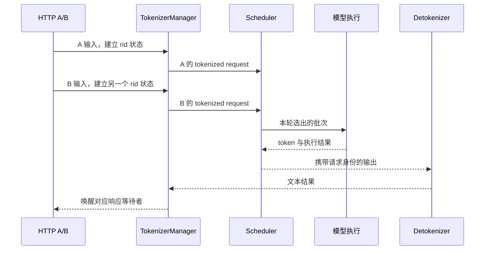

# HTTP 请求为什么不能直接拥有推理循环

源码版本：`0f6761b54facebb47f2068f87ecccd8f14da3a0e`。证据等级：静态源码核对。下文的 A、B 请求和图是教学示意，本次没有启动模型或测量吞吐。

假设 A 发来一段提示词，要求生成四个 token。最自然的服务写法是让 HTTP handler 完成 tokenize，调用模型四次，再返回文本。只有一个请求时，这很直观；但 B 在 A 生成第二个 token 时到达，问题就出现了：如果各 handler 各自调模型，谁来决定两次 forward 的次序，谁能把 A 和 B 合并到一个批次，谁负责判断显存是否足够？请求各自正确，不代表它们一起运行时仍然有可控的资源和顺序。

SGLang 把网络请求的等待状态与推理资源的调度状态放在不同边界里。HTTP 层处理连接和响应，TokenizerManager 把输入规范化并转换成 tokenized request，Scheduler 持续收取请求、形成批次、调用模型并处理结果，输出再经 detokenizer 回到请求等待者。这里值得学习的并非“用了多进程”这个形式，而是把 GPU 和 KV 的调度决策集中到能看见队列与当前批次的地方。启动边界可以从 [Engine 的 scheduler 启动](https://github.com/sgl-project/sglang/blob/0f6761b54facebb47f2068f87ecccd8f14da3a0e/python/sglang/srt/entrypoints/engine.py#L847) 进入阅读。

沿 A 的实际入口看，[HTTP 的 `/generate`](https://github.com/sgl-project/sglang/blob/0f6761b54facebb47f2068f87ecccd8f14da3a0e/python/sglang/srt/entrypoints/http_server.py#L918) 将请求交给 TokenizerManager。后者的 [generate_request](https://github.com/sgl-project/sglang/blob/0f6761b54facebb47f2068f87ecccd8f14da3a0e/python/sglang/srt/managers/tokenizer_manager.py#L848) 先创建以 rid 标识的请求状态，然后 tokenize、发送，再异步等待响应。等待不等于占住 GPU；B 可以在 A 等待期间进入，Scheduler 得以把不同 HTTP 协程的工作统一安排。rid 把响应与正确等待者关联起来，不能把“同一个 TCP 连接”当作整个运行时中的请求身份。

图省略了并行模式和传输细节，只表达职责与回流关系；它不表示 A、B 一定在同一个批次执行。能否合批还取决于预算和当前调度状态。

进程边界也使失败处理更精细。A 如果在输入长度校验阶段失败，它尚未进入 Scheduler，只需要丢弃本地请求状态；如果已经交接出去，HTTP 侧删除字典条目不能释放远端排队状态和 KV。源码用 [_send_one_request 与 _mark_state_dispatched](https://github.com/sgl-project/sglang/blob/0f6761b54facebb47f2068f87ecccd8f14da3a0e/python/sglang/srt/managers/tokenizer_manager.py#L1665) 记录是否已派发，generate_request 的异常路径据此选择清理方式。这个标记的价值是回答“现在谁还可能拥有这个请求”，从而避免校验失败泄漏等待状态，或派发后只清理了一半。

到了 Scheduler，[event_loop_normal](https://github.com/sgl-project/sglang/blob/0f6761b54facebb47f2068f87ecccd8f14da3a0e/python/sglang/srt/managers/scheduler.py#L1932) 反复收请求、取下一批、执行、处理结果，再保存 last_batch。它是集中状态转换的基础读法；overlap 是另一条循环，不能用正常循环的立即处理结果顺序推断 overlap 的时间线。分层付出的成本是 IPC、序列化、跨进程异常传播以及更多需要协调的生命周期状态。因此仅看到进程拆分不能断言服务更快；它首先使独立到达的请求能在统一资源视角下调度。

进一步调试时，在 generate_request、_mark_state_dispatched 和 Scheduler 接收路径观察同一个 rid，分别制造发送前校验失败和发送后取消，检查本地 rid_to_state、远端队列和资源是否最终清理。若仅前者正常，后者仍残留，便说明“HTTP 结束等于请求结束”的理解不成立。这是待执行的验证方案，不是本次实验结果。下一篇继续看被集中调度的请求怎样变成模型能执行的输入。
