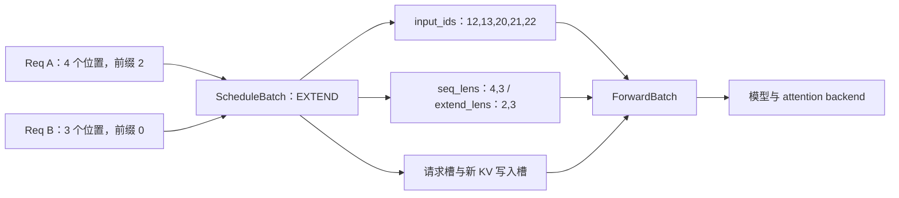

# 为什么一个请求要经过三种不同的表示

源码版本：`0f6761b54facebb47f2068f87ecccd8f14da3a0e`。证据等级：静态源码核对。数值例子忽略分页、chunking、推测解码和多模态，是教学模型，本次没有执行 forward。

上一篇把 A 和 B 交给同一个 Scheduler，但“把两个请求放到列表里”还不是一个可执行 batch。A 要在多轮生成中记住已经输出什么、是否结束、缓存在哪里；Scheduler 要决定本轮运行哪些请求、采用 extend 还是 decode、能分配多少槽位；模型则需要连续 token 张量、位置、序列长度和 KV 写入地址。这三类问题的时间尺度不同：请求跨许多轮存在，批次服务本轮决策，执行视图服务一次 forward。

因此源码分别有 [Req](https://github.com/sgl-project/sglang/blob/0f6761b54facebb47f2068f87ecccd8f14da3a0e/python/sglang/srt/managers/schedule_batch.py#L977)、[ScheduleBatch](https://github.com/sgl-project/sglang/blob/0f6761b54facebb47f2068f87ecccd8f14da3a0e/python/sglang/srt/managers/schedule_batch.py#L2305) 和 [ForwardBatch](https://github.com/sgl-project/sglang/blob/0f6761b54facebb47f2068f87ecccd8f14da3a0e/python/sglang/srt/model_executor/forward_batch_info.py#L468)。Req 承载逻辑请求的持续状态；ScheduleBatch 把一组选中的 Req 组织成当前执行模式与资源映射；ForwardBatch 把相关张量和元数据提供给执行层。它们不一定各自拥有一份完全独立的内存，分离表示也不意味着深拷贝。

为了看到转换的实质，设 A 的完整输入为 `[10,11,12,13]`，前两个位置已经有可复用 KV，B 为 `[20,21,22]`，没有命中前缀。本轮决定完整处理两者剩余输入。模型要新计算的 token 就是 A 的 `[12,13]` 与 B 的 `[20,21,22]`，拼接后为 `[12,13,20,21,22]`。这五个 token 并不是一条长度五的句子，而是两个请求的待扩展片段；还必须同时携带前缀长度 `[2,0]`、扩展长度 `[2,3]` 和本轮结束位置对应的序列长度 `[4,3]`，执行后端才知道每一段应读取怎样的历史。

图中的 KV 写入槽是由分配器决定的物理位置，不能根据 token ID 或序列位置自行猜一个地址。逻辑上的 A 第三个 token 并不意味着它占物理槽 2。这个区分会在下一篇前缀共享中变得更重要。

源码的 [prepare_for_extend](https://github.com/sgl-project/sglang/blob/0f6761b54facebb47f2068f87ecccd8f14da3a0e/python/sglang/srt/managers/schedule_batch.py#L2686) 先从每个请求的 fill IDs 去掉 prefix_indices 对应的已缓存部分，计算各请求的长度，再调用 alloc_for_extend 得到 out_cache_loc 和请求槽索引。它包含一个直接表达契约的断言：本轮 seq_len 减去 prefix_len，必须等于 req.extend_range.length。否则拼接片段的实际长度和后端解释的范围不同，即使张量能正常传入模型，也可能读写错误的上下文。

到了 [ForwardBatch.init_new](https://github.com/sgl-project/sglang/blob/0f6761b54facebb47f2068f87ecccd8f14da3a0e/python/sglang/srt/model_executor/forward_batch_info.py#L847)，执行视图接收 forward_mode、input_ids、seq_lens、req_pool_indices、out_cache_loc 等字段。decode 或 idle 分支没有相同的 extend 元数据，不能拿 prefill 的拼接办法套所有模式。这里的设计类似编译器把语义对象降低成执行表示：调度决定运行什么，执行层消费该决策已经组织好的输入，避免每种模型都重新遍历请求队列并分配缓存。

分层的代价是字段一致性和别名约束。该函数注释要求不要修改输入 ScheduleBatch，但紧接着实际代码存在对 sampling_info.grammars 的更新，以及暂时容许的 seq_lens_sum 回填。这提醒我们：设计意图是阅读起点，实际不变量必须逐行核对，不能仅凭注释宣称“转换绝对纯粹”或“视图完全隔离”。overlap 时如果上一轮还在读共享字段，下一轮过早修改它们就会形成另一类生命周期问题。

可执行的调试问题是：在 prepare_for_extend 后观察 A、B 的 prefix_lens、extend_lens、input_ids、req_pool_indices 和 out_cache_loc，再在 init_new 返回处核对它们的对应关系。预期是五个新 token 对应五个新增 KV 写入位置，而每个请求读取的历史由其映射决定；若长度对得上但映射错了，仍不能称为正确 batch。本次只验证了源码中的转换关系，这个数值例子尚未运行。下一篇解释前缀槽位为什么能够被不同请求共享，以及共享后何时才能回收。
