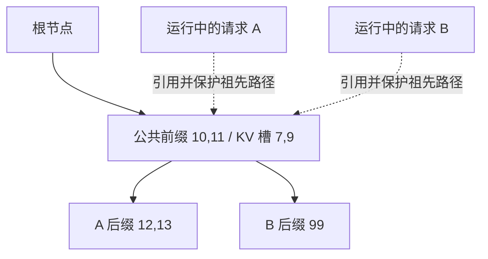

# 共享前缀 KV 为什么必须同时设计保护和回收

源码版本：`0f6761b54facebb47f2068f87ecccd8f14da3a0e`。证据等级：静态源码核对。树形、槽号和请求顺序是教学示意，假设 page_size=1、相同缓存命名空间与兼容模型上下文，本次未运行缓存命中实验。

沿用 A 的输入 `[10,11,12,13]`，现在 B 的输入换为 `[10,11,99]`。如果 A 已经计算并缓存了前两个 token 的 KV，B 没必要重新计算这段公共历史。但“只要两段文字像就复用”不成立：KV 是模型在具体 token 序列与上下文下产生的状态，不是文本相似度结果。复用首先要求精确前缀和正确的缓存身份；对 adapter、盐值或其他隔离条件不同的请求，匹配逻辑还必须区分命名空间。

SGLang 的 [RadixCache.match_prefix](https://github.com/sgl-project/sglang/blob/0f6761b54facebb47f2068f87ecccd8f14da3a0e/python/sglang/srt/mem_cache/radix_cache.py#L396) 查找最长可复用前缀，返回 device_indices 和匹配终点节点。它并不是把 K、V 张量塞进每个请求里再拷贝一次，而是让缓存树记录 token 前缀与物理 KV 索引的关系。假设 `[10,11]` 对应物理槽 `[7,9]`，B 获得这些索引后，就可以把它们作为已缓存前缀，只为 `[99]` 分配新的槽并计算。

图的枝干表示共享逻辑前缀，虚线表示活动请求的保护关系，绝不代表两份 KV 数据。实际 radix tree 可以把多个 token 压缩成一个节点，匹配停在段内部时也可能拆分节点；拆分改变索引组织方式，不等于重新计算整段 KV。page_size 大于一时，匹配还受页对齐影响，因此不能把图中“精确命中两个 token”推广到所有缓存配置。

节省计算后，一个更危险的问题才出现：当新请求 C 需要空间，缓存淘汰器能不能释放槽 7、9？如果 B 正在读取这两个槽，释放后让 C 复用它们，B 的 attention 就会把 C 的状态当成历史。请求张量可能仍然在合法地址范围内，错误却已经从内存越界变成了上下文混乱。因此缓存可复用性与可淘汰性是两个不同判断：过去算过且可匹配的 KV，并不意味着现在无人依赖。

源码的 [inc_lock_ref 和 dec_lock_ref](https://github.com/sgl-project/sglang/blob/0f6761b54facebb47f2068f87ecccd8f14da3a0e/python/sglang/srt/mem_cache/radix_cache.py#L673) 从被引用节点沿祖先路径更新 lock_ref，并在从零变为非零或从一变为零时调整 protected_size 与 evictable_size。保护祖先路径很关键：B 的末端节点仍有效，不代表其公共前缀可以被释放。A、B 都引用公共节点时，A 结束只解除自己的保护，B 仍然需要它；不能把“有一个请求结束”误读成“这段共享前缀现在空闲”。

[evict](https://github.com/sgl-project/sglang/blob/0f6761b54facebb47f2068f87ecccd8f14da3a0e/python/sglang/srt/mem_cache/radix_cache.py#L643) 从 evictable_leaves 按策略选叶子，释放其 value 对应的物理段；子节点移除后，父节点在没有孩子且没有锁引用时才可能继续成为候选。这表达了两种约束的组合：树结构要求先处理叶子，生命周期要求候选不能仍受活动请求保护。淘汰策略决定候选之间谁先走，不能替代候选是否安全这个判断。

请求完成也不必意味着整段 KV 立即返回空闲池。[cache_finished_req](https://github.com/sgl-project/sglang/blob/0f6761b54facebb47f2068f87ecccd8f14da3a0e/python/sglang/srt/mem_cache/radix_cache.py#L478) 会将可缓存范围插入树，并处理重复或未插入的槽位；缓存持有的历史可以等后续复用或容量压力再淘汰。这里必须区分逻辑请求结束、活动保护解除和物理槽最终释放，三者不是同一瞬间。否则最容易出现重复 free、泄漏，或者释放仍被另一请求依赖的状态。

这个设计把计算成本转成树查询、索引维护、引用计数和缓存占用。共享前缀很少、缓存频繁被挤出或者隔离条件不同，收益就可能变小；仅从源码存在 RadixCache 不能推出更高吞吐。要验证理解，可以构造同前缀 A、B 和施加压力的 C，在 match_prefix、inc_lock_ref、dec_lock_ref 与 evict 处观察命中索引、lock_ref、protected_size 和淘汰对象，检查 B 存活期间公共槽不会被释放。这是下一步待执行实验。三篇到此形成闭环：进程边界集中资源决策，批次表示显式表达读写映射，引用保护则让映射背后的共享内存保持有效。
