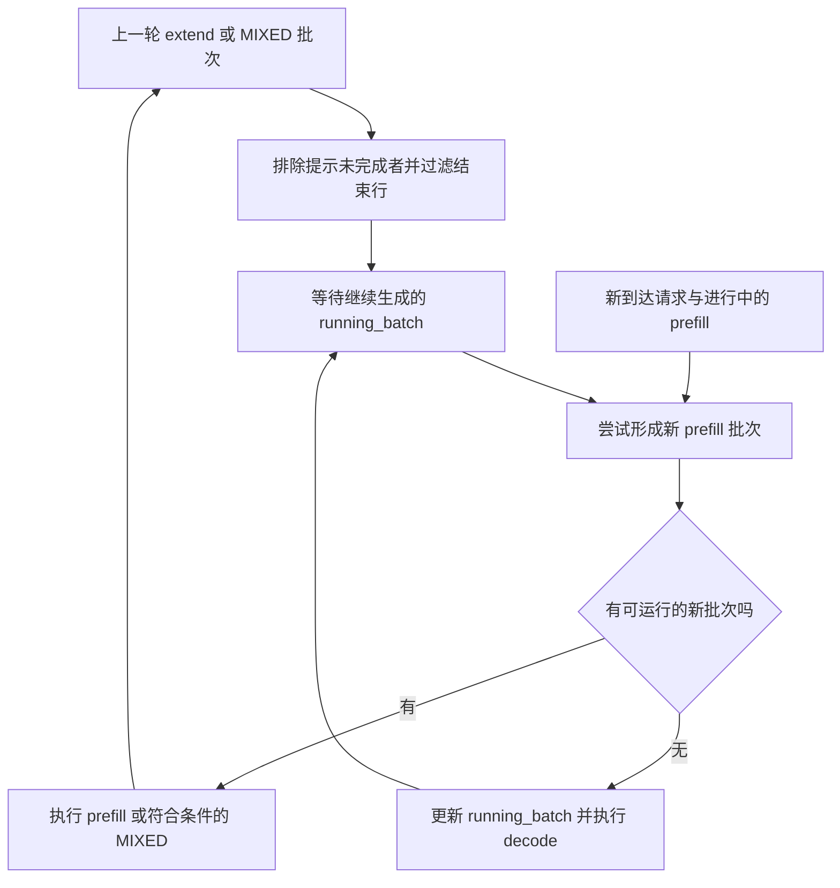

# 正在运行的请求，为什么不等于下一次 forward 的批次

源码版本：`0f6761b54facebb47f2068f87ecccd8f14da3a0e`。证据等级：静态源码核对。下文采用普通自回归、完整 attention、无推测解码和无 overlap 的读法；A、B、C 及机制图均为教学示意，本次没有启动模型或测量性能。

昨天把单请求从入口追到执行表示与共享 KV，今天让 A 正在 decode，B 带着 160 个提示 token 到达，随后又来一个短请求 C。若把批次理解成一组请求从开始一直跑到全部结束，C 就只能等 A、B 都结束；若每轮简单把新请求塞进旧批次，B 尚未完成 prefill，却会被当成只需处理一个新 token 的 decode 行。真正的矛盾是：请求的生命周期可以交错，但本次 forward 必须准确表达每行已经有多少 KV、还要计算多少输入。

SGLang 用 `running_batch` 保存等待继续生成的集合，用 `batch_to_run` 表达这一轮选择的工作，另用 `last_batch` 留住上一轮批次以便完成状态交接。[正常事件循环](https://github.com/sgl-project/sglang/blob/0f6761b54facebb47f2068f87ecccd8f14da3a0e/python/sglang/srt/managers/scheduler.py#L1932) 收请求、计划、执行、处理结果，再记录上一批。因而“系统里仍活跃”不意味着“本轮都参与 forward”；continuous batching 的连续，是请求能在迭代边界加入或退出，并非所有请求每轮都得到相同的服务。

沿 [get_next_batch_to_run](https://github.com/sgl-project/sglang/blob/0f6761b54facebb47f2068f87ecccd8f14da3a0e/python/sglang/srt/managers/scheduler.py#L3648) 看这个边界：上一批是 extend 时，调度器先排除尚未完成提示处理的 chunked request，再过滤已经结束的行，然后把可继续生成的行并入 `running_batch`。只有完成 prefill 且没有结束的 B，才能进入常规 decode 集合。这里的“完成”特指提示处理完成，并不要求整个请求生成结束。过滤逻辑可以在 [filter_batch](https://github.com/sgl-project/sglang/blob/0f6761b54facebb47f2068f87ecccd8f14da3a0e/python/sglang/srt/managers/schedule_batch.py#L3600) 核对；它同时处理完成状态和显式排除的中间块。

接下来才尝试形成新 prefill；有可执行的 prefill 批时优先选择它，否则更新运行集合并准备 decode。于是，在没有混合执行的条件下，B 的一轮 prefill 可以让 A 本轮暂不推进，下一轮 A 仍保持可继续状态。反过来，B 如果无法通过准入，并不因此阻止 A 进入 decode。这是控制流事实，不能直接转换成“延迟必然改善”的性能结论。

图是迭代边界的教学示意，省略了分布式同步和专用模型分支。`running_batch` 向准入器提供负载和预算信息；这条连线不表示它一定被合入新批次。图中 prefill 到运行集合的路径经过过滤，就是为了把“提示还没处理完”与“可以接着生成”分开。

混合执行把这个区分进一步落到行级别。[新批次形成函数](https://github.com/sgl-project/sglang/blob/0f6761b54facebb47f2068f87ecccd8f14da3a0e/python/sglang/srt/managers/scheduler.py#L3843) 在启用 mixed chunk 且配置兼容时，先准备 A 的 decode，再调用 [mix_with_running](https://github.com/sgl-project/sglang/blob/0f6761b54facebb47f2068f87ecccd8f14da3a0e/python/sglang/srt/managers/schedule_batch.py#L3096)。假设 B 本轮处理 32 个新输入，A 处理一个尾部 token，同一次 forward 就有两种长度。普通非推测路径把 A 的 prefix 设为准备后的序列长度减一，extend 范围长度设为一，而 B 保持自己的分块范围。两行共享一次执行机会，却没有被假设成相同阶段。

值得留意的是，本提交的混合方法会把 `input_ids` 设为 `None`，保留 `mix_running_indices`，运行部分的 token 后续从 `future_map.output_tokens_buf` 解析；不能仅依据调用方旧注释，把实现解释成当场拼接两个现成输入数组。这里的结论只需要“行的 prefix 与增量长度得到保留”，延迟 token 的解析留待 overlap 主题深入。

混合后，调度器把旧运行集合替换为空集合，并在新批次记录 `decoding_reqs`。A 没有结束，它的本轮归属转到了 MIXED 批；下一轮从上一批恢复时，再把合格行送回运行集合。若保留旧集合又把包含 A 的上一批重新合并，就可能使同一个请求重复出现，重复分配尾部位置或提交输出。核心不变量是一次计划中的每个请求具有一致的行身份、阶段和输入范围，不能把持续活跃误写成重复入批。

待验证时可在 get_next_batch_to_run 入口、mix_with_running 返回和下一轮合并后停住，记录 A、B 的请求身份、`forward_mode`、`extend_range`、`decoding_reqs` 以及两批的行集合。若 B 的中间块进入常规 decode，或 A 在恢复后的集合出现两次，就能推翻上述生命周期解释。关闭 mixed 后，应观察到 prefill 与 decode 分轮选择；启用也要满足无 logprob、无输入 embedding 等条件，不能假设任何配置都能混合。代价是更多跨轮状态交接与阶段约束；收益仍需真实工作负载下的延迟和吞吐测量。下一篇继续追 B 尚未完成的 96 个输入如何推进。
