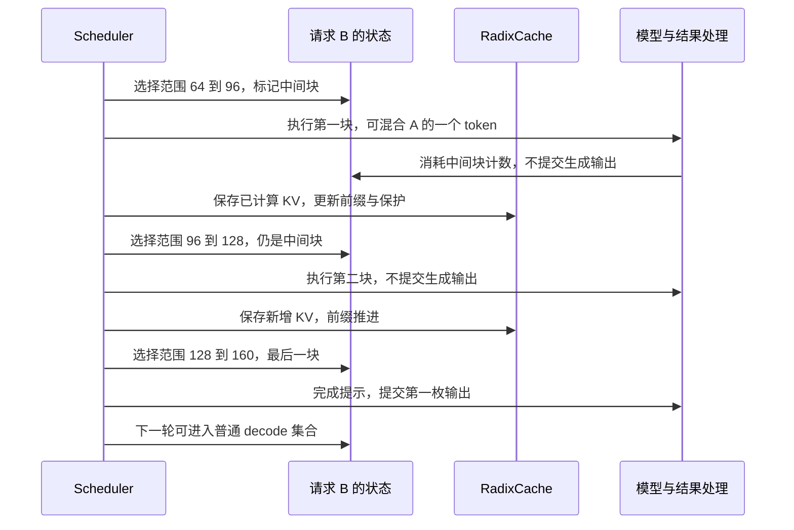

# 长提示被切成几块之后，怎样仍然是同一个请求

源码版本：`0f6761b54facebb47f2068f87ecccd8f14da3a0e`。证据等级：静态源码核对。沿用 A 正在 decode、B 长提示到达、C 随后到达的例子；本文假定普通自回归、完整 attention、启用 RadixCache、`page_size=1`，关闭 overlap、推测与其他专用分支。数字轨迹和图均为教学示意，没有实际运行或性能测量。

B 的提示长度是 160，已有 64 个 token 的有效前缀 KV，还需处理 96 个输入。如果一次算完，A 的下一次生成要与这段长工作争用执行机会。把 96 切成三个 32，给调度器更多迭代边界，是直观办法；但不能把三块当作三个独立请求。后两块必须访问前块算出的 KV，而且只有处理完完整提示，采样结果才代表基于完整输入的第一枚输出 token。

SGLang 保留完整输入，再用范围表示本轮工作。[Req 的 set_extend_range 与 get_fill_ids](https://github.com/sgl-project/sglang/blob/0f6761b54facebb47f2068f87ecccd8f14da3a0e/python/sglang/srt/managers/schedule_batch.py#L1530) 分别记录 `[start,end)`，并返回截止 end 的输入视图。`full_untruncated_fill_ids` 保持完整提示与已有输出，不能因为只选了 32 个输入就永久截断提示。已有 KV 用 `prefix_indices` 表达；这使“完整任务还有多少”与“本轮做到哪里”可以同时存在。

在充足容量、C 暂不入批、没有额外对齐约束的条件下，设 mixed 总计算预算为 33，A 的单 token 消耗一份，B 可用 32。B 的第一轮范围是 `[64,96)`，后两轮为 `[96,128)`、`[128,160)`。这组数不是源码固定配置，也不是运行记录：它说明 prefix 长度逐步增长，完整输入长度仍是 160，每一轮只计算尚未拥有 KV 的后缀。已有前缀有效是计算后块的前提，而不是把旧输入每轮重新完整计算。

第一轮结束后，B 仍被 Scheduler 的 `chunked_req` 跟踪。[下一轮计划](https://github.com/sgl-project/sglang/blob/0f6761b54facebb47f2068f87ecccd8f14da3a0e/python/sglang/srt/managers/scheduler.py#L3648) 将它排除在上一批到 decode 集合的合并之外；只有前一块确实产生了新增 KV，才经 [stash_chunked_request](https://github.com/sgl-project/sglang/blob/0f6761b54facebb47f2068f87ecccd8f14da3a0e/python/sglang/srt/managers/scheduler.py#L3542) 保存进行中的缓存状态。普通 RadixCache 的 [cache_unfinished_req](https://github.com/sgl-project/sglang/blob/0f6761b54facebb47f2068f87ecccd8f14da3a0e/python/sglang/srt/mem_cache/radix_cache.py#L566) 按当前 fill 范围插入、重新匹配并更新请求映射和 prefix_indices，同时转移节点引用保护。下一轮使用的 prefix 因而能覆盖已经完成的块，保护关系也跟着新的缓存端点前进。

图是普通非 overlap 路径的教学示意，缓存保存画在下一轮规划之前，省略内部张量准备。它表达两条独立进度：KV 前缀在中间块后推进，而生成输出只在提示完整后提交。混合批里的 A 已经具备完整上下文，所以同一批次处理结果时，A 与 B 可以有不同的输出提交资格。

续块长度由 [PrefillAdder.add_chunked_req](https://github.com/sgl-project/sglang/blob/0f6761b54facebb47f2068f87ecccd8f14da3a0e/python/sglang/srt/managers/schedule_policy.py#L1022) 计算：用完整 fill 长度减 prefix 长度得到剩余工作，再按可用预算设置范围并加入 `can_run_list`。还没完成时返回原请求，让 Scheduler 继续跟踪；最后一块返回 `None`，表示无需再保持这个续块指针，而非请求对象被删除。Scheduler 只为仍然处在中间块的请求增加 `inflight_middle_chunks`。

真正防止“半个提示就开始回答”的闸门在 [process_batch_result_prefill](https://github.com/sgl-project/sglang/blob/0f6761b54facebb47f2068f87ecccd8f14da3a0e/python/sglang/srt/managers/scheduler_components/batch_result_processor.py#L257)。中间块计数大于零时，它消耗一份计数，并将该请求设为不流式发送；不走普通分支的 `output_ids.append(next_token_id)`。所以即使执行接口给出了采样 token，也不能把它认作已提交的生成结果。最后一块没有中间块标记，才能追加输出并检查请求是否结束；若已结束，也不会进入后续 decode。

切块解决的是每次可规划的工作粒度，并不自动保证 A 或 C 的公平性。没有 mixed 时，续块仍可能连续占用 prefill 轮；有 mixed 时，旧 decode 也要扣预算；C 能否插入还受策略和容量限制。更小块意味着更多调度与执行边界，也可能改变 attention 的执行效率，不能从块数直接推算延迟收益。大页缓存还会区分页对齐的树内前缀和请求保留的尾页，不能把这里的 64、96 映射推广为任意页大小都同样增长。

待验证时在 stash_chunked_request、add_chunked_req 和结果处理的中间块分支设断点，连续记录完整 fill 长度、prefix 长度、extend_range、inflight_middle_chunks 和 output_ids 长度。预期前两轮完整输入不缩短、前缀推进但输出长度不变，最后一轮才提交首 token。若中间块增加了 output_ids，或续块重复从 64 开始且没有重算原因，就能推翻此解释。接下来要回答：当 C 到来，为什么队列先后仍不能直接决定这 32 份预算如何分配？
