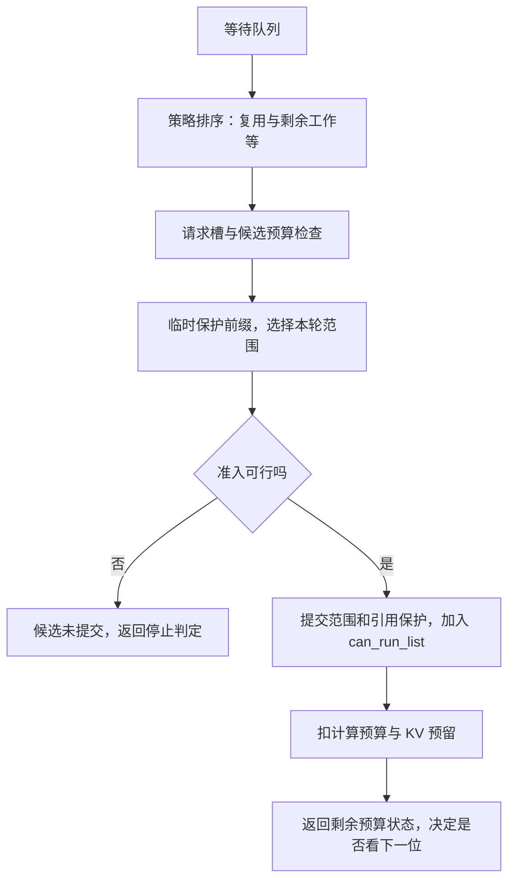

# 队列排在前面，为什么仍然可能进不了批次

源码版本：`0f6761b54facebb47f2068f87ecccd8f14da3a0e`。证据等级：静态源码核对。例子使用普通自回归、单一完整 KV 池、`page_size=1`，无 host load-back、推测、overlap 和专用模型分支；数值与机制图为教学简化，本次未执行调度实验，也未测量策略性能。

A 正在 decode，B 的提示长 160、命中前缀 64，还需计算 96；C 只有 8 个未命中的输入。长前缀优先可能把 B 排在 C 前面，因为它有较多可复用的 KV；短 prefill 优先则倾向 C，因为 C 尚需计算的工作少。这两个判断回答不同问题：前者关注复用，后者关注剩余工作。它们都不能单独回答本轮是否有请求槽、计算预算和可用 KV 容量，因此排队策略与准入器必须分开。

[SchedulePolicy.calc_priority](https://github.com/sgl-project/sglang/blob/0f6761b54facebb47f2068f87ecccd8f14da3a0e/python/sglang/srt/managers/schedule_policy.py#L259) 负责队列顺序。缓存感知排序还会识别等待队列中的重复前缀，不能把真实 LPM 实现简化成只按命中长度排序。[实验性的 shortest-prefill-first](https://github.com/sgl-project/sglang/blob/0f6761b54facebb47f2068f87ecccd8f14da3a0e/python/sglang/srt/managers/schedule_policy.py#L439) 按未缓存的工作量与入队时间等排序；它并非按完整提示长度，更不是按未知的总生成时长。策略自身也有成本：[active policy 的选择](https://github.com/sgl-project/sglang/blob/0f6761b54facebb47f2068f87ecccd8f14da3a0e/python/sglang/srt/managers/schedule_policy.py#L330) 在 LPM 或 HRRN 队列超过 128 时切到 FCFS，不能把这个条件推广到所有缓存感知策略。

选完顺序后，[新 prefill 批次构造](https://github.com/sgl-project/sglang/blob/0f6761b54facebb47f2068f87ecccd8f14da3a0e/python/sglang/srt/managers/scheduler.py#L3843) 创建 PrefillAdder，先处理已在进行的 B，再尝试等待请求。计算预算已经减去 mixed decode 的 token 数，因此总预算 33、A 占一份时，只剩 32。短请求即使排第一，也可能输给“续块先消耗预算”这个阶段顺序。该提交的 [shortest_prefill_chunk_limit](https://github.com/sgl-project/sglang/blob/0f6761b54facebb47f2068f87ecccd8f14da3a0e/python/sglang/srt/managers/schedule_policy.py#L451) 专门在实验短 prefill 策略下为更短的等待请求保留预算：若 C 需要 8、B 仍需 64，32 可以拆成 B 的 24 与 C 的 8。它至少为续块留一个页的空间；预留只是计算形状机会，C 仍需通过其他准入条件。

更容易误解的是“切成 32 就只需 32 个空闲 KV 槽”。对刚要首次准入的 B，[add_one_req](https://github.com/sgl-project/sglang/blob/0f6761b54facebb47f2068f87ecccd8f14da3a0e/python/sglang/srt/managers/schedule_policy.py#L1232) 用完整未缓存长度，加经过限制的剩余生成额度，再加一页对齐余量，形成 `total_tokens`。设生成额度为 4，则是 `96+4+1=101`。普通池的 [check_prefill](https://github.com/sgl-project/sglang/blob/0f6761b54facebb47f2068f87ecccd8f14da3a0e/python/sglang/srt/mem_cache/prefill_budget.py#L98) 要求它严格小于 `remaining_total`：剩余为 100，甚至等于 101，都不会接受。当前块只算 32，不消除完整任务继续成长的空间压力。

这里的 `remaining_total` 也不是单看 allocator 的空闲数。[PrefillBudget](https://github.com/sgl-project/sglang/blob/0f6761b54facebb47f2068f87ecccd8f14da3a0e/python/sglang/srt/mem_cache/prefill_budget.py#L61) 把空闲与可淘汰缓存相加，再减去批次内待分配及 decode 余量的 offset。候选前缀临时上锁后，其保护的 KV 不能再被当作可淘汰容量。第一轮接受长请求与后来让进行中块继续推进，也采用不同路径；普通池续块在剩余估计非正时仍允许返回 chunk_limit 以推进。故上述门槛是首次准入的局部规则，不能包装成全局永不内存不足的证明，真实分配与回退仍需单独研究。

图是教学示意，省略 host 数据回载与专用池约束。它强调一次候选审查和批次剩余状态是两个判定时刻。[选择阶段](https://github.com/sgl-project/sglang/blob/0f6761b54facebb47f2068f87ecccd8f14da3a0e/python/sglang/srt/managers/schedule_policy.py#L1345) 产生 `_PrefillAdmission`，并不在这里分配物理槽或发布缓存；[提交阶段](https://github.com/sgl-project/sglang/blob/0f6761b54facebb47f2068f87ecccd8f14da3a0e/python/sglang/srt/managers/schedule_policy.py#L1432) 才设置范围、建立请求持有的节点引用、加入 can_run_list，并扣账。这种分离使拒绝候选不致留下“已入批”的半完成状态，之后 prepare_for_extend 才进行实际输入准备与分配。

尤其要看清 `AddReqResult`：add_one_req 提交后还会返回 [budget_state](https://github.com/sgl-project/sglang/blob/0f6761b54facebb47f2068f87ecccd8f14da3a0e/python/sglang/srt/managers/schedule_policy.py#L827)。若 C 恰好花完计算额度，返回 OTHER 是让调用者停止考察下一位，C 已经在批次中；不能据此把 C 当作被拒绝并清理。NO_TOKEN 也需结合提交位置与 can_run_list 判断。调度循环在这些停止判定后会 break，而非总能跳过 B 继续尝试后面的 C；因此更好的队列位置只能增加被考察的机会，不能承诺一定执行。

计算扣账与物理预留还各有单位：[更新预算](https://github.com/sgl-project/sglang/blob/0f6761b54facebb47f2068f87ecccd8f14da3a0e/python/sglang/srt/managers/schedule_policy.py#L848) 在普通路径按页取整，在 exact-chunk-fill 分支可按实际 forward token 扣计算额度，KV 仍按页预留。关闭切块时，首个请求也允许超过 input cap，说明参数名并不保证每条路径都是硬上限。策略优化因此要同时考虑调度开销、复用、等待时间与容量，不能从一种排序推断普遍最优。

待验证时在 calc_priority、add_one_req、_commit_prefill_admission 返回处设置断点，同时看排序后的身份、候选 total_tokens、锁前后的可淘汰数、remaining_total、rem_chunk_tokens、can_run_list 和返回枚举。用 100 与大于 101 的可用容量比较 B 首次准入，再让 C 用尽最后 8 份计算额度，检验它是否已提交却返回 OTHER。若拒绝分支留下请求引用或入批状态，或者提交后返回停止被当成拒绝，这就推翻了上述局部状态机。下一步沿 prepare_for_extend 看预留如何兑现为请求槽、token 槽，以及真实容量压力怎样触发回退。
