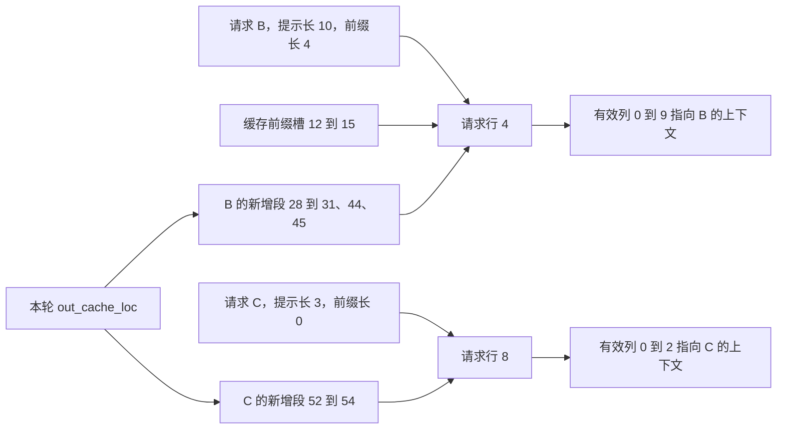

# 有空闲 KV，为什么仍然可能分不到请求槽

源码版本：`0f6761b54facebb47f2068f87ecccd8f14da3a0e`。证据等级：静态源码核对。采用普通文本自回归、完整 attention、普通 ReqToTokenPool 与分页分配器，关闭 overlap、推测、beam 和分离部署。槽号与图均为教学示意，本次未启动模型。源码工作区另有未跟踪的导读文件，未作为证据；本文只核对上述提交的内容。

昨天解释了请求通过准入后才会准备输入，今天追这份许可怎样兑现。A 已经在 decode；B 的提示有 10 个 token，前四个位置命中缓存；C 的提示有三个 token，完全未命中。本轮 B、C 要新增九个 KV 位置。只检查 KV 池还有九份容量并不够：执行层还需要找到每个请求的历史，而历史由一张“请求行、逻辑位置到物理 KV 槽”的表组织。表的行数与 KV 槽数是两种资源，前者可以先耗尽。

[ReqToTokenPool](https://github.com/sgl-project/sglang/blob/0f6761b54facebb47f2068f87ecccd8f14da3a0e/python/sglang/srt/mem_cache/memory_pool.py#L272) 创建 `req_to_token` 二维表，真实请求使用非零行，零行留给填充批次。表项是索引，不存 K、V 张量本身。假定 A 已持有行 2，B 分得行 4，C 分得行 8；B 的第六个逻辑 token 要读取哪个 KV，必须查行 4 的列 5，不能把请求行号或 token ID 当成物理地址。请求槽是索引组织的身份，KV 槽是历史数据的存放位置。

[alloc_req_slots](https://github.com/sgl-project/sglang/blob/0f6761b54facebb47f2068f87ecccd8f14da3a0e/python/sglang/srt/mem_cache/allocation.py#L289) 向请求池申请行；普通池的 [alloc](https://github.com/sgl-project/sglang/blob/0f6761b54facebb47f2068f87ecccd8f14da3a0e/python/sglang/srt/mem_cache/memory_pool.py#L315) 会区分首次进入的请求与已经持有 KV 的请求。正在进行的 chunked prefill 复用已有行，仅为没有行的请求扣除空闲行数。若续块每次重新申请行，B 的上下文会被分散到不同身份，也会无谓耗尽行容量；若把任意旧行拿来复用，又可能把其他请求的上下文当成 B 的历史。

行分配失败时，alloc_req_slots 抛出 RuntimeError，要求缩小运行请求数，而不是偷偷返回一个空批次。这个失败说明先前准入与真实请求池容量之间的契约出了问题；不能用“token 预算足够”解释过去。它与随后物理 KV 分配失败也应分别定位，因为一个需要检查空闲行和请求身份，另一个需要检查页与保护状态。

接着 [alloc_for_extend](https://github.com/sgl-project/sglang/blob/0f6761b54facebb47f2068f87ecccd8f14da3a0e/python/sglang/srt/mem_cache/allocation.py#L344) 分配新增 KV，并经 [write_cache_indices](https://github.com/sgl-project/sglang/blob/0f6761b54facebb47f2068f87ecccd8f14da3a0e/python/sglang/srt/mem_cache/allocation.py#L55) 写入映射。设页大小为四，B 的共享前缀是物理槽 `[12,13,14,15]`，新增六个位置为 `[28,29,30,31,44,45]`；C 新增三个位置为 `[52,53,54]`。本轮扁平 `out_cache_loc` 是后两段拼接，写表时用每个请求的 extend 长度切出属于它的段，然后把前缀与新增段放在相应列区间。

图是教学映射示意，省略 A 的行与真实 K、V 数组。前缀来自缓存，新段来自本轮分配；二者最终在同一请求行中组成连续的逻辑历史，物理位置却可不连续。另一个请求可以合法引用 B 的同一段共享前缀，因此不能对整张表要求“所有槽号唯一”；需要禁止的是新分配的独占位置意外重叠，以及未经保护的共享。

[prepare_for_extend](https://github.com/sgl-project/sglang/blob/0f6761b54facebb47f2068f87ecccd8f14da3a0e/python/sglang/srt/managers/schedule_batch.py#L2686) 要求序列长度减前缀长度等于本轮范围长度。对 B 是 `10-4=6`，对 C 是 `3-0=3`；这个等式把输入切片、out_cache_loc 分段和写表列区间绑在一起。alloc_for_extend 也会更新请求的 allocated、committed 长度，但这发生在模型执行之前，是准备阶段的记账，不能把字段名字当成 GPU 已经计算完成的证据。

行归还也没有逐项清零。[free](https://github.com/sgl-project/sglang/blob/0f6761b54facebb47f2068f87ecccd8f14da3a0e/python/sglang/srt/mem_cache/memory_pool.py#L358) 把行还给 free_slots，并清除请求的 req_pool_idx；后来分配时还会增加该行的 req_generation。旧表值可能仍在，所以“某列里有非零地址”不能证明它属于当前请求。正确读取必须依据当前行归属、当前有效长度和重新建立的映射；generation 字段存在也不代表所有消费者都自动检查了它。

待验证时在 alloc_req_slots、write_cache_indices 和请求池 free 处停住，检查 free_slots、请求行身份、prefix/extend 长度与表的有效列。让 KV 充足而行耗尽，应定位到请求槽失败；让 B 续块，应看到行不变、有效范围推进。再让 C 释放后由新请求复用行 8，检查旧范围之外的值不会被当成新上下文。若行被重复归还、续块丢失旧身份，或 out_cache_loc 切段与输入段不一致，就能推翻此解释。两级索引付出表空间与维护成本，却让请求独立增长并共享前缀；下一篇看这九个逻辑新位置为什么还不是九份物理容量。
