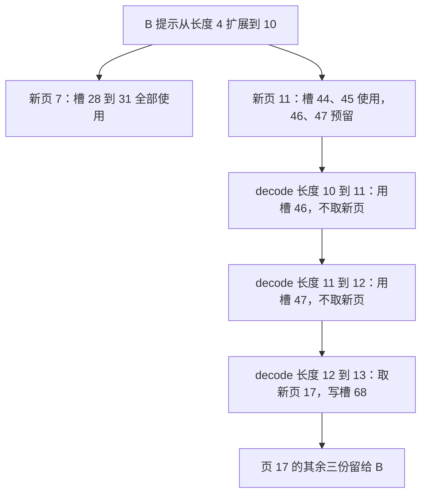

# 每轮只生成一个 token，为什么有时要分配整页 KV

源码版本：`0f6761b54facebb47f2068f87ecccd8f14da3a0e`。证据等级：静态源码核对。沿用普通文本 B、C，采用普通 PagedTokenToKVPoolAllocator、完整 attention、`page_size=4`，无 overlap、推测、beam、KV 分片或专用模型分配器。页号、槽号和图均为教学示意，未运行 kernel 或测量性能。

上一篇中 B 的已缓存前缀长四，本轮把提示推进到十，新增六个逻辑 KV 位置；C 从零推进到三，新增三个。若按 token 逐个分配，九份位置就是九份容量。然而分页分配器以整页维护空闲集合：B 需要两页，C 需要一页，共占十二份物理容量。只有九个位置本轮写入，余下三份是各自尾页中尚未使用的空间，不能直接给不相干的请求使用。

[PagedTokenToKVPoolAllocator](https://github.com/sgl-project/sglang/blob/0f6761b54facebb47f2068f87ecccd8f14da3a0e/python/sglang/srt/mem_cache/allocator/paged.py#L116) 用 free_pages 管理页号，available_size 以空闲页数乘 page_size 返回 token 单位容量；它不把活动请求尾页里的余量算成空闲池。物理槽在普通布局下由“页号乘页大小，加页内偏移”得到。假定给 B 的新页号为 7、11，新增位置就是 28 到 31、44 到 45；页 11 的 46、47 留给 B 后续增长。页号本身无需相邻，逻辑连续性由请求映射表保持。

[get_num_new_pages](https://github.com/sgl-project/sglang/blob/0f6761b54facebb47f2068f87ecccd8f14da3a0e/python/sglang/srt/utils/common.py#L4702) 在 extend 路径计算 `ceil(seq_len/page_size)-ceil(prefix_len/page_size)`。B 是 `ceil(10/4)-ceil(4/4)=2`，C 是 `ceil(3/4)-ceil(0/4)=1`。注意它数的是要新增的页，out_cache_loc 的长度仍数本轮实际 token；用十二当作扁平输入长度，或用九当作必须扣掉的物理容量，都会混淆执行形状与所有权粒度。

[alloc_extend](https://github.com/sgl-project/sglang/blob/0f6761b54facebb47f2068f87ecccd8f14da3a0e/python/sglang/srt/mem_cache/allocator/paged.py#L183) 调用的 [alloc_extend_kernel](https://github.com/sgl-project/sglang/blob/0f6761b54facebb47f2068f87ecccd8f14da3a0e/python/sglang/kernels/ops/memory/allocator.py#L116) 把范围分成旧尾页可填部分、新完整页和新尾页。若已有前缀不是整页对齐，就先沿 last_loc 填旧页余量，再消耗 free_pages；前提是这个旧尾页确实属于该请求且布局一致。内核与调试断言要求 last_loc 的页内位置和 prefix 长度相容，不能只看到 `last_loc+1` 就宣称所有分配都靠连续地址完成。

图是容量变化的教学示意，不是实际分配追踪。它把同一个请求的三次单 token decode 对比起来：前两次消耗自己已经持有的尾页余量，第三次跨边界才让空闲页数减少一。最后的页 17 只是任意教学页号，分配器也可能返回其他空闲页。

沿 [alloc_for_decode](https://github.com/sgl-project/sglang/blob/0f6761b54facebb47f2068f87ecccd8f14da3a0e/python/sglang/srt/mem_cache/allocation.py#L587) 看时序，它从当前请求行与旧序列长度取得 last_loc，再把下一轮长度传给分页分配器。[alloc_decode_kernel](https://github.com/sgl-project/sglang/blob/0f6761b54facebb47f2068f87ecccd8f14da3a0e/python/sglang/kernels/ops/memory/allocator.py#L203) 没跨页时写 last_loc 加一，跨页时取新页的首槽；随后写回逻辑列，并推进长度。这里计算的是把上一轮采样 token 放进模型输入后产生的 KV，不能把“已经返回给客户端的输出 token 数”直接当作当前 KV 长度。

尾页不能任意拆给别人，也解释了 free 的危险。[普通分页 free](https://github.com/sgl-project/sglang/blob/0f6761b54facebb47f2068f87ecccd8f14da3a0e/python/sglang/srt/mem_cache/allocator/paged.py#L270) 把传入槽号除以页大小并去重，归还的是整页。若 B 仍使用 44、45，却把“没用的 46”拿去 free，页 11 就会进入空闲池，未来请求可覆盖 B 的活动历史。free 不是逐 token 解除所有权；调用者必须证明页中其余位置也不再需要。RadixCache 的普通缓存插入按页对齐，因此跨请求共享的树内前缀与请求持有的未完整尾页还要分别管理。

这种设计让连续增长无需每个 token 都维护一份分配对象，也允许不同物理页拼成完整上下文，代价是尾页浪费、页边界检查和映射维护。大页可能减少管理工作，也可能增加小请求的内部浪费；这些是机制上的取舍，不能直接推导特定硬件上哪个页大小最快。专用共享池、SWA、DCP 与分片布局会改变容量规则，不能套用普通页号公式。

待验证时在 alloc_extend、alloc_decode 与 get_num_new_pages 处记录 CPU 长度、last_loc、out_cache_loc 以及分配前后的空闲页数。B 的首次扩展应返回六个新槽但消耗两页；后续 10 到 11、11 到 12 不消耗新页，12 到 13 才消耗一页。在调试模式检查页内位置与新增槽唯一性。若非跨页步骤扣了新页，或返回的尾槽落在别人仍持有的页中，就能推翻该解释。下一篇把 A、B、C 同时推到页边界，研究容量不足时怎样撤回执行资源而保留请求进度。
