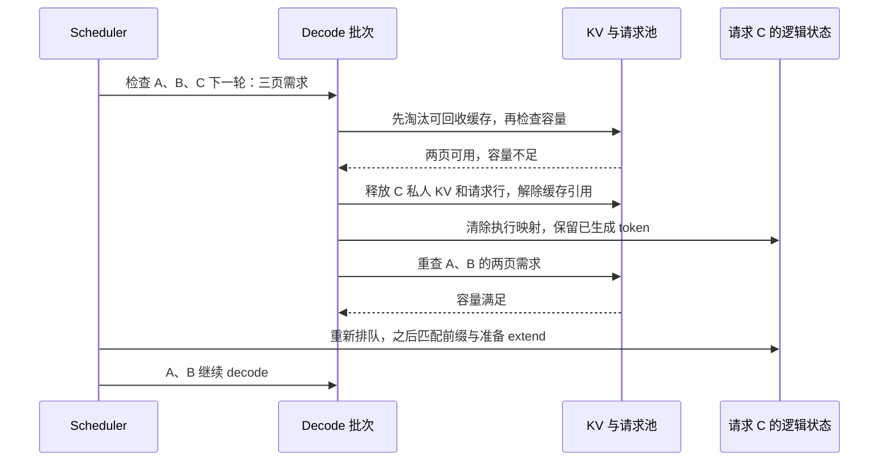

# KV 不够时，怎样撤回请求而不抹掉已经生成的内容

源码版本：`0f6761b54facebb47f2068f87ecccd8f14da3a0e`。证据等级：静态源码核对。采用普通 token 输入、自回归完整 attention、普通 RadixCache 与分页池、页大小四；关闭 overlap、推测、beam、PD 分离、HiSparse 和输入 embedding。容量轨迹与机制图为教学示意，未执行回退实验或测量性能。

昨天的准入器为未来增长留了估计空间，但估计不能代替每轮真实容量检查。让 A、B、C 已经处理好的 KV 长度分别为 8、12、4，三者都位于页边界；对应已生成输出数量设为 5、3、2，原提示长度分别为 4、10、3。自回归循环中最新采样 token 尚待下一轮计算 KV，所以这些数量并不矛盾。现在空闲池只有两页，也没有可淘汰的缓存。下一轮三个请求各扩展一 token，却各需一页，需求是十二份容量，空闲只有八份。

若等到实际分配返回 None 才处理，输入准备可能已经进行了一部分，错误又发生在 GPU 资源持有与请求状态交接处。SGLang 的 [update_running_batch](https://github.com/sgl-project/sglang/blob/0f6761b54facebb47f2068f87ecccd8f14da3a0e/python/sglang/srt/managers/scheduler.py#L4193) 先过滤结束请求，再检查下一次 decode 是否能容纳，容量不足才进入 retract_decode。调用 prepare_for_decode 是之后的步骤，因此回退首先调整谁继续执行，而非在已经形成的输入里随便删一行。

[new_tokens_required_next_decode](https://github.com/sgl-project/sglang/blob/0f6761b54facebb47f2068f87ecccd8f14da3a0e/python/sglang/srt/managers/schedule_batch.py#L3200) 对普通非推测路径统计 committed 长度整除页大小的请求，按新增页数计需求。[check_decode_mem](https://github.com/sgl-project/sglang/blob/0f6761b54facebb47f2068f87ecccd8f14da3a0e/python/sglang/srt/managers/schedule_batch.py#L3229) 把需求交给 allocator 的 [check_decode_capacity](https://github.com/sgl-project/sglang/blob/0f6761b54facebb47f2068f87ecccd8f14da3a0e/python/sglang/srt/mem_cache/allocator/base.py#L151)，后者先尝试释放可淘汰缓存，再比较真实可用容量。缓存淘汰和活动请求回退是不同动作：前者移除可再利用的历史，后者暂停一个仍需服务的请求，并撤回它占用的资源。

[retract_decode](https://github.com/sgl-project/sglang/blob/0f6761b54facebb47f2068f87ecccd8f14da3a0e/python/sglang/srt/managers/schedule_batch.py#L3248) 每次选择一位释放，然后对剩余请求再次调用同一个容量检查。普通默认顺序在 [_get_decode_retraction_order](https://github.com/sgl-project/sglang/blob/0f6761b54facebb47f2068f87ecccd8f14da3a0e/python/sglang/srt/managers/schedule_batch.py#L3335) 以输出数量等排序，末端被优先撤回；本例 C 输出最少，先被选择。配置为 priority 策略时还会加入优先级，不能把默认顺序当作固定公平承诺。

设 C 的四个已计算位置都属于一页私人 KV，尚未成为受保护的树内共享前缀。撤回 C 后，这页回到池中，剩余 A、B 的下一轮只需两页，容量检查通过。若 C 有共享前缀，解除 C 的引用并不保证整段前缀马上可释放：其他请求可能仍保护它。因此回退不能按“删除一个请求就固定增加它的全部序列长度”来算账，必须重新询问分配器。

图为普通重算路径的教学示意。C 失去当前运行行与设备历史，但没有失去请求身份和已提交的输出；重新排队也不表示它立即获得资源。图中释放与重查的顺序保证容量判断依据真实回收结果，而不是仅在计数器里假装多出空间。

[release_req](https://github.com/sgl-project/sglang/blob/0f6761b54facebb47f2068f87ecccd8f14da3a0e/python/sglang/srt/managers/schedule_batch.py#L2209) 调用 release_kv_cache，显式指定 `is_insert=False`，避免为了回收空间又把私人后缀插进树里。[RadixCache 的该分支](https://github.com/sgl-project/sglang/blob/0f6761b54facebb47f2068f87ecccd8f14da3a0e/python/sglang/srt/mem_cache/radix_cache.py#L478) 释放不属于受保护前缀的 committed 槽，并解除本请求的节点保护；[release_kv_cache](https://github.com/sgl-project/sglang/blob/0f6761b54facebb47f2068f87ecccd8f14da3a0e/python/sglang/srt/mem_cache/common.py#L272) 再处理尾部与请求行归还。每份资源只有一个合法释放归属，是这里必须维持的不变量。

随后 [reset_for_retract](https://github.com/sgl-project/sglang/blob/0f6761b54facebb47f2068f87ecccd8f14da3a0e/python/sglang/srt/managers/schedule_batch.py#L1931) 清空 prefix_indices、节点、范围与相关执行状态，增加 retraction_count，设置 is_retracted 和 retracted_stain。普通 token 输入路径保留 output_ids；C 的输出数量仍是二，不应退回零。[重新入队](https://github.com/sgl-project/sglang/blob/0f6761b54facebb47f2068f87ecccd8f14da3a0e/python/sglang/srt/managers/scheduler.py#L3277) 还受队列限制，撤回并不保证一定恢复。重新准入时，[刷新 fill 输入](https://github.com/sgl-project/sglang/blob/0f6761b54facebb47f2068f87ecccd8f14da3a0e/python/sglang/srt/managers/schedule_batch.py#L1536) 把原提示与已有输出连接起来，再匹配仍可复用的前缀，对缺失部分重新计算 KV。这是恢复模型上下文，并不把旧输出作为新结果再次追加。

重算付出的代价是额外 prefill、等待和可能反复回退；源码更新未来 token 的估计比例，但没有由此保证每个请求都能持续推进。即使只剩最后一个请求，容量仍不足时该实现也会释放并中止它，而非永远保留或让 Scheduler 崩溃。输入 embedding 路径会重置输出，分离部署还有备份与恢复分支，均不能套用本文“保留 token 后重算”的范围。

待验证时在容量检查、release_req、reset_for_retract 和重新入队处记录请求身份、output_ids、req_pool_idx、protected 长度、空闲页与 retraction_count。本例应观察 C 从运行批移出，行归还、输出二枚保留，A、B 的检查重新通过；C 恢复时映射必须重新建立。若它仍持旧行却再次分配、共享页被误释放，或恢复后把旧两枚输出重复发送，就能推翻该状态机。今天三篇把准入后的索引建立、分页增长和容量反馈连成闭环；下一步可继续追取消如何与这些资源释放路径交汇。
