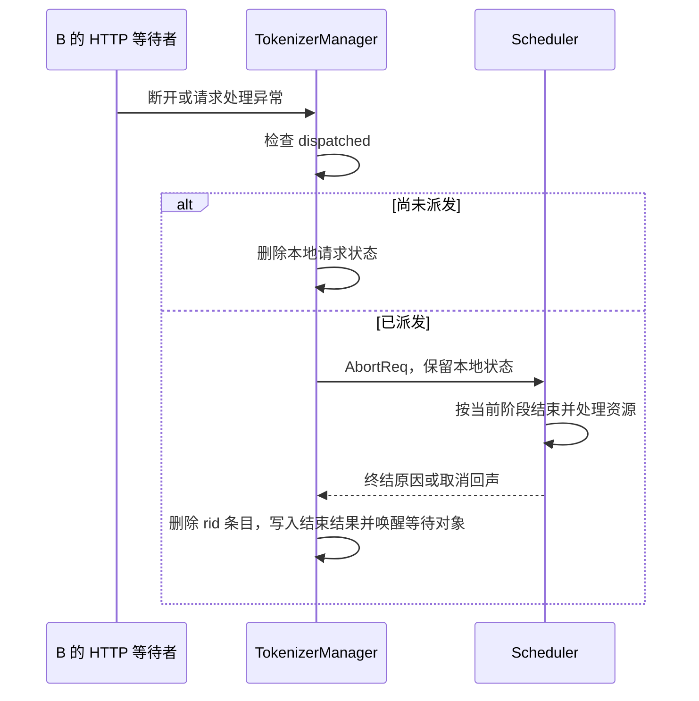

# 客户端断开以后，为什么请求状态还不能立即删除

源码版本：`0f6761b54facebb47f2068f87ecccd8f14da3a0e`。证据等级：静态源码核对。采用普通文本生成、单 TokenizerManager worker 与 Scheduler 的读法，暂不进入多模态、LoRA、PD 分离和其他专用队列。B 与时序图为教学示意，本次未启动服务或测量取消延迟。源码工作区的未跟踪导读文件未参与证据核对。

昨天把请求槽与 KV 的归还追到了 Scheduler，今天让 B 的客户端先断开。最自然的写法是捕获 HTTP 异常，删除 B 的本地字典条目，然后认为工作结束。但 B 可能只在 tokenize，也可能已经排队，甚至正在使用 GPU。HTTP 等待者的消失并不携带远端资源的释放动作；若远端继续生成，本地状态删除只会让输出找不到接收者，无法归还请求行和 KV。

关键边界在于请求是否已派发。[generate_request](https://github.com/sgl-project/sglang/blob/0f6761b54facebb47f2068f87ecccd8f14da3a0e/python/sglang/srt/managers/tokenizer_manager.py#L848) 建立请求状态后，把后续流程包在异常清理中；捕获 BaseException 的路径也覆盖协程取消等退出，而不只处理输入校验错误。[发送路径](https://github.com/sgl-project/sglang/blob/0f6761b54facebb47f2068f87ecccd8f14da3a0e/python/sglang/srt/managers/tokenizer_manager.py#L1665) 在 dispatch 后记录 dispatched。[失败清理](https://github.com/sgl-project/sglang/blob/0f6761b54facebb47f2068f87ecccd8f14da3a0e/python/sglang/srt/managers/tokenizer_manager.py#L3615) 对尚未派发的 B 直接删除本地状态；对已派发的 B 则发送 AbortReq，并保留状态，等待 Scheduler 的结束消息来清理。

因此 dispatched 解决的是“应该在哪里结束”的问题，并非远端已经释放资源的确认。这个状态的保留也不是泄漏的同义词：B 的等待对象还需要容纳最终原因，接收路径还需要按 rid 找到它。真正值得检查的是派发后有没有终结消息、终结后条目是否消失，以及远端资源是否结束，而非要求一发生异常字典立刻为空。

断开的发现有几条入口。[响应等待协程](https://github.com/sgl-project/sglang/blob/0f6761b54facebb47f2068f87ecccd8f14da3a0e/python/sglang/srt/managers/tokenizer_manager.py#L1828) 在等待超时后，或非流式请求收到中间结果时检查连接；非 background 请求断开就触发 abort 并退出。[流式 HTTP handler](https://github.com/sgl-project/sglang/blob/0f6761b54facebb47f2068f87ecccd8f14da3a0e/python/sglang/srt/entrypoints/http_server.py#L922) 还给 StreamingResponse 挂上 [create_abort_task](https://github.com/sgl-project/sglang/blob/0f6761b54facebb47f2068f87ecccd8f14da3a0e/python/sglang/srt/managers/tokenizer_manager.py#L2275)，延迟两秒后对仍有本地状态的请求补发取消。两秒是这条后台任务的等待，不是整个系统取消延迟的上限；background 请求也不能套用相同断开规则。

图是控制面教学示意，不表示发送 AbortReq 与释放 KV 发生在同一时刻。它把本地失败和远端工作结束分成两次状态转换，下一篇再展开 Scheduler 的阶段判断。

多个清理入口可能对 B 重复发送取消。[TokenizerManager.abort_request](https://github.com/sgl-project/sglang/blob/0f6761b54facebb47f2068f87ecccd8f14da3a0e/python/sglang/srt/managers/tokenizer_manager.py#L2097) 用 abort_sent 合并本地重复操作；发送失败则恢复标志，让后续重试仍有机会发出。它拒绝没有 abort_all 的空 rid，因为 Scheduler 使用 startswith 匹配，空字符串会匹配所有请求。这里的防线与请求身份有关，不能把取消接口想成任意字符串都精确匹配一个请求。本文例子使用完整且无前缀冲突的 rid。

另一种重复来自正常完成和取消回声交错。[取消回声处理](https://github.com/sgl-project/sglang/blob/0f6761b54facebb47f2068f87ecccd8f14da3a0e/python/sglang/srt/managers/tokenizer_manager.py#L3354) 先 get 本地状态；如果正常结束已经删掉它，就直接返回，不重新制造 B。若仍存在，则标记结束、构造 finish_reason、删除字典键，再把结果放进仍被等待协程引用的 ReqState 并唤醒 event。字典成员关系与对象是否还被引用是两个问题；删除键不妨碍已有等待者消费最后一个结果。

这套机制的代价是跨进程消息、多个结束入口和短暂保留的状态。[HTTP 取消端点](https://github.com/sgl-project/sglang/blob/0f6761b54facebb47f2068f87ecccd8f14da3a0e/python/sglang/srt/entrypoints/http_server.py#L1655) 在调用 abort_request 后直接返回 200，没有等待 Scheduler 的释放确认。因此 200、abort_sent 为真与空闲 KV 增加，代表不同观察层次；不能用其中一个替代另两个。

待验证时在失败清理、abort_request 与取消回声处理设断点，分别让 B 在派发前校验失败、排队时断开、自然完成与取消接近同时发生。观察 dispatched、abort_sent、rid_to_state、ReqState.event 和远端位置；发送失败时 abort_sent 应恢复，迟到回声不应重建已结束状态。若本地删除后远端持续占用资源，或正常完成后的回声触发异常，就能推翻上述清理解释。这些是待执行方案，源码中的保护不能直接证明网络故障下所有取消都会最终送达。
