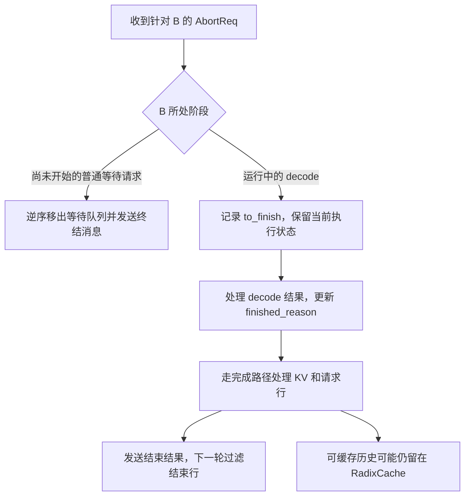

# 同一个取消消息，为什么排队请求和 decode 请求要走不同清理路径

源码版本：`0f6761b54facebb47f2068f87ecccd8f14da3a0e`。证据等级：静态源码核对。以普通文本、自回归、普通 RadixCache 和非 overlap 循环为主，排除 grammar 等专用队列、beam、PD 分离及异步 KV offload。B 的不同取消时刻是对照场景，图为教学示意，本次未运行取消或缓存实验。

上一篇把 B 的取消送进 Scheduler，但收到 AbortReq 还不足以决定怎么 free。假如 B 仍在等待队列，从未获得请求行，把它从队列移除就能停止后续工作；假如 B 已经在 decode，批次、映射表与执行路径都依赖它，直接删对象或归还 KV 会破坏当前批次的约定。真正需要区分的是当前有哪些参与者已经持有资源，而不只是用户是否还想要结果。

[Scheduler.abort_request](https://github.com/sgl-project/sglang/blob/0f6761b54facebb47f2068f87ecccd8f14da3a0e/python/sglang/srt/managers/scheduler.py#L5436) 对等待队列先收集命中下标，再逆序移除，避免删除前一个元素后错过后面的目标。普通尚未启动的 B 不需要再执行 forward，却仍要向 TokenizerManager 发终结消息；否则远端队列清了，本地 dispatched 状态仍在等待。[缓存侧结束钩子](https://github.com/sgl-project/sglang/blob/0f6761b54facebb47f2068f87ecccd8f14da3a0e/python/sglang/srt/managers/scheduler.py#L3340) 记录 ABORT，不能把这个钩子本身当成所有 KV 和请求行均已释放的证明。

轮到运行请求，调度器从 [collect_inflight_reqs](https://github.com/sgl-project/sglang/blob/0f6761b54facebb47f2068f87ecccd8f14da3a0e/python/sglang/srt/managers/scheduler.py#L5427) 找到当前批与上一批中的请求，用集合合并对象身份；在普通单流水阶段不只看 waiting_queue，也不只看 running_batch。尚未结束的 B 被设置 `to_finish=FINISH_ABORT`。此刻 finished_reason 仍未提交，因此“已要求停止”和“已经终结”是两个状态，B 还会沿原执行结果路径收尾。

图是阶段转换的教学示意，长 prefill 中间块留到下一篇。两条路径的共同终点是停止继续服务 B 并传回结束信息，但它们是否需要处理一次模型结果，以及物理空间何时回到空闲池，并不相同。

在 [process_batch_result_decode](https://github.com/sgl-project/sglang/blob/0f6761b54facebb47f2068f87ecccd8f14da3a0e/python/sglang/srt/managers/scheduler_components/batch_result_processor.py#L921) 的普通路径中，采样 token 先进入 output_ids，然后 [update_finish_state](https://github.com/sgl-project/sglang/blob/0f6761b54facebb47f2068f87ecccd8f14da3a0e/python/sglang/srt/managers/schedule_batch.py#L1889) 优先消费 to_finish，转成 finished_reason 并清除待结束标记。因而不能把取消理解成收到消息后绝不再计算或提交任何 token；本提交复用结果处理入口完成终结，具体客户端可见行为还要看结束输出及连接是否仍在。

已经终结的 B 随后进入 [完成状态处理](https://github.com/sgl-project/sglang/blob/0f6761b54facebb47f2068f87ecccd8f14da3a0e/python/sglang/srt/managers/scheduler_components/batch_result_processor.py#L1257)，普通 RadixCache 路径调用 release_kv_cache 时允许插入缓存。这里有个容易误判的结果：取消之后请求行回来了，空闲 KV 却未必增加 B 的整段上下文。有效历史可以转为缓存持有、解除活动保护，之后被复用或淘汰。这与昨天为立即回收空间而使用 is_insert=False 的回退路径不同；停止一个请求并不等于清空它曾经计算的所有历史。

[release_kv_cache](https://github.com/sgl-project/sglang/blob/0f6761b54facebb47f2068f87ecccd8f14da3a0e/python/sglang/srt/mem_cache/common.py#L272) 把缓存处理、额外尾部释放和请求行归还组织起来，[cache_finished_req](https://github.com/sgl-project/sglang/blob/0f6761b54facebb47f2068f87ecccd8f14da3a0e/python/sglang/srt/mem_cache/radix_cache.py#L478) 负责插入历史并处理重复或未插入范围。共享前缀不能因 B 取消就释放给别人，因为 A 可能还引用它。正确不变量是 B 的活动所有权结束、每份私人资源只处理一次、其他请求的依赖保持有效，而不是强求缓存计数立刻归零。

下一轮 [update_running_batch](https://github.com/sgl-project/sglang/blob/0f6761b54facebb47f2068f87ecccd8f14da3a0e/python/sglang/srt/managers/scheduler.py#L4193) 过滤已经结束的行。这样，finish_reason 提交、资源归属交接与批次成员删除有清楚的先后关系。若在 to_finish 阶段就把 B 过滤掉，却没有安排独立清理，就可能让它永远错过归还资源的入口；若在取消消息里和完成路径各 free 一次，又会把同一页重复放回池里。

这个设计节省独立的 decode 取消执行路径，却可能支付一次额外 forward 和结果回流成本。专用队列及分离部署可能已经预分配资源，不能套用“等待队列没有 KV”的假设；本文也不声称所有取消都必须多跑恰好一轮，正常结束、阶段变化和配置会改变结果。

待验证时对同一个 B 分别在排队与 decode 阶段取消，观察 waiting_queue、to_finish、finished_reason、req_pool_idx、protected/evictable 大小和下一轮行集合。排队取消应传回终结而不准备新 forward；运行取消应从待终结走到完成处理，之后消失。若 A 仍引用的共享槽被释放，或 B 的行归还两次，就能推翻该所有权解释。要判断泄漏，还需区分活动资源与留在树中的可淘汰历史，不能仅截图 GPU 占用就下结论。
