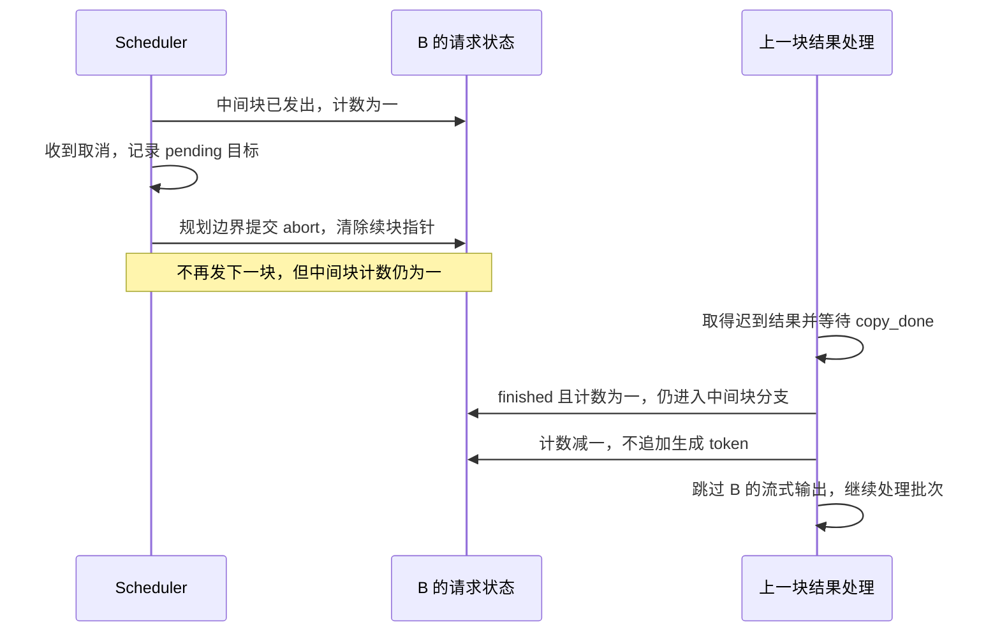

# 长 prefill 已经取消，为什么还要处理它的迟到结果

源码版本：`0f6761b54facebb47f2068f87ecccd8f14da3a0e`。证据等级：静态源码核对。采用普通文本、自回归、单个进行中的 chunked request、普通 RadixCache；排除 PD 分离、pipeline parallel、推测及其他专用模型。本文对照正常与 overlap 循环的控制状态，未执行 GPU 并发实验；图为 CPU 逻辑顺序的教学示意，不是设备执行追踪。未跟踪的本地导读未作为证据。

把 B 放到第三种取消时刻：长提示的一个中间块已经发出，完整提示仍未处理完。它既不是能直接移除的普通等待请求，也不是可以靠下一次正常 decode 结束的请求。若只把 B 标成结束，再让所有结果处理看见 finished 就 continue，已经发出的中间块会失去记账出口；若把中间块计数清零，迟到的采样结果又可能被误当成完整提示后的生成输出。取消需要同时完成两件事：停止追加新工作，处理已经发出的工作所留下的结果与账目。

[Scheduler.abort_request](https://github.com/sgl-project/sglang/blob/0f6761b54facebb47f2068f87ecccd8f14da3a0e/python/sglang/srt/managers/scheduler.py#L5436) 对命中的 chunked_req 先记录 `_pending_chunked_abort_req`，随后在 [get_next_batch_to_run](https://github.com/sgl-project/sglang/blob/0f6761b54facebb47f2068f87ecccd8f14da3a0e/python/sglang/srt/managers/scheduler.py#L3648) 开头处理。标记把取消动作接到规划下一块的边界，避免仅在收消息处随意拆掉当前续块状态。在正常循环中，上一批结果此前已经处理；[overlap 循环](https://github.com/sgl-project/sglang/blob/0f6761b54facebb47f2068f87ecccd8f14da3a0e/python/sglang/srt/managers/scheduler.py#L1967) 则先规划当前批，之后才处理上一批结果，所以这时还可能欠一次结果处理。

[process_pending_chunked_abort](https://github.com/sgl-project/sglang/blob/0f6761b54facebb47f2068f87ecccd8f14da3a0e/python/sglang/srt/managers/scheduler.py#L3545) 先核对当前 chunked_req 是否仍是同一个对象。若 B 已经离开分块阶段，就检查它是否已结束或失去 KV；仍活跃则重新调用普通 abort 路径，让当前位置负责收尾。这个重新定位很重要：标记记录的是先前观察，不保证下一次处理时阶段没变，不能拿一个过时的续块指针强行释放后来请求的资源。

对象仍匹配时，[prepare_abort](https://github.com/sgl-project/sglang/blob/0f6761b54facebb47f2068f87ecccd8f14da3a0e/python/sglang/srt/disaggregation/utils.py#L1704) 直接设置 finished_reason；随后 pending 处理清除 to_finish、记录缓存侧结束、按 is_insert=False 处理 KV，清空 chunked_req 与 pending 标记，并发回取消原因。清空续块指针使新规划不再为 B 发下一块，但这里没有像回退重置那样抹掉 inflight_middle_chunks。请求逻辑结束与已发块的计数债务仍然分开。

图展示 overlap 可出现的控制顺序，不表示归还地址后 GPU 可以无条件复用它，也不表示正常循环总会留下迟到结果。等待 copy_done 是结果处理入口的动作，不能倒过来证明更早发生的资源交接已经覆盖了所有设备依赖。

真正让记账闭合的是 [process_batch_result_prefill](https://github.com/sgl-project/sglang/blob/0f6761b54facebb47f2068f87ecccd8f14da3a0e/python/sglang/srt/managers/scheduler_components/batch_result_processor.py#L257) 的跳过条件：只有 finished 且中间块计数不大于零才直接 continue。B 已结束但计数为一时仍进入中间块分支，减去一份，并设置 skip_stream_req；不会走普通 output_ids.append。把判断简化成“finished 一律跳过”会漏掉这一步，后续阶段判断可能永久带着过时计数。

结果数据的分段也不能随 B 一起忽略。启用输入 logprob 时，[中间块 logprob 处理](https://github.com/sgl-project/sglang/blob/0f6761b54facebb47f2068f87ecccd8f14da3a0e/python/sglang/srt/managers/scheduler_components/batch_result_processor.py#L712) 仍推进扁平结果游标，并包含输入 logprob 的状态处理；这不是“取消后完全不触碰请求”。即便不向 B 提交生成结果，也要让后面请求读到自己的数据段，否则一个取消会把错误扩散给同批其他请求。[输出路径](https://github.com/sgl-project/sglang/blob/0f6761b54facebb47f2068f87ecccd8f14da3a0e/python/sglang/srt/managers/scheduler_components/output_streamer.py#L144) 对 skip_req 直接跳过，对已经发过终结输出的结束请求也避免重复输出。

取消标记与结果计数提供逻辑边界，设备安全还依赖实际流与地址复用的顺序。[共享读屏障](https://github.com/sgl-project/sglang/blob/0f6761b54facebb47f2068f87ecccd8f14da3a0e/python/sglang/srt/managers/scheduler.py#L1918) 显式使用事件或流等待，说明布尔 finished 本身无法替代 GPU 同步。本文核对的是停止新块、消耗旧结果和避免生成提交的状态机，不把这些局部条件包装成所有 overlap 配置的完整内存安全证明；下一次学习将继续沿流依赖和对象共享展开。

待验证时在取消入口、pending 处理和中间块结果分支停住，记录请求对象身份、chunked_req、pending 指针、finished_reason、inflight_middle_chunks 与 output_ids。对照正常循环和 overlap，检查清除续块指针后不再发新块，若有一份迟到中间块结果，计数从一到零而输出长度不增长。再在阶段刚转为 decode 时取消，检验 pending 目标会重新定位而非重复释放。若 finished 导致账目未消耗、计数被提前抹掉而追加了采样 token，或其他请求的结果段发生错位，就能推翻这套解释。运行验证还应记录 GPU 事件与实际槽复用，不能只用 Python 断点推断设备完成时间。
