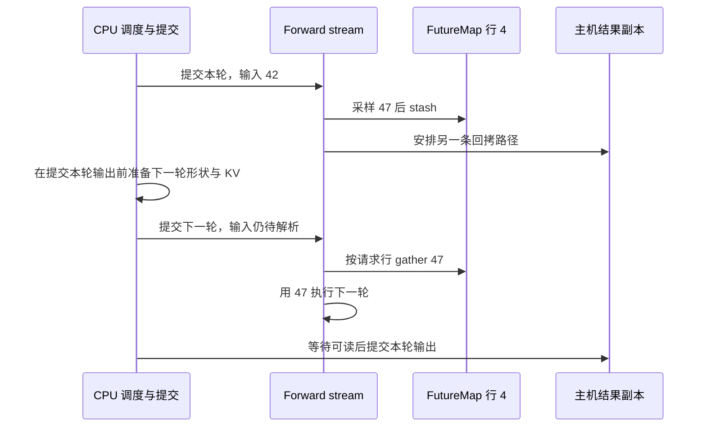

# 下一枚 token 还没回到 CPU，为什么已经能准备下一轮 decode

源码版本：`0f6761b54facebb47f2068f87ecccd8f14da3a0e`。证据等级：静态源码核对。采用 CUDA 普通文本、自回归、非推测 decode 的 overlap 路径，假定容量足够；排除 grammar、beam、PD 分离和专用模型。数值与图为教学示意，未运行 GPU 或测量性能。工作区另有未跟踪导读，不作为提交证据。

让 B 持有请求行 4，本轮模型输入是 token 42，下一枚采样 token 暂记为 47。朴素循环会等 47 拷回 CPU，追加到 output_ids，再准备下一轮。这把选请求、检查容量、准备执行形状都绑在 token 的主机可见时刻；然而普通 decode 的下一轮增量长度已知是一，只有输入值尚未确定。昨天研究的迟到结果，正来自这两种进度的分离。

[event_loop_overlap](https://github.com/sgl-project/sglang/blob/0f6761b54facebb47f2068f87ecccd8f14da3a0e/python/sglang/srt/managers/scheduler.py#L1967) 先规划并提交当前批，把批次快照与结果放入 result_queue，再处理上一批结果。CPU 对输出的提交晚一轮，执行输入却不必等待该主机提交。这里提前的是执行准备，并没有猜出 47，也没有消除模型的数据依赖。[prepare_for_decode](https://github.com/sgl-project/sglang/blob/0f6761b54facebb47f2068f87ecccd8f14da3a0e/python/sglang/srt/managers/schedule_batch.py#L3504) 可以分配下一个 KV 位置并推进长度，把输入值留到模型消费前确定。

[FutureMap](https://github.com/sgl-project/sglang/blob/0f6761b54facebb47f2068f87ecccd8f14da3a0e/python/sglang/srt/managers/overlap_utils.py#L248) 提供按请求池行索引的设备中继。普通路径的 output_tokens_buf 存储上一轮采样结果；它不是一个等待 CPU 回调的 Python Future。B 在下一批改变批内行序时，仍按请求行 4 找自己的 token，不能用“上一批第几个请求”来猜位置。请求池行身份跨轮保持，批内位置则可能因过滤、合并变化。

在 [run_batch](https://github.com/sgl-project/sglang/blob/0f6761b54facebb47f2068f87ecccd8f14da3a0e/python/sglang/srt/managers/scheduler.py#L4337) 的 forward stream 中，执行返回后，[relay payload](https://github.com/sgl-project/sglang/blob/0f6761b54facebb47f2068f87ecccd8f14da3a0e/python/sglang/srt/managers/scheduler.py#L4670) 用普通采样结果构造 bonus_tokens，再经 [stash](https://github.com/sgl-project/sglang/blob/0f6761b54facebb47f2068f87ecccd8f14da3a0e/python/sglang/srt/managers/overlap_utils.py#L596) 写入相应行。代码随后把 batch.input_ids 设为 None，明确下一轮应从中继解析。None 表达尚未物化的输入，不能被当成可以随便补零的缺失数据。

图为依赖教学示意，不是实际设备时间线。CPU 准备可以与前轮计算交错，而设备 gather 必须在 stash 之后。主机副本服务输出与结束判断，设备 buffer 服务下一轮执行；两条消费路径没有强制合成一次 CPU 等待。

[resolve_forward_inputs](https://github.com/sgl-project/sglang/blob/0f6761b54facebb47f2068f87ecccd8f14da3a0e/python/sglang/srt/managers/overlap_utils.py#L87) 在 forward 入口兑现这个约定：普通 decode 的 input_ids 为 None 时，按 req_pool_indices 从 output_tokens_buf gather。该操作与上一轮 stash 都在 forward stream 中安排，生产后消费的依赖由流内次序维持。prefill 则从 pinned CPU 输入拷入，mixed 批把它与运行请求的设备 token 拼接。不同输入来源在消费入口统一，不要求 Scheduler 先拿到所有 token 的 CPU 值。

还要区分 [publish](https://github.com/sgl-project/sglang/blob/0f6761b54facebb47f2068f87ecccd8f14da3a0e/python/sglang/srt/managers/overlap_utils.py#L571) 与 stash。publish 更新 new_seq_lens_buf，推测分支才需要它的 publish_ready 事件；普通 token 值由 stash 写入。看见 publish 名字不能断言 token 已写好，也不能把推测分支的 CPU 长度同步需求套到单 token decode。接口分离后，调试也必须分别追长度发布与实际 token 生产。

不变量是每次有效消费前，目标行已有属于这个请求的新 stash，且消费排在生产之后。调试模式用负值初始化，并在 gather 后失效化行，暴露未写先读等错误；生产 buffer 不是初始化好的有效 token 表。行被 C 复用时，B 的旧值可能残留，必须由 C 自己的生产步骤建立新输入，地址合法不代表身份正确。

该机制缩短 token 回拷对 CPU 准备的约束，却仍有采样依赖、中继管理和延迟的结束状态，不能仅从源码存在推断吞吐提升。待验证时在 run_batch 返回、stash、resolve_forward_inputs 和旧批结果提交处记录 forward_iter、请求行、input_ids 与 output_ids 长度，并用设备事件核对生产到消费的顺序。预期 CPU 输出尚未追加时，下一轮已经从设备中继取得输入；若改批内顺序后 B 拿到别人的 token，或消费没有新 stash，就能推翻解释。不要为观察值随处调用 item，把异步路径人为同步。下一篇继续追共享映射的读写依赖。
