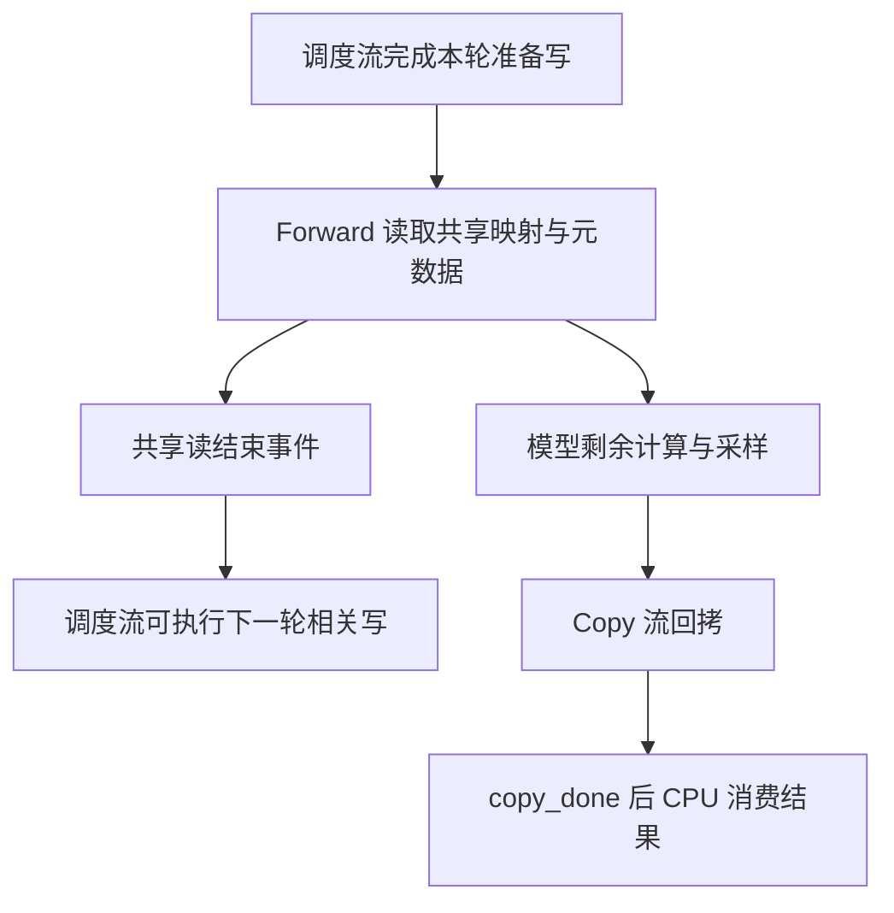

# CPU 可以先走一步，共享映射表为什么仍然必须等读完

源码版本：`0f6761b54facebb47f2068f87ecccd8f14da3a0e`。证据等级：静态源码核对。采用 CUDA 普通自回归 overlap，区分调度、forward、copy 流，并讨论一处 CUDA Graph 条件分支。图为教学依赖图，未运行设备 trace 或性能实验，也未证明所有 backend 的共享读边界。未跟踪导读不作为证据。

B 的 token 可以从设备中继取得，仍不代表 CPU 能随意覆盖旧 forward 正在读取的表。设 attention 尚需从共享映射 R 取得 B 的历史位置，下一轮已准备更新 R；保证“新 token 写好了”无法阻止旧 attention 读到新映射。这同时存在先写后读、先读后写两条依赖，缺少任一条，都可能在合法地址读取错误上下文。

[run_batch](https://github.com/sgl-project/sglang/blob/0f6761b54facebb47f2068f87ecccd8f14da3a0e/python/sglang/srt/managers/scheduler.py#L4337) 在 forward 消费输入前调用 wait_stream(schedule_stream)，让本轮调度侧准备先完成；[共享读屏障](https://github.com/sgl-project/sglang/blob/0f6761b54facebb47f2068f87ecccd8f14da3a0e/python/sglang/srt/managers/scheduler.py#L1918) 则给 schedule stream 安排等待，阻止后续相关写越过本轮 forward 的共享读。两个等待方向相反，不能以“代码里有同步”代替逐条核对。前者保护新输入可读，后者保护旧读取尚未完成时数据不被覆盖。

[PyTorch Stream 文档](https://docs.pytorch.org/docs/2.14/generated/torch.cuda.Stream_class.html) 说明 wait_stream、wait_event 为后续设备操作添加依赖，调用可以先返回。因此 CPU 可继续组织对象，而依赖的设备写仍在等待；Python 已经走到下一行不等于共享表已经改写。主机真正消费回拷结果时，等待位置又不同。

图为教学依赖示意，事件后仍有模型工作，只在 backend 已完成相关共享读或已建立私有快照时才成立。共享读结束、模型结果可用、主机副本可读是三个边界；图不保证真实硬件上的并发比例。

最保守的办法是等整个 forward stream，代价是把映射所需等待扩大为整段模型计算。实现从 last_shared_read_runner 取 shared_read_done_event，消费后清空；有事件且未强制粗屏障时 wait_event，否则 wait_stream。清空旧事件尤其重要：新阶段没有发布时，不能把上次的“读完”当成本次完成证明。较细的边界必须是正确的边界，而不只是更早的时间点。

[SharedReadEnds](https://github.com/sgl-project/sglang/blob/0f6761b54facebb47f2068f87ecccd8f14da3a0e/python/sglang/srt/layers/attention/base_attn_backend.py#L22) 区分 PRE_REPLAY、IN_REPLAY、POST_REPLAY、UNKNOWN。[prefill 发布入口](https://github.com/sgl-project/sglang/blob/0f6761b54facebb47f2068f87ecccd8f14da3a0e/python/sglang/srt/model_executor/runner_utils/shared_read_event.py#L26) 要求开关、EXTEND 模式和 PRE_REPLAY 声明等条件，才在准备后记录事件。这是 backend 与调度器之间的契约：若模型内部仍读调度侧共享数据，却声明准备时已结束，事件存在也只是在错误位置记录了真实时间。

本提交有一个具体边界。[decode graph 的解析](https://github.com/sgl-project/sglang/blob/0f6761b54facebb47f2068f87ecccd8f14da3a0e/python/sglang/srt/model_executor/runner/decode_cuda_graph_runner.py#L505) 在声明 IN_REPLAY、但缺少图内 metadata 完成事件时返回 PRE_REPLAY；同处注释指出它早于声明，并认为 POST_REPLAY 才稳妥。[execute](https://github.com/sgl-project/sglang/blob/0f6761b54facebb47f2068f87ecccd8f14da3a0e/python/sglang/srt/model_executor/runner/decode_cuda_graph_runner.py#L1433) 据此可能在 replay 前发布读完事件。这构成静态条件性风险，不能以“枚举声称图内读完”证明实际等待足够；本次没有观测实际内存破坏，也不认为所有 CUDA Graph 都会触发该条件。

[external event 创建](https://github.com/sgl-project/sglang/blob/0f6761b54facebb47f2068f87ecccd8f14da3a0e/python/sglang/srt/model_executor/runner_utils/shared_read_event.py#L16) 不支持时可以返回 None，因此需要核验事件缺失的实际配置。少一个标记不能成为把等待挪到更早位置的理由，fallback 也必须维持原依赖契约。本文保留上游原样，只记录固定提交的分支与可验证反例，不把静态风险写成已复现故障。

回拷是另一条边。run_batch 让 copy stream 等 forward stream，[copy_to_cpu](https://github.com/sgl-project/sglang/blob/0f6761b54facebb47f2068f87ecccd8f14da3a0e/python/sglang/srt/managers/utils.py#L154) 安排拷贝并记录 copy_done，[decode 结果处理](https://github.com/sgl-project/sglang/blob/0f6761b54facebb47f2068f87ecccd8f14da3a0e/python/sglang/srt/managers/scheduler_components/batch_result_processor.py#L921) 再同步该事件。copy_done 证明主机结果可读，不能替代更早的共享读屏障；forward 也不因这条 copy 路径自动等待 CPU 消费。这样才能区分设备表复用、输出回流与主机提交，而不把它们都压进同一个全局同步。

待验证时记录三条流的身份、事件记录位置、backend 声明与共享表最后一次读取。先比较粗屏障和可用细事件，再构造图内事件缺失的分支，核对 replay 前的放行是否早于最后共享读。若出现越序，就推翻“边界解析总保守”的解释；若声明结束后模型仍读共享表，则推翻该 backend 契约。设备先后应由事件或 trace 判断，不能由 CPU 断点推断。等待缩短可能扩大重叠，也增加契约审计负担；只有实际时间线与正确性结果才能支持收益结论。下一篇讨论顺序正确时对象和 tensor 的生命周期问题。
