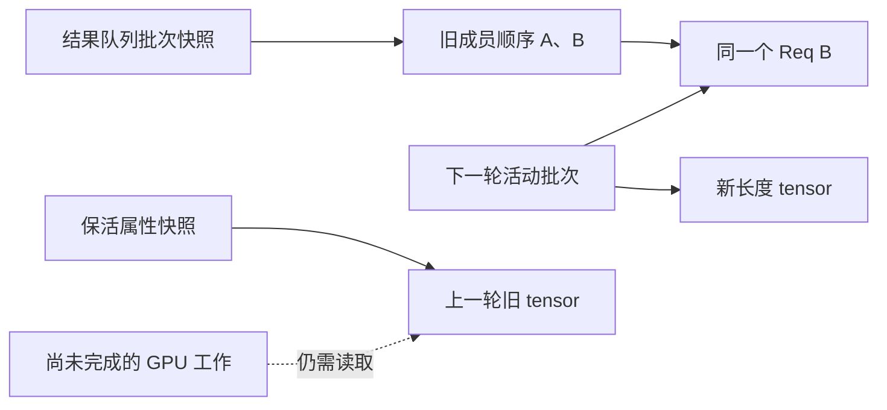

# 保存上一批对象，为什么不等于保存了上一批的全部状态

源码版本：`0f6761b54facebb47f2068f87ecccd8f14da3a0e`。证据等级：静态源码核对。采用普通 CUDA 文本自回归 overlap，排除推测、beam、PD 分离和专用状态池。对象关系图为教学示意，未运行别名、生命周期或性能实验。未跟踪导读不作为提交证据。

前两篇解决值从哪里来、访问按什么顺序执行，还有一类错误来自状态被下一轮替换。设上一批是 A、B，随后 C 加入、A 结束。结果处理若直接遍历此刻运行集合，第二份结果未必仍对应 B；即便保留 batch 引用，也不能阻止同一对象的字段在下一轮改变。要保存的是特定版本的关系，而不是一个名字。

[ScheduleBatch.copy](https://github.com/sgl-project/sglang/blob/0f6761b54facebb47f2068f87ecccd8f14da3a0e/python/sglang/srt/managers/schedule_batch.py#L3759) 保存结果处理需要的字段，并以 reqs 的列表切片保留当时成员顺序。[overlap 循环](https://github.com/sgl-project/sglang/blob/0f6761b54facebb47f2068f87ecccd8f14da3a0e/python/sglang/srt/managers/scheduler.py#L1967) 把该快照与结果一起入队，回答“这份结果属于谁”。后来运行集合的合并或过滤不应改变这份结果的解释，否则合法张量也会被交给错误请求。

但列表切片没有复制 Req。快照中的 B 与当前状态中的 B 仍是同一个对象，某些元数据和 tensor 也共享引用。这是有目的的：旧结果要推进同一请求的输出和结束状态；若深拷贝所有请求，就会得到互不相知的生命周期。设计需要冻结批次成员，同时允许请求继续演化，copy 并不等于全量时间快照。

图是教学别名关系。结果快照保存成员顺序，属性记录保留 tensor 引用；两者不是同一种快照，也都没有自动冻结存储内容。

[prepare_for_decode](https://github.com/sgl-project/sglang/blob/0f6761b54facebb47f2068f87ecccd8f14da3a0e/python/sglang/srt/managers/schedule_batch.py#L3504) 用 seq_lens 加一得到新 tensor 后重新绑定，CPU 镜像也重新绑定，而不是原地加一。已有执行视图持有旧 tensor 时，它才能继续表达上一轮长度。保住旧引用却在原存储上修改，只能保住地址，保不住值。这是对象存活与版本稳定的区别，不能只检查引用计数。

新绑定又可能让旧 tensor 在 Python 侧失去最后引用，而 GPU 仍在用它。[record_batch_in_overlap](https://github.com/sgl-project/sglang/blob/0f6761b54facebb47f2068f87ecccd8f14da3a0e/python/sglang/srt/managers/scheduler.py#L4277) 保存 batch 及各字段当时的引用，在两个槽中轮换，因此重绑定前的对象仍被保留。该窗口适配此处有界延后循环；增加队列深度或延长异步使用时必须重新证明窗口够长，不能从“两槽”推出任意流水深度都安全。

[forward 隔离](https://github.com/sgl-project/sglang/blob/0f6761b54facebb47f2068f87ecccd8f14da3a0e/python/sglang/srt/managers/scheduler.py#L4293) 处理执行期间的临时字段替换。普通路径换上 forward 专用 sampling_info，在 finally 中恢复调度侧对象；[copy_for_forward](https://github.com/sgl-project/sglang/blob/0f6761b54facebb47f2068f87ecccd8f14da3a0e/python/sglang/srt/sampling/sampling_batch_info.py#L535) 先更新 penalty，再移除副本的 penalizer_orchestrator。副本仍共享预先准备的 buffer，不是复制所有采样数据。推测路径还恢复更多字段，不能把普通路径的窄范围推广过去；包装对象独立与其内部存储独立也必须分清。

[async_d2h](https://github.com/sgl-project/sglang/blob/0f6761b54facebb47f2068f87ecccd8f14da3a0e/python/sglang/srt/utils/common.py#L562) 用另一种办法管理回拷源：建立 pinned host tensor、安排拷贝，并对源 tensor 调用 record_stream。[PyTorch 的接口说明](https://docs.pytorch.org/docs/2.14/generated/torch.Tensor.record_stream.html) 将其作用限定在把侧流使用告知缓存分配器，防止源存储过早复用。它不会冻结内容，也不会使主机提前读到回拷结果；可读性仍需 copy_done，访问先后仍需上一章的依赖。

共享 Req 还解释了旧轮结束后已多发一轮的情形。旧结果让 B finished，较新的结果快照可能仍有 B。[decode 结果处理](https://github.com/sgl-project/sglang/blob/0f6761b54facebb47f2068f87ecccd8f14da3a0e/python/sglang/srt/managers/scheduler_components/batch_result_processor.py#L921) 在 overlap 下跳过 finished 或 is_retracted 请求，防止再追加和重复完成清理。中间块却要消耗计数债务，因此不能把这个条件机械移到 prefill。共享身份让新结果看见最新终结状态，具体阶段决定还能消费哪些账目。

待验证时在 batch.copy、prepare_for_decode、隔离返回和旧结果处理处观察列表身份、Req 身份、tensor 地址与字段恢复。预期成员列表独立而 B 对象相同，新旧长度存储分开，保活记录仍引用旧对象。让 B 在旧结果中结束，检查新结果不会再追加或归还行。若仅变动当前成员就错配结果，或旧视图长度被原地更新，便推翻快照解释；若 GPU 未读完就复用了源存储，则是生命周期失败。运行证据仍需设备事件。副本、重新绑定与延后释放各付出对象管理或内存代价，三者必须按职责组合，不能用一句“复制 batch”笼统覆盖。
