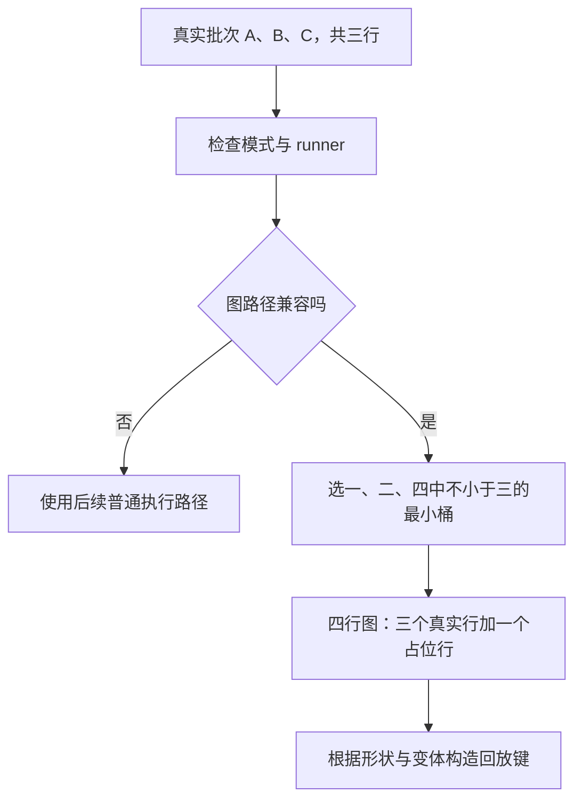

# 动态批次只有三个请求，为什么能复用四行的 CUDA Graph

源码版本：`0f6761b54facebb47f2068f87ecccd8f14da3a0e`。证据等级：静态源码核对。采用普通 CUDA 文本、自回归 decode，captured_req_width 为一；排除推测、DP、LoRA、PD 分离、TBO 和专用模型。桶集合与请求轨迹为教学示意，未捕获图、运行模型或测量性能。未跟踪的导读不作为证据。

上一组把 overlap 的值依赖、流依赖和对象生命周期连起来，今天让同一个运行时面对另一个矛盾：A 结束、C 加入，批大小不断变化，而重复执行的模型工作又值得复用。如果为每一种请求组合捕获一份图，组合数量很快失控；如果只按模型名挑一份旧图，又会忽略执行形状和功能差异。需要复用的是符合契约的执行形状，而不是某一组具体请求。

[PyTorch CUDA Graph 文档](https://docs.pytorch.org/docs/2.14/notes/cuda.html#cuda-graphs) 将 graph replay 建立在捕获时的执行与地址约束上，重复执行不能任意换成另一套动态操作。SGLang 在其上安排有限捕获桶。假定配置只捕获一、二、四行，现在 A、B、C 三个请求各 decode 一个 token，便可把实际三行映射到四行桶，多出一行作为 padding，而不需要为 A、B、C 的身份组合重新捕获。

[ModelRunner._forward_raw](https://github.com/sgl-project/sglang/blob/0f6761b54facebb47f2068f87ecccd8f14da3a0e/python/sglang/srt/model_executor/model_runner.py#L1849) 先判断 forward_mode 是否适合图路径、runner 是否存在，再调用 [can_run_graph](https://github.com/sgl-project/sglang/blob/0f6761b54facebb47f2068f87ecccd8f14da3a0e/python/sglang/srt/model_executor/runner/decode_cuda_graph_runner.py#L647)。所以“启用了 CUDA Graph”并不等于每轮都 replay；图是满足条件时的一条执行路径，其他工作仍可由后续普通执行路径承接。把参数开关当作所有请求都命中的证据，会把配置事实误读成运行事实。

普通本地批次首先受最大形状限制。有 padding 时，can_run_graph 比较当前批大小与 max_bs；[load_batch](https://github.com/sgl-project/sglang/blob/0f6761b54facebb47f2068f87ecccd8f14da3a0e/python/sglang/srt/model_executor/runner/decode_cuda_graph_runner.py#L1247) 再用 [_pad_to_bucket](https://github.com/sgl-project/sglang/blob/0f6761b54facebb47f2068f87ecccd8f14da3a0e/python/sglang/srt/model_executor/runner/base_cuda_graph_runner.py#L157) 选不小于实际大小的最小桶。三映射到四；若最大桶是四，五个请求必须在准入时被拒绝，不能越界查桶。辅助函数还有断言检查这一契约，避免把上游选择错误伪装成难懂的索引异常。

图是选择关系的教学示意，不是实测调度轨迹。padding 扩大的是执行形状，不增加 waiting_queue 中的真实请求，也不要求真实 Req 变成四个。下一篇再看占位行如何避免携带旧请求的地址。

形状以外仍有功能契约。can_run_graph 遇到 replace_embeds 会拒绝；对于有 spec_info 的路径，还检查实际每请求宽度是否与捕获宽度一致。编码器长度、分布式同步与 TBO 也有各自门槛，不能拿本文单 token 的“三请求等于三 token”推广到所有执行模式。关闭 padding 时，代码走 backend.can_run 检查精确 key，不能仍假定缺少三行图时四行桶一定可用。

最终键也不只是 batch_size。[_make_graph_key](https://github.com/sgl-project/sglang/blob/0f6761b54facebb47f2068f87ecccd8f14da3a0e/python/sglang/srt/model_executor/runner/decode_cuda_graph_runner.py#L554) 组合 size、stream_idx、variant_label 与 attention_variant；load_batch 根据实际上下文解析这些维度。本文关闭的功能会让若干项为空，但接口保留它们，防止不同流或不同实现分支误用同一捕获结果。固定桶解决形状复用，不能替代执行语义相容；can_run_graph 也只是整个准备契约的一层，而非证明任意后端变体一定正确。

另一个边界在 [_validate_capture_hidden_mode](https://github.com/sgl-project/sglang/blob/0f6761b54facebb47f2068f87ecccd8f14da3a0e/python/sglang/srt/model_executor/runner/decode_cuda_graph_runner.py#L1240)：运行时要求的隐藏状态模式超过捕获模式，会在加载时抛错。因此“人数落在范围内”甚至不足以保证后续加载成功。理解这一点有助于定位故障：形状拒绝、功能拒绝与捕获能力不足，是不同原因，不能统统归为图回放失效。

桶越密，padding 的额外工作可能越少，却增加捕获、预热、图存储与维护成本；桶越疏，更多实际大小共享同一形状，但可能多算占位行。这些是机制上的取舍，本文没有把它们换算成吞吐或延迟数字。待验证时在 can_run_graph、load_batch 与最终 execute 处记录实际模式、raw_bs、bs、capture_bs、captured_req_width 和回放 key。对三请求检查是否选四行桶，对超最大桶和动态 embedding 覆盖检查是否退出图路径；再对比精确形状模式。若同一 key 混入不兼容宽度，或越界批进入加载，就能推翻该准入解释。下一篇继续追稳定输入地址与每次变化的数据如何共存。
