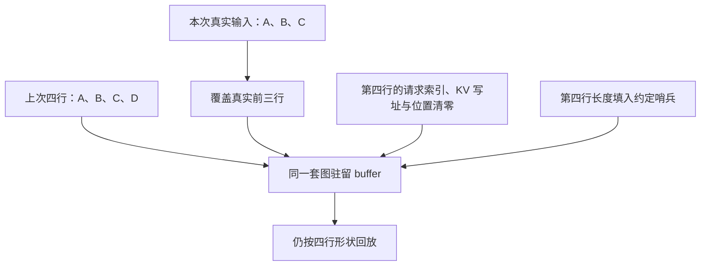

# 图输入地址保持不变以后，上一批的脏尾数据由谁清理

源码版本：`0f6761b54facebb47f2068f87ecccd8f14da3a0e`。证据等级：静态源码核对。沿用普通 CUDA 单 token decode、一二四行捕获桶，排除推测、DP、LoRA 和专用模型。表格数值与图为教学示意，未执行 graph replay 或压力测试。未跟踪导读不作为固定提交证据。

上一批有 A、B、C、D 四个请求，下一批只剩 A、B、C，仍选择四行图。如果每次为新输入重新分配整套 tensor，难以满足图的地址契约；如果保留地址而只覆盖前三行，第四行又可能保留 D 的请求行号与 KV 写入位置。D 可能已经结束，甚至其位置已被其他请求复用。地址稳定解决了复用入口，却把旧内容的处理变成每次回放都必须履行的责任。

[CudaGraphBufferRegistry](https://github.com/sgl-project/sglang/blob/0f6761b54facebb47f2068f87ecccd8f14da3a0e/python/sglang/srt/model_executor/cuda_graph_buffer_registry.py#L264) 把 ForwardBatch 的字段映射到图驻留 buffer，backend 私有工作区仍由 attention backend 管理。[build_decode_registry](https://github.com/sgl-project/sglang/blob/0f6761b54facebb47f2068f87ecccd8f14da3a0e/python/sglang/srt/model_executor/cuda_graph_buffer_registry.py#L509) 可以接纳已有 DecodeInputBuffers 的同名存储，避免仅为登记字段再制造第二份物理输入。这里稳定的是捕获和回放所使用的存储，当前请求的数据仍要每轮刷新；一个 buffer 对象长期存在，不意味着其中内容一直有效。

[fill_from](https://github.com/sgl-project/sglang/blob/0f6761b54facebb47f2068f87ecccd8f14da3a0e/python/sglang/srt/model_executor/cuda_graph_buffer_registry.py#L381) 把一次刷新分成三个阶段：先按字段规则处理 padding，再复制当前数据到真实前缀，最后执行需要变换的 post_fill。GraphSlot 还区分 bs 轴与 tokens 轴，虽然普通 decode 二者相等，其他执行模式却不一定。把所有字段按请求数切片，会在每请求含多个 token 时得到错误范围，不能因为今天例子是一就省略单位。

图是输入状态变化的教学示意，不表示所有字段都清零。D 的身份被清除，执行形状仍为四；清理占位行也不等于取消或释放真实 D 的资源，后者由请求生命周期路径负责。图中的两个动作必须分清，才能避免把输入表刷新当成资源回收。

[PaddingPolicy](https://github.com/sgl-project/sglang/blob/0f6761b54facebb47f2068f87ecccd8f14da3a0e/python/sglang/srt/model_executor/cuda_graph_buffer_registry.py#L70) 给出这种差别。decode registry 对 req_pool_indices、out_cache_loc 与 positions 使用 ZERO，对 seq_lens 和 CPU 镜像使用 FILL_SENTINEL，填入该后端约定的 seq_len_fill_value。若只把长度置零，却保留旧写址，某些准备或执行分支仍可能沿着 D 的历史访问；如果把所有长度也不加区分地清零，又可能违反后端需要的合法占位长度约定。

input_ids 则采用默认 FOREACH_COPY，只覆盖真实前缀，保留尾部。该注册路径的注释认为尾 token 不需要读取；这是一项字段消费契约，不能据此宣称“所有 padding 数据都不会读”。同一注册函数特意为 positions 清零，并说明某些准备路径会读取尾部位置。本文只核对注册策略，没有用运行证据证明每个 backend 的全部 kernel 都满足跳读条件。

[reset_padding](https://github.com/sgl-project/sglang/blob/0f6761b54facebb47f2068f87ecccd8f14da3a0e/python/sglang/srt/model_executor/cuda_graph_buffer_registry.py#L229) 只处理 raw_n 到 padded_n 之间的尾部，而非每次清空最大容量。这样保留有效输入，控制刷新成本。KEEP_PAD、FOREACH_COPY、FILL_ONCE 等策略会跳过逐轮尾部重置，适用前提分别依赖调用方与字段消费者；不能把“没有清零”直接认定为 bug，也不能因一次正确回放就证明后续收缩批次没有脏尾问题。

复制阶段还跳过本轮没有提供的 None 字段。这避免对不存在的数据强行复制，却意味着旧 buffer 内容可能仍留在内存。因此消费者还必须保留“本轮字段缺失”的语义。下一篇将看到回放视图在 seq_lens_cpu 缺失时传播 None，防止把未刷新的旧 CPU 镜像伪装成本轮有效数据。物理存储是否存在，与逻辑字段这轮是否有效，是两层契约。

按槽描述字段轴、dtype、padding 与 post_fill，让多条执行路径共享刷新逻辑，代价是新增字段必须同时审查生产者和消费者。只登记一块 tensor 却忽略轴或尾部规则，可能比显式代码更隐蔽。批大小连续四、三、二地变化时尤其适合暴露这种错误，而始终满桶的测试往往看不见它。

待验证时在 fill_from 前后记录 buffer 的 data_ptr、raw/padded 数量与尾部内容，故意在上一轮第四行留下明显不同的请求索引和写址，再缩到三行。预期地址保持，真实前缀更新，占位行按各自策略处理；不要要求 input_ids 等所有字段同时变零。再让 CPU 长度字段缺失，检查后端不会消费旧镜像。若某个尾部旧索引进入实际映射准备，或轴不一致使复制越过真实范围，就能推翻该镜像契约。所有这些仍是待执行验证，不能由静态图推出实际性能或无越界结论。
