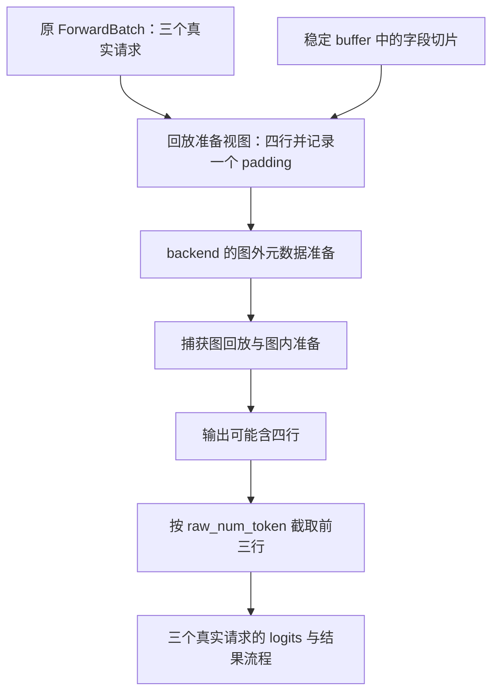

# 图按四行执行，怎样只把三个真实请求的结果交还调度器

源码版本：`0f6761b54facebb47f2068f87ecccd8f14da3a0e`。证据等级：静态源码核对。采用普通 CUDA 文本单 token decode，三请求补到四行桶；排除推测、pipeline parallel、DP 与专用模型。图为教学数据流，未执行 eager/graph 正确性对照或测量性能。未跟踪导读不作为证据。

现在 A、B、C 的输入已经写进稳定 buffer，第四行也按字段规则处理。仍不能把“成功运行四行图”当成请求完成：attention 准备要理解四行的执行形状，而调度器只拥有三个真实请求。如果直接把原 ForwardBatch 的 batch_size 改成四，后续输出可能把占位行当成真实请求；如果坚持所有准备都按三行，捕获的四行执行又可能拿到不完整元数据。

[build_replay_fb_view](https://github.com/sgl-project/sglang/blob/0f6761b54facebb47f2068f87ecccd8f14da3a0e/python/sglang/srt/model_executor/runner/decode_cuda_graph_runner.py#L153) 建立一份供 backend 准备使用的视图，合并原始批次语义与捕获 buffer 的形状。它的 batch_size 为 padded bs，req_pool_indices、seq_lens、positions 等来自稳定存储的相应切片；num_padding 则记录 bs 减 raw_bs。这样执行元数据可以按四行准备，而原始批次仍表达 A、B、C 三个真实请求，两个视角由显式数量关联起来。

图是语义投影的教学示意，不是实际运行追踪。向内扩张为捕获形状，向外恢复真实数量，二者共同防止占位行成为请求。它也没有声称 backend 所有字段都来自 padding buffer：例如 out_cache_loc 保留原始字段来源，具体使用依赖对应接口契约。

视图同时保留 forward_mode 与 actual_forward_mode：前者是捕获时模式，后者是本轮实际模式。本文两者都是 decode，但某些扩展路径会用 decode 图表达 idle 等工作，不能仅靠捕获模式判断本轮语义。[load_batch](https://github.com/sgl-project/sglang/blob/0f6761b54facebb47f2068f87ecccd8f14da3a0e/python/sglang/srt/model_executor/runner/decode_cuda_graph_runner.py#L1247) 的 metadata glue key 也区分这些分支，说明一次稳定的图调用并不自动抹平控制层的语义差异。

更微妙的是 CPU 长度镜像。若原 forward_batch.seq_lens_cpu 为 None，build_replay_fb_view 也传 None，而不是因为驻留 buffer 有一块 CPU tensor 就把它暴露出去。上一轮数值可能还在，但本轮没有刷新。缺失值必须继续缺失，否则后端的 None 判断失效，读取旧长度便可能生成错误的 page table；这正是上一章“存储存在不等于字段有效”的接口落实。

[attention backend 基类](https://github.com/sgl-project/sglang/blob/0f6761b54facebb47f2068f87ecccd8f14da3a0e/python/sglang/srt/layers/attention/base_attn_backend.py#L36) 把准备分成 eager 入口、图外 init_forward_metadata_out_graph、图内 init_forward_metadata_in_graph。decode runner 的 [capture_one_shape](https://github.com/sgl-project/sglang/blob/0f6761b54facebb47f2068f87ecccd8f14da3a0e/python/sglang/srt/model_executor/runner/decode_cuda_graph_runner.py#L1124) 在捕获执行体中调用图内准备，load_batch 则在每轮实际输入装入后做图外准备。哪些操作进入捕获、哪些参数随请求变化，需要 backend 和 runner 协作表达，不能简单把所有 Python 准备工作也当成已经录进图。

这一分层接上前一组共享读边界：把本轮共享表转换成 backend 可用的元数据，可以改变共享读结束的位置，但必须与实际消费者一致。昨天已经记录了缺图内事件时过早退到 PRE_REPLAY 的条件分支；今天不会因为元数据接口齐全就宣称该风险消失。接口形式提供审查位置，正确性仍需逐 backend 核对与实际运行观察。

回放之后，[execute](https://github.com/sgl-project/sglang/blob/0f6761b54facebb47f2068f87ecccd8f14da3a0e/python/sglang/srt/model_executor/runner/decode_cuda_graph_runner.py#L1433) 对普通 LogitsProcessorOutput 用 raw_num_token 截取 next_token_logits 和存在的 hidden_states，再通过 dataclasses.replace 保留其他扩展字段。本文每请求一 token，所以 raw_num_token 为三；不能把该等式推广到每请求多 token 的验证路径。占位行可能产生中间数值，但它不能增加真实请求数量、生成客户端响应或被当成第四个请求追加输出。

结果裁剪也不是深拷贝保证。张量切片仍可能引用图输出存储，异步消费必须继续遵守前一组讨论的流顺序、回拷和生命周期规则；不能只看返回一个新 dataclass 就认定数据已独立。正确的边界既要数量对，也要有效范围、字段来源、元数据与存储使用时间一起对。

待验证时在 build_replay_fb_view、图外准备、execute 返回和采样入口记录 raw_bs、bs、num_padding、原始及视图的模式、CPU 镜像有无与 logits 行数。三请求应准备四行视图，返回三行真实 logits，原请求集合不多出占位对象。交替启用和缺失 CPU 镜像，检查不会用旧值；再以同一输入比较 eager 与图路径的有效输出，数值容差与采样控制应单独记录。若第四行进入响应，或视图把缺失镜像变成旧 tensor，就能推翻该投影解释。有限图复用需要这些接口维护成本；是否值得仍要在真实负载下比较准备、执行与端到端时间。
