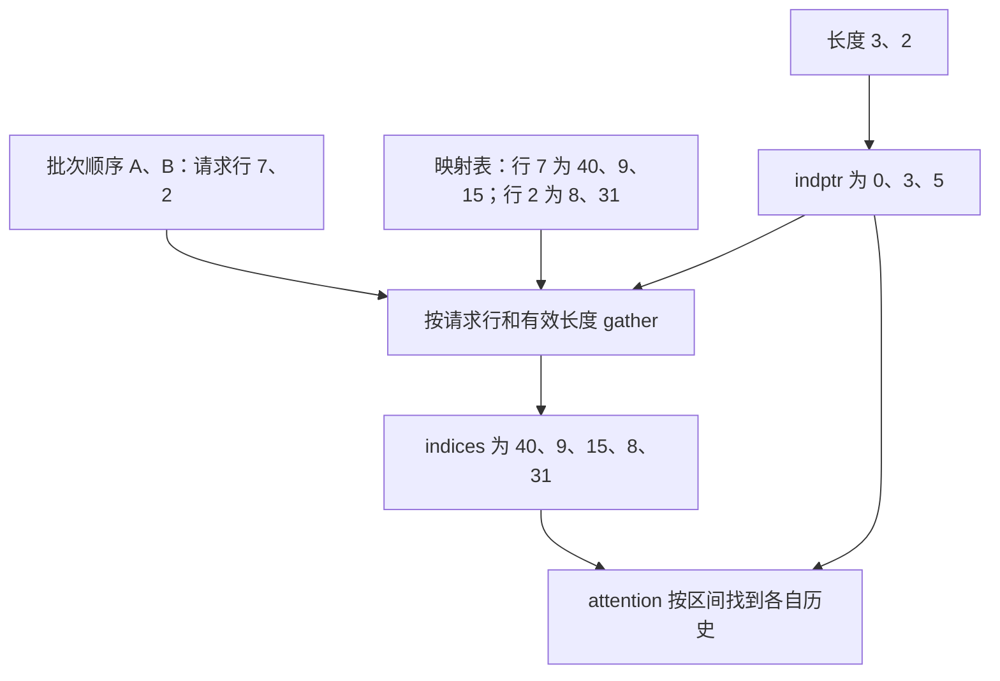

# 请求有了 KV 映射，attention 为什么还要重建一条索引流

源码版本：`0f6761b54facebb47f2068f87ecccd8f14da3a0e`。证据等级：静态源码核对。聚焦单设备普通文本 Triton attention 的 eager 元数据准备，先用静态、每 token 一个槽的 KV 池解释，再说明统一池的接口边界；排除 DCP、推测与滑窗。数值和图为教学示意，未运行 GPU 或测量性能。工作区另有未跟踪导读，不作为固定提交证据。

前一组解释了图回放如何取得执行视图，留下的问题是：attention 实际怎样知道该读哪些历史？让 A、B 本轮按这个顺序执行，请求池行分别为 7、2，历史长度为 3、2。假设映射表第 7 行保存槽号 40、9、15，第 2 行保存 8、31。请求行、逻辑位置、物理槽号已经足够表达归属，却不是每个 kernel 都愿意直接消费的布局。批内第零行不是池的第零行，A 的历史也不连续；把槽 40 当作连续三格的起点，会读取完全不同的上下文。

一种自然方案是为每请求展开到统一最大长度，再让 kernel 跳过填充。它把不齐整的数据变成矩形，却让短请求承担长请求的宽度，也仍然需要解释批内位置到请求行的对应。这里的设计把请求边界与槽号分开：[元数据结构](https://github.com/sgl-project/sglang/blob/0f6761b54facebb47f2068f87ecccd8f14da3a0e/python/sglang/srt/layers/attention/triton_backend.py#L113) 同时携带 kv_indptr 和 kv_indices，前者给出每请求在平坦索引流里的区间，后者保存实际访问 ID。它与之前讨论的 KV 分配不同：这里整理已有访问关系，不分配、搬动或回收 KV 内容。

[准备入口](https://github.com/sgl-project/sglang/blob/0f6761b54facebb47f2068f87ecccd8f14da3a0e/python/sglang/srt/layers/attention/triton_backend.py#L772) 在普通 decode 分支使用完整 seq_lens，[填充函数](https://github.com/sgl-project/sglang/blob/0f6761b54facebb47f2068f87ecccd8f14da3a0e/python/sglang/srt/layers/attention/triton_backend.py#L489) 将长度累加，得到 indptr=[0,3,5]，再让 translator 按 req_pool_indices 聚集各行。例子便成为 indices=[40,9,15,8,31]。A 消费 [0,3)，B 消费 [3,5)；这些区间连续，不要求区间里的槽号连续。要紧的不变量是区间长度等于该请求应读的 token 数，槽号顺序仍对应逻辑历史顺序。

图为教学映射示意，并非实际运行追踪。两条输出各有职责：仅有 indptr 不知道读哪里，仅有 indices 不知道在哪个请求结束。批次换序后必须一起重建；如果只交换 Q 的批行，仍沿用旧区间，即便没有越界，A 也会把 B 的上下文当成自己的历史。

[fill_packed_read_stream](https://github.com/sgl-project/sglang/blob/0f6761b54facebb47f2068f87ecccd8f14da3a0e/python/sglang/srt/mem_cache/kv_index_translator.py#L199) 把“按哪个行聚集”与“这些 ID 属于哪个空间”集中处理。静态池走 [索引聚集 kernel](https://github.com/sgl-project/sglang/blob/0f6761b54facebb47f2068f87ecccd8f14da3a0e/python/sglang/kernels/ops/kvcache/kv_indices.py#L22)，从 req_pool_indices 取池行，再从该行的有效位置复制 ID；默认 ENTRY_PAGE_SIZE=1，直接输出表中值。统一池则融合聚集与转换，使用当前 v2p 表生成 kernel 可索引的 ID。因而不能把所有 req_to_token 值都称为物理地址，也不能认为索引流永远只是原表的字节复制。

接口返回值说明是否完成转换，后续消费者必须按相应空间解释结果。在普通静态池中命名恰好重合，容易让错误假设隐藏起来；一旦支持池内移动，旧虚拟命名与当前位置便会分离。本文只核对 translator 的入口与两个分支，不推导压缩执行时序或所有统一池的正确性；那些需要继续审查映射更新和共享读依赖。

另一个容易混淆的量是索引 buffer 的容量。decode 若缺少主机 seq_lens_sum，入口可按 bs*max_context_len 预留空间，但真实区间仍由设备长度的累加和限定。多出来的容量没有自动变成有效历史，也不要求全被初始化。反过来，实际累加长度超出容量就违反契约，不能靠 kernel 的单请求 mask 修复整体越界。

这一步复制的是 ID，省去重新排列每层 K/V 的必要，仍需索引构造与间接寻址成本，也可能为缺失主机总长多预留空间。是否值得不能由 CSR 形态直接推出。待验证时在准备入口与填充后记录批内请求身份、req_pool_indices、seq_lens、kv_indptr 和有效前缀，再在 decode kernel 观察区间起点及 kv_loc。用 A、B 换序且物理槽不连续的输入，应看到区间随请求重排、每请求逻辑历史不变；若按 buffer 总容量读尾部，或换序后读错请求，就是反例。这仍是待执行方案。下一篇追问：prefill 有多个新 Q 时，索引流究竟该包含完整历史还是仅含旧前缀？
