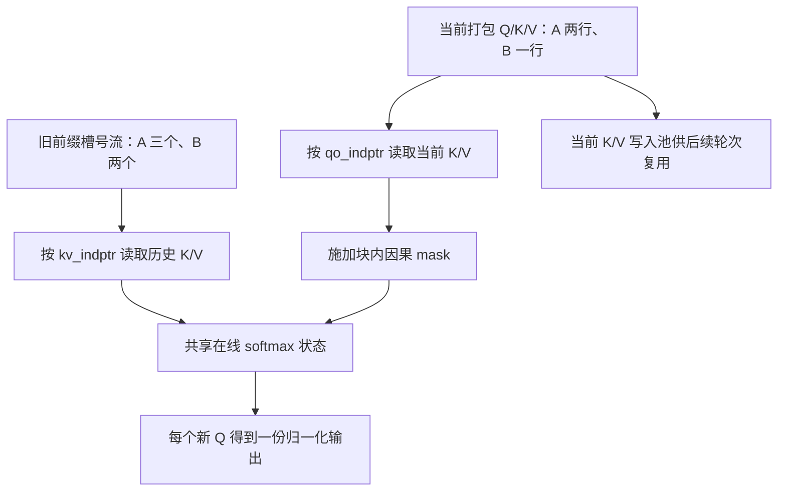

# 旧前缀与当前块分开读取，为什么仍然只做一次 softmax

源码版本：`0f6761b54facebb47f2068f87ecccd8f14da3a0e`。证据等级：静态源码核对。限定普通因果文本、单设备、非 deterministic 的 Triton extend 路径，排除 MLA one-shot、DCP、FP8、滑窗、自定义 mask 和推测验证。图与数字为教学示意，未运行 GPU 或测量性能。未跟踪导读不作为源码证据。

沿用 A、B，让 A 已有三个前缀 token，本轮新增两个；B 已有两个，本轮新增一个。新 Q 一共三行，历史却不能简单按 decode 的方式处理。若把所有 token 都变成新 Q，就会重算缓存前缀；若每个新 Q 只读旧前缀，A 的第二个新 token 又看不到第一个新 token。缓存复用和块内因果性必须在同一次 attention 中对齐。

[init_forward_metadata](https://github.com/sgl-project/sglang/blob/0f6761b54facebb47f2068f87ecccd8f14da3a0e/python/sglang/srt/layers/attention/triton_backend.py#L772) 的普通 extend 分支用 extend_prefix_lens 构造 KV 索引流，所以 kv_indptr=[0,3,5]；另用 extend_seq_lens 的累加生成 qo_indptr=[0,2,3]。前者划分旧前缀的槽号，后者划分当前打包 Q/K/V 的行。两套边界不能互换：A 的 KV 区间长三，当前 Q 区间长二，代表两个不同单位。总 seq_lens 为五、三也不能直接代替前缀长度。

[forward_extend](https://github.com/sgl-project/sglang/blob/0f6761b54facebb47f2068f87ecccd8f14da3a0e/python/sglang/srt/layers/attention/triton_backend.py#L1517) 在允许保存时先把当前 K/V 写入本层池，随后把当前连续 k/v 与历史 K/V buffer 一同传给 extend kernel。写入服务后续轮次，本轮普通路径对当前块仍直接读 K_Extend、V_Extend。这两次可见性不能被理解成当前 token 应参与两遍 attention；只要前缀流也包含了当前块，便会重复计权。

图为教学数据流，并非实际运行追踪。“共享”指同一个 Q 在两段扫描间保留累计状态，不是不同请求共享 softmax。A 的两个新 Q 分别对应绝对位置三、四：第一个读旧三项加自己，第二个读旧三项加当前两项。B 的 Q 只读 B 的历史和自身，打包排列不授予跨请求的可见性。

[底层 _fwd_kernel](https://github.com/sgl-project/sglang/blob/0f6761b54facebb47f2068f87ecccd8f14da3a0e/python/sglang/kernels/ops/attention/extend_attention.py#L327) 先由两组 indptr 找到前缀长度和新增长度，再扫描历史槽号；这部分普通因果前缀对所有当前 Q 都是过去。接着扫描当前连续 K/V，在当前块坐标中检查 q_index>=k_index。仅限制循环到 query tile 的结尾还不够：同一个 tile 内仍有早晚不同的 Q，需要逐元素三角 mask，不能让位置三偷看位置四。

两段之间不会清空 acc、deno、e_max。对于某个 Q，令已累计状态为最大分数 m、缩放后的指数和 l、缩放后的加权和 a；遇到新 tile 后取新最大值 m'，把旧 l、a 乘 exp(m-m')，再累加新 tile 的指数权重与加权 V。实际 kernel 还可选择 exp2 版本，缩放单位要一致。最后统一输出 a/l，因此前缀与当前块参与同一个分母。

如果先独立计算前缀 softmax 和当前块 softmax，再平均两个输出，就丢失两段的总权重。教学例子中，旧前缀分数全低、新块分数很高时，当前块应主导输出，平均却强制各占一半；即便两段 token 数相等也不成立。实现让在线状态跨两段延续，避免显式拼出完整得分矩阵，也不需要先把历史 K/V 物化成一条连续 tensor。

这里注释的 stage 1、stage 2 是同一个 extend kernel 内的两段扫描，与下一组 decode 的两个 kernel launch 不同。不同数据来源、量化比例和访问布局增加了分支与核对成本。deterministic 会路由到 unified 路径，MLA one-shot 又有专门入口，所以本文的“当前块直接读连续 K/V”不能无条件推广到全部 prefill。

待验证时在 metadata 初始化后核对 A、B 的两套 indptr，在 forward_extend 入口记录 q/k/v 行数、save_kv_cache 与实际分支。设备端观察 A 的两个 query 的 mask，以及前缀扫描结束后的 acc、deno、e_max 是否延续到当前段。对照显式因果 attention，若第一个新 Q 对未来新 K 敏感、当前 token 被计入两次，或把两段各归一化后仍被当作正确合并，都能推翻解释。观察方式应使用专门小输入与调试记录，普通 CPU 断点不能代表 GPU 执行时刻。下一篇把这套两段结构缩到滑窗，研究裁掉旧索引后哪些逻辑坐标仍需保留。
