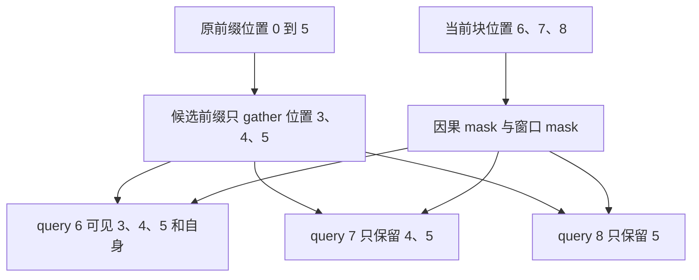

# 滑窗已经裁掉旧 KV，为什么每个 query 还要再做一次窗口 mask

源码版本：`0f6761b54facebb47f2068f87ecccd8f14da3a0e`。证据等级：静态源码核对。聚焦单设备普通因果 Triton extend，假定 backend 与该层使用相同正窗口参数 W；排除 DCP、deterministic、位置相关温度变换和推测树。图与坐标为教学示意，未执行设备实验。未跟踪导读不作为证据。

让 A 已有六个前缀位置 0..5，这次加入位置 6、7、8，窗口参数取 W=3。前一篇把旧前缀和当前块分别扫描；现在若先保留所有历史再逐元素屏蔽，计算入口仍要搬运大量必定不可见的旧索引。自然优化是仅收集最后三项前缀。但这三项只是整个当前块可能需要的候选集，不是每个新 query 都可见的最终集合：位置八应当比位置六丢弃更多旧项。

[update_sliding_window_buffer](https://github.com/sgl-project/sglang/blob/0f6761b54facebb47f2068f87ecccd8f14da3a0e/python/sglang/srt/layers/attention/triton_backend.py#L2478) 先计算 window_kv_lens=min(seq_lens,W)，再计算 window_kv_start_idx=seq_lens-window_kv_lens。普通 extend 传入的是前缀长度，所以例子中窗口前缀长三、起点三，聚集的是位置 3、4、5，而不是整条新序列最后三项。把 seq_lens 理解成“永远是包含新增部分的总长度”，在这个调用点就会选错历史。

函数对候选长度做累加，得到 window_kv_indptr，再把起点交给 [fill_packed_read_stream](https://github.com/sgl-project/sglang/blob/0f6761b54facebb47f2068f87ecccd8f14da3a0e/python/sglang/srt/mem_cache/kv_index_translator.py#L199)。聚集 kernel 从原请求行的 start+offset 读值，输出流却从自身区间起点紧密排列。物理槽号可以离散，裁剪按逻辑位置进行，不能按槽号大小比较远近。窗口前缀还是旧 KV 的引用，没有在此删除对应完整缓存，更不能由“没进入窗口索引”推出资源已被释放。

图为教学可见性示意，并非实际运行追踪。Q7 还读取当前位置 6、7，Q8 读取 6、7、8。对这条 extend 分支，代码窗口不等式为 q<=k+W，加上因果条件，因此 W 表示最多向前的距离，连自身共可见 W+1 项。不要把教学中的 W=3 自动翻译成总共三项，也不要仅从“窗口大小”这个名字推断边界是否包含自身。

[forward_extend](https://github.com/sgl-project/sglang/blob/0f6761b54facebb47f2068f87ecccd8f14da3a0e/python/sglang/srt/layers/attention/triton_backend.py#L1517) 为滑窗层选择 window_kv_indptr、window_kv_indices，并传入 window_kv_offsets；完整 attention 层仍选完整流。同一批次的请求身份不变，消费哪一份索引由层语义决定。[extend kernel](https://github.com/sgl-project/sglang/blob/0f6761b54facebb47f2068f87ecccd8f14da3a0e/python/sglang/kernels/ops/attention/extend_attention.py#L327) 在前缀段使用压缩后的 prefix_len+query_local 与 prefix_key_local 比较，在当前段使用 query_local 与 key_local 比较。这不是把位置六当成了原始位置三：前缀与 Q 同时减去了被裁掉的起点，纯相对距离不等式保持不变。

但不是所有消费者都只关心距离。custom mask 仍可能按完整前缀与当前块的布局存储，kernel 在启用相应分支时读 window_kv_offset，用它修正原 mask 的行宽与列偏移；若照压缩后长度直接索引原 mask，得到的是另一行另一列的合法布尔值，未必越界，却会改变可见性。本文没有验证推测树，只用这一接口说明“压缩存储坐标”不能自动取代全部逻辑坐标。

池的命名空间也要分清。统一池的 translator 可直接从虚拟 ID 产生滑窗子池 ID，返回已转换；静态 SWA 池在未转换时还要走 full-to-swa 映射。再次转换已经属于子池的 ID，会把合法数字解释成错误空间。候选裁剪、逐 Q 可见性、物理 ID 转换是三个独立步骤，某一步正确不能替另外两步背书。

这条方案减少必定无用的旧前缀索引和访问，代价是额外元数据、每 Q mask 和多空间契约。decode 调用同一准备函数时传入完整 seq_lens 并直接取尾部，其候选计数与本文 extend 的 W+1 推导不能简单等同；跨模式一致性需结合模型配置与各分支独立验证。本文不以静态公式声称所有后端窗口语义一致。

待验证时在滑窗准备和 forward_extend 处记录原前缀长度、window_kv_lens、start_idx、层窗口参数与 ID 空间。用同一块的三个 Q 检查窗口左边界逐行右移；特意让物理槽号不单调，结果仍应只受逻辑距离影响。若后两个 Q 保留了全部候选前缀，或已转换子池 ID 又经 full-to-swa，就能推翻解释。自定义 mask 需另构造非对称矩阵核对 offset，而不是用全一 mask 掩盖错位。以上均为待执行检查；下一组进入 decode，研究正确索引流怎样被多个计算单元共同消费。
