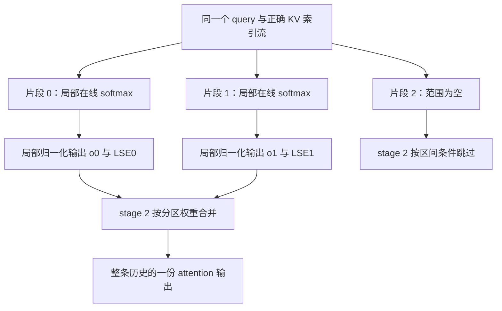

# 一个 decode query 被拆给多个 kernel program，softmax 怎样重新合成

源码版本：`0f6761b54facebb47f2068f87ecccd8f14da3a0e`。证据等级：静态源码核对。承接前一组的 KV 索引流，限定普通单设备、无滑窗的 Triton 标准 decode，先用 MHA、无量化、无 sink、无 score_mod 的情况解释。公式与图为教学示意，未运行 GPU 或测量性能。未跟踪导读不作为提交证据。

让请求 A 进入单 token decode，当前 query 要读很长的历史。索引流已经正确，不代表计算单元就容易忙起来：若每个请求每个头只启动一个 program，它得独自扫完全部历史；批次很小时，能够同时独立计算的 query 数量有限。自然办法是沿 KV 长度拆成多个片段，但 softmax 的分母覆盖整条历史，不能把几个片段的输出直接相加。

[forward_decode](https://github.com/sgl-project/sglang/blob/0f6761b54facebb47f2068f87ecccd8f14da3a0e/python/sglang/srt/layers/attention/triton_backend.py#L2102) 把新 K/V 写入池后，将 q、池 buffer、kv_indptr、kv_indices 和分片工作区交给 [decode_attention_fwd](https://github.com/sgl-project/sglang/blob/0f6761b54facebb47f2068f87ecccd8f14da3a0e/python/sglang/kernels/ops/attention/decode_attention.py#L1156)。普通 MHA 由 [_decode_att_m_fwd](https://github.com/sgl-project/sglang/blob/0f6761b54facebb47f2068f87ecccd8f14da3a0e/python/sglang/kernels/ops/attention/decode_attention.py#L413) 启动三维 grid：batch、query head、最大分片数。这里的切分轴是同一个请求的逻辑 KV 区间，不是按物理槽地址连续切开；每段仍通过索引流取实际 kv_loc。

[_fwd_kernel_stage1](https://github.com/sgl-project/sglang/blob/0f6761b54facebb47f2068f87ecccd8f14da3a0e/python/sglang/kernels/ops/attention/decode_attention.py#L226) 由 indptr 差得到长度 L，从 num_kv_splits 读取 S，再以 ceil(ceil(L/S)/32)*32 算每片跨度。例子只为说明边界：L=100、S=3 时跨度为 64，实际两段为 [0,64)、[64,100)，第三段为空。选择了三个 split 不等于一定产生三份有效部分和；按 32 对齐可以留下空尾，stage 2 必须使用相同分片几何。

图为教学分片关系，并非实际运行追踪。不同 program 处理相互不重叠的逻辑范围；某个片段空闲不等于可以读其工作区残留值。合法范围和部分状态两者都属于归并协议。

每个有效片段内部保留最大分数 m、缩放指数和 l、缩放加权 V 和 a，在线更新避免直接对大分数指数化。它最终写入 attn_logits 的是 o=a/l，另写 attn_lse=m+log(l)。所以 attn_logits 这个名称在此不能按“每 token 原始 logits”理解，它的维度是 batch、head、split、value_dim，保存的是部分输出；LSE 才保存这份输出在全局归一化中的质量。

设片段 j 的 LSE 为 z_j，完整输出为 sum(exp(z_j)*o_j)/sum(exp(z_j))。[_fwd_kernel_stage2](https://github.com/sgl-project/sglang/blob/0f6761b54facebb47f2068f87ecccd8f14da3a0e/python/sglang/kernels/ops/attention/decode_attention.py#L904) 不直接指数化所有 z，而是再次维护最大值、指数和及加权输出，每来一个有效片段就重缩放旧状态。这等价于按分区配分函数的权重合并，避免大 z 溢出。该 kernel 只在 split_end>split_start 时读取工作区，因此无需把空段的未初始化内容当作零贡献。

一个可手算的反例是两个片段只有一个有效分数，分别为 0 和 log(9)，对应标量 V 为 0、10。各段输出为 0、10，但正确整体输出是 9；直接平均得到 5，直接相加得到 10。即便两个局部输出都已经归一化，仍需 LSE 才能恢复整条历史的权重。这里是数学教学例子，不是某次模型采样或 GPU 结果。

接口的另一个不变量是 producer 和 reducer 使用同一组 S、L 及最小块跨度。若 stage 1 以三个 split 生产，stage 2 却用另一个 S 重算区间，可能把未写尾部当有效，或者漏掉真正部分和，地址检查未必能发现。启用 sink 时该实现还在最终分母加一项，不能在每个局部片段都重复加入；本文无 sink 的公式也不能直接替代全部扩展语义。

分片增加并行性，同时增加 fp32 部分输出工作区、写回和第二次归并。短历史或已足够宽的批次可能无法抵消这些代价，源码不能证明端到端收益。待验证时在 decode launcher 记录 L、S、max_kv_splits 和工作区形状，在两个 kernel 中核对实际非空区间、o_j、z_j 与最终输出。先用明确不同的片段分数，对照显式 attention，再试空尾和不连续槽号。若结果等于局部平均、读取空尾，或双方区间不一致，就能推翻解释。下一篇研究另一个并行轴：多个 Q 头共享 K/V 时，如何复用数据而不混合各头的概率。
