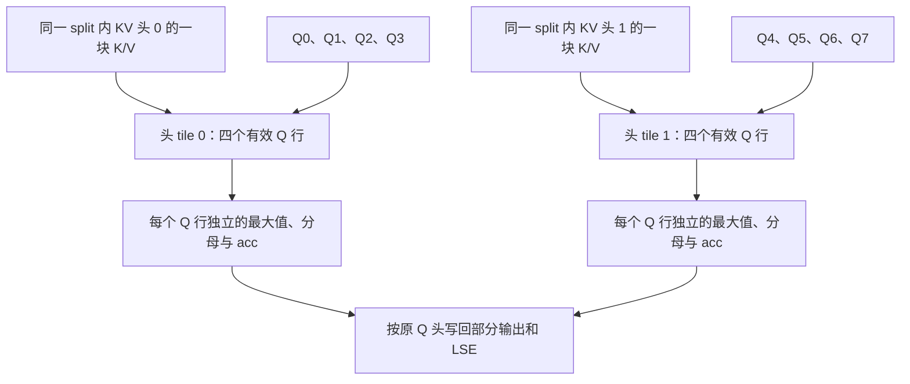

# GQA 的多个 Q 头共享 K/V，为什么不能共享 softmax 状态

源码版本：`0f6761b54facebb47f2068f87ecccd8f14da3a0e`。证据等级：静态源码核对。沿用普通单设备标准 Triton decode，使用 GQA、无量化、无 sink 与 score_mod；排除 MLA、Lean、DCP。数字、矩阵与图为教学示意，未测 GPU 带宽、occupancy 或性能。未跟踪导读不作为证据。

上一篇把 A 的长历史沿 KV 切开，每段都需要读 K/V。现在让本设备有八个 Q 头、两个 KV 头，每四个 Q 头共享一组 K/V。如果仍为每个 Q 头独立发一个 program，相同 KV 数据会被多条计算路径请求。缓存也许缓解一部分，但执行结构没有显式表达复用。另一方面，共享 K/V 不意味着四个 query 相同：每头 Q 的分数和概率各有一份，不能把它们合成一个平均 query。

[decode_attention_fwd](https://github.com/sgl-project/sglang/blob/0f6761b54facebb47f2068f87ecccd8f14da3a0e/python/sglang/kernels/ops/attention/decode_attention.py#L1156) 从 v_buffer 的头维取得本地 KV 头数，以 Q 头数除之得到 kv_group_num。等于一走普通路径，大于一走 grouped 路径。本例 ratio=4，Q0..Q3 归 KV0，Q4..Q7 归 KV1；这些是执行设备当前可见的本地维度，不应拿模型全局头数覆盖 TP 后的实际 tensor 形状。

[_grouped_head_tiles](https://github.com/sgl-project/sglang/blob/0f6761b54facebb47f2068f87ecccd8f14da3a0e/python/sglang/kernels/ops/attention/decode_attention.py#L114) 用 min(16,ratio) 计算每个头 tile 的有效宽度。于是八个 Q 头对应两个有效 tile，而不是八个 program 的头轴。[_decode_grouped_att_m_fwd](https://github.com/sgl-project/sglang/blob/0f6761b54facebb47f2068f87ecccd8f14da3a0e/python/sglang/kernels/ops/attention/decode_attention.py#L768) 启动 batch、head_tiles、split 三维 grid，并把 Q/K/V 和部分结果的 stride 传给 kernel。沿 KV 的拆分仍在，头分组只是另一个轴上的组织方式；不能把“两个 KV 头”误读成整次 attention 只有两个 program。

图为教学共享关系，并非实际访存追踪。共享的是同一个 program 内被多个 Q 行利用的 K/V tile，图没有承诺每字节只从显存读取一次，也没有把不同 split 或不同 program 的缓存行为算成已验证复用。

[_fwd_grouped_kernel_stage1](https://github.com/sgl-project/sglang/blob/0f6761b54facebb47f2068f87ecccd8f14da3a0e/python/sglang/kernels/ops/attention/decode_attention.py#L510) 将 cur_head_id 映射到当前 KV 头，再生成一组 Q 行。BLOCK_H 为 16，而 ratio=4 时只有四行有效；mask_h 防止填充行写入不存在的 Q 头。若 ratio 比 16 大，一组 KV 头又可拆成多个头 tile。分组边界与填充宽度不同，不能把相邻所有 16 行无条件归到同一 KV 头，更不能把填充行计入真实头数。

在每个 KV tile 中，Q 是“头行×维度”，K 是“维度×历史位置”，一次矩阵乘生成“头行×历史位置”的分数。V 则按历史位置参与下一次乘法。关键状态 e_max、e_sum 是按头行保存的向量，acc 是“头行×value_dim”矩阵。tl.max、tl.sum 沿历史位置做归约，保留头行，这让四个 Q 头共享输入块，同时分别进行 softmax。若沿头轴求一个最大值和分母，就会把四个不同的概率分布混在一起。

想象 Q0 与某个 K 极相似，而 Q1 更接近另一项，两个头应该产生不同输出。把共享 K/V 错当成共享概率，会让改变 Q0 同时扰动 Q1，即使 Q1 自身输入没变。实现写回时仍使用真实 cur_head 计算 attn_logits 和 attn_lse 的位置，之后 stage 2 每个 Q 头分别合并 split；分组只改变计算组织，不改变结果按 Q 头归属的协议。

这种组织把独立向量计算变成多行矩阵计算，也增加寄存器状态、tile 填充与硬件形状约束。ratio 小时 16 行中有不少无效行，ratio 大时又需要更多头 tile；因此 GQA 减少 KV 头数不等于吞吐按 ratio 线性提高。真正收益还受 batch、历史长度、head_dim、split 数与内存系统影响，本文不引用源码注释里的硬件测量数字作为当前结果。

待验证时在入口记录 Q.shape、KV buffer 头维、ratio 和 grid，在 grouped kernel 记录 cur_head_id、cur_kv_head、cur_head 与 mask_h。用八 Q 两 KV 的小输入，对照逐头 attention，并只改变 Q0：Q1 的输出应保持对应输入下的数值稳定。再构造 ratio 超过 16 的有效配置，核对同一 KV 组的多个 tile 不跨组。若填充行写坏输出、不同 KV 组混读，或一个 Q 的改动改变另一头的归一化，就是反例。验证性能需另测访存与 kernel 时间。下一篇回到同一 A，研究请求的批次伙伴为什么可能改变它自己的归约数值路径。
