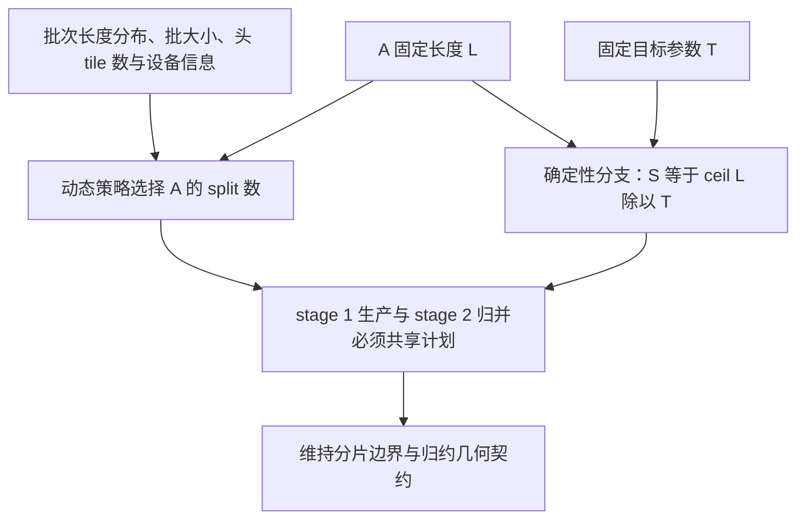

# A 的输入没有变，换一批同伴为什么仍可能改变 attention 的末位数值

源码版本：`0f6761b54facebb47f2068f87ecccd8f14da3a0e`。证据等级：静态源码核对。讨论标准 Triton decode 的分片计划，再核对一条 MLA 专用调优如何保留确定性约束；不推导所有模型的确定性。图与数字为教学示意，未运行模型、做逐位对照或性能测量。未跟踪导读不作为证据。

让 A 的 Q、历史 K/V、逻辑长度都固定，先单独执行，再与很短的 B、很长的 C 组成动态批次。前两篇的数学公式保证每次都表达同一份 attention，却不保证浮点加法按照同一棵树进行。若为填满设备而改变 A 的 split 数，每段内部累加顺序和最终合并顺序都会变化；实数代数相等不能推出有限精度结果逐位一致，更不能直接推出采样输出总相同。

[get_num_kv_splits](https://github.com/sgl-project/sglang/blob/0f6761b54facebb47f2068f87ecccd8f14da3a0e/python/sglang/srt/layers/attention/triton_backend.py#L407) 的普通动态分支调用 [GPU 计划 kernel](https://github.com/sgl-project/sglang/blob/0f6761b54facebb47f2068f87ecccd8f14da3a0e/python/sglang/kernels/ops/attention/metadata.py#L12)。后者观察整批最大、最小长度，并结合设备核心数与 batch×头 tile 并行度推算分片。GQA 的头 tile 数也进入估算，接上上一篇的组织方式。因此 A 不只受自身长度影响，批次伙伴改变时，它分到的 S 可能变化。算法注释也把它视为待调优策略，不能把启发式选择说成全局最优。

最直接的办法是固定所有请求同一个 split 数，但短请求会产生大量空段，长请求也失去按长度适配的自由。该提交启用 enable_deterministic_inference 后，在 [backend 初始化](https://github.com/sgl-project/sglang/blob/0f6761b54facebb47f2068f87ecccd8f14da3a0e/python/sglang/srt/layers/attention/triton_backend.py#L151) 取固定目标 tile 参数，默认 256，并把最大分片工作区容量按上下文上限预留；get_num_kv_splits 再按每请求长度计算 ceil(L/T)。这样固定 L 与 T 就固定 S，批次同伴不再参与这一决定。目标从设备利用率偏向请求自身数值路径的稳定性。

图为教学决策关系，并非实际运行追踪。两种策略是配置分支，不是同一轮同时选两份 S；图也没有声称确定性分支能约束模型中所有其他算子。

这里“固定 tile”还需仔细读到消费者。标准 kernel 并不直接把 T 当片段宽度，而是用 S 再计算 ceil(ceil(L/S)/32)*32。教学例子 L=600、T=256，得到 S=3，实际跨度却是 224，而不是三个固定 256 段。稳定性来自相同 L 导出相同 S 和同一边界公式，不是“每片恰好 T 个 token”。若只看配置名写出固定 256 分片，就会在断点中得到看似矛盾的结果。

还要防止更深的调优覆盖这一决定。[MLA 的 _keep_scheduler_splits](https://github.com/sgl-project/sglang/blob/0f6761b54facebb47f2068f87ecccd8f14da3a0e/python/sglang/kernels/ops/attention/decode_attention.py#L89) 检查确定性、显式 tile 或静态 split 配置；[_mla_launch_plan](https://github.com/sgl-project/sglang/blob/0f6761b54facebb47f2068f87ecccd8f14da3a0e/python/sglang/kernels/ops/attention/decode_attention.py#L172) 在需要保留时仍可选择调优几何，却将强制批次级 split 数设为零，表达继续读取每请求计划。[_decode_grouped_att_m_fwd](https://github.com/sgl-project/sglang/blob/0f6761b54facebb47f2068f87ecccd8f14da3a0e/python/sglang/kernels/ops/attention/decode_attention.py#L768) 又在没有强制 split 时选择 batch-free 的几何桶，避免请求的累加组织重新依赖批大小。只固定 S，却仍按 batch 改 num_warps，同样不足以约束这条数值路径。

[decode_attention_fwd_grouped](https://github.com/sgl-project/sglang/blob/0f6761b54facebb47f2068f87ecccd8f14da3a0e/python/sglang/kernels/ops/attention/decode_attention.py#L1096) 一次生成调优决策，再把同一个 forced_kv_splits 同时传给 stage 1 和 stage 2。强制值为零不是零份工作，而是两端沿用 num_kv_splits。[_fwd_kernel_stage2](https://github.com/sgl-project/sglang/blob/0f6761b54facebb47f2068f87ecccd8f14da3a0e/python/sglang/kernels/ops/attention/decode_attention.py#L904) 还保留编译期循环边界；该处注释指出把边界改为动态会重排 fp32 归约。接口一致既避免漏读未写部分，也关乎末位结果，不能只验证最后输出 tensor 的形状。

[forward_decode](https://github.com/sgl-project/sglang/blob/0f6761b54facebb47f2068f87ecccd8f14da3a0e/python/sglang/srt/layers/attention/triton_backend.py#L2102) 在确定性配置下还关闭 Lean 分支。这说明可替换 kernel 会改变工作分配与合并方式，约束必须跨过多层选择器，不能只在最高层放一个布尔开关。本文没有运行不同设备、编译器或模型的全路径逐位验证，因此只说明固定提交中的防护意图及具体机制，不保证跨硬件复现，也不把潜在 ULP 差异写成已经观察到的故障。

待验证时用同一 A 的固定 Q/K/V，分别单独执行和加入不同长度伙伴，先关闭采样随机性干扰，在计划入口记录 L、S、实际跨度、forced 值与 launch 几何，再比较 attention 输出。动态分支可以改变 S，确定性分支应保持 A 自身计划及相应几何；若同伴仍改变该路径，便推翻批次无关解释。数值相同一次也不是普遍证明，应覆盖长度临界点和 MLA 调优门控。代价是可能放弃部分随负载调优的并行度、增加工作区或空尾；正确性、稳定性和速度需分别检验，最终收益仍等待真实测量。
