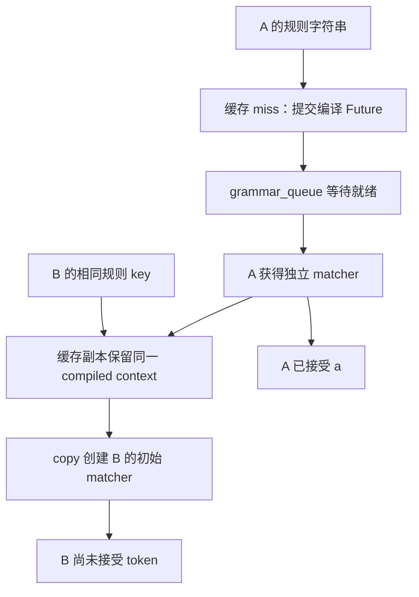

# 两个请求使用同一条语法，为什么只能共享编译结果，不能共享匹配进度

源码版本：`0f6761b54facebb47f2068f87ecccd8f14da3a0e`。证据等级：静态源码核对。聚焦单设备普通文本生成、XGrammar backend 与非 reasoning 请求；排除推测、jump-forward、分布式同步和客户端协议转换。机制图和 token 序列为教学示意，未运行编译器、模型或测量延迟。工作区另有未跟踪导读，不作为固定提交证据。

前一组研究了 attention 数值如何产生。现在让 A 要求输出属于语言 {ab,ac}，B 稍后使用同一条 regex，C 不带约束。为看清状态关系，教学例子假设相关 token 分别对应字符 a、b、c；真实系统按当前 tokenizer 的 token ID 工作，不能据此推断所有词表都是逐字符切分。A 已生成 a 时，B 可能尚未开始。相同规则并不意味着两者下一步可选集合相同。

朴素办法是在请求进入调度器时同步编译 regex，再让后续请求复用同一个对象。前半段可能阻塞调度循环，连 C 也要等待；后半段若对象还含生成进度，A 接受 a 后，B 的初始状态就被污染。设计需要把昂贵的规则准备与逐请求可变状态分开，同时让尚未准备好的请求暂时离开正常推理队列。

[process_req_with_grammar](https://github.com/sgl-project/sglang/blob/0f6761b54facebb47f2068f87ecccd8f14da3a0e/python/sglang/srt/constrained/grammar_manager.py#L145) 把约束类型与原始字符串组成 key，向 backend 请求缓存值或 future。缓存未命中时，req.grammar 暂存 Future，req.grammar_key 保存 key，请求进入 grammar_queue。[请求接收路径](https://github.com/sgl-project/sglang/blob/0f6761b54facebb47f2068f87ecccd8f14da3a0e/python/sglang/srt/managers/scheduler.py#L2776) 只在没有进入该队列时调用正常入队。这个“语法未就绪”阶段与普通 waiting_queue 的资源等待不同：即便 GPU 还有空位，也不能让一个 Future 冒充可生成词表 mask 的 grammar 对象。

[get_cached_or_future_value](https://github.com/sgl-project/sglang/blob/0f6761b54facebb47f2068f87ecccd8f14da3a0e/python/sglang/srt/constrained/base_grammar_backend.py#L283) 命中时调用 value.copy()，未命中则由线程池提交编译分派。key 使用字符串，因此本层不能保证语义等价但文本不同的规则命中同一个条目；同样，本层没有把编译中的 future 存进 cache。两个相近时刻的相同 miss 可以各自提交，不能只看到线程池与缓存就宣称它实现了同键编译去重。底层编译器是否另有缓存，不属于本文核对范围。

图为教学对象关系，并非实际运行追踪；它假定 B 在缓存写入之后到达。若 B 与 A 同时 miss，不应沿图中的命中箭头理解。两个 matcher 的 compiled context 可以相同，接受历史必须独立。

[XGrammar 的 dispatch_regex](https://github.com/sgl-project/sglang/blob/0f6761b54facebb47f2068f87ecccd8f14da3a0e/python/sglang/srt/constrained/xgrammar_backend.py#L372) 编译后通过 [_from_context](https://github.com/sgl-project/sglang/blob/0f6761b54facebb47f2068f87ecccd8f14da3a0e/python/sglang/srt/constrained/xgrammar_backend.py#L323) 创建 matcher；[copy](https://github.com/sgl-project/sglang/blob/0f6761b54facebb47f2068f87ecccd8f14da3a0e/python/sglang/srt/constrained/xgrammar_backend.py#L148) 则用已有 ctx 再构造一个新的 GrammarMatcher，并返回新的 XGrammarGrammar，accepted_tokens 初始为空。这里 copy 不是把 A 当前解析栈复制给 B，而是复用规则、重建初始进度。这条具体实现才支持状态隔离的结论；基类 copy 默认返回自身，不能把 XGrammar 的保证推广到所有 backend。

[get_ready_grammar_requests](https://github.com/sgl-project/sglang/blob/0f6761b54facebb47f2068f87ecccd8f14da3a0e/python/sglang/srt/constrained/grammar_manager.py#L203) 在有限轮询窗口内检查 Future.done，再取 result，把 grammar.copy() 写入缓存，并移出 grammar_queue；[prefill 规划入口](https://github.com/sgl-project/sglang/blob/0f6761b54facebb47f2068f87ecccd8f14da3a0e/python/sglang/srt/managers/scheduler.py#L3843) 才把返回请求交给正常入队路径。结果已完成仍可能是 InvalidGrammarObject，异常也会被转换成无效对象并标记 abort。缓存还会保留编译失败或超时结果，所以命中只代表已有准备结论，不代表规则有效。

超时计数按轮询轮数增长，并非独立墙钟定时器。调度轮次还受 forward 等工作影响，不能把某个次数直接写成精确毫秒保证；cancel Future 也不能仅凭调用存在断言后台工作已经停止。本文只追队列与可见结果，不证明线程调度或编译器内部的中止行为。

这种分离把编译等待移出普通推理准入，付出线程池、缓存、轮询与错误状态管理成本；缓存命中仍要创建请求自己的 matcher。待验证时在请求处理、缓存查询、就绪回收与 XGrammar.copy 设断点，记录 key、cache_hit、Future.done、队列归属、ctx 与 matcher 身份。先让 A 生成 a，再用同键启动 B，应看到 ctx 可共享、matcher 不同，B 的 accepted_tokens 仍为空；若 B 继承 A 的进度或 Future 被交给正常 mask 路径，就是反例。并发 miss 另记提交次数，避免把希望的去重当作事实。下一篇追问：各自状态正确以后，怎样在动态批次中生成对应到正确 logits 行的 mask？
