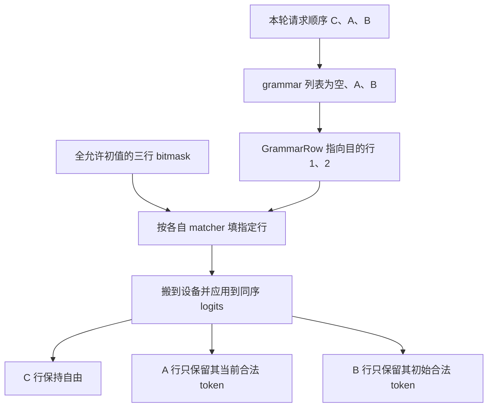

# 同一批既有受限请求又有自由请求，词表 mask 怎样不串行

源码版本：`0f6761b54facebb47f2068f87ecccd8f14da3a0e`。证据等级：静态源码核对。沿用单设备 XGrammar、普通非推测文本生成；排除 reasoning、beam、jump-forward、自定义 logit processor、非有限 bias 与异常空支持集合。字符 token 仅为教学简化，真实约束基于 tokenizer 词表。图为教学示意，未执行设备 mask 或采样实验。未跟踪导读不作为提交证据。

让 A 已接受 a，B 使用同一规则但仍在起点，C 自由生成。本轮批次顺序恰为 C、A、B：三行 logits 都长得像词表分数，却各有不同合法集合。A 的行只能继续 b 或 c，B 的行需先生成 a，C 则保持自由。若把“找到的第一个 grammar”生成的 mask 复制给全批，三个请求会被同一种状态约束；如果只对 constrained 请求紧凑打包，又容易把 mask 第零行应用到自由请求 C。

[ForwardBatch.init_new](https://github.com/sgl-project/sglang/blob/0f6761b54facebb47f2068f87ecccd8f14da3a0e/python/sglang/srt/model_executor/forward_batch_info.py#L847) 以当前 batch.reqs 顺序建立 sampling_info.grammars，例子得到 [None, grammar_A, grammar_B]。这份列表与本轮输出行序对应，不能沿用上轮池行号或旧批内位置。[update_regex_vocab_mask](https://github.com/sgl-project/sglang/blob/0f6761b54facebb47f2068f87ecccd8f14da3a0e/python/sglang/srt/sampling/sampling_batch_info.py#L290) 的名字虽含 regex，实际消费的是 grammar 接口，分配的行数按当前 temperatures 的长度决定，再构造含明确 row 编号的 GrammarRow 条目。只为 A、B 填充，但目的行仍是一、二，不会自动压缩成零、一。

图为教学行映射，并非实际运行追踪。mask 行表达本轮位置，matcher 表达请求自身状态；两者通过 row 配对，不要求请求池中的行号相邻，也不要求 A、B 虽使用同规则就处于同状态。

[BaseGrammarObject.fill_vocab_mask_batched](https://github.com/sgl-project/sglang/blob/0f6761b54facebb47f2068f87ecccd8f14da3a0e/python/sglang/srt/constrained/base_grammar_backend.py#L88) 的默认实现逐条调用各 entry.grammar 的填充方法，而不是让 first_grammar 替所有人决定可见集合。[GrammarMask](https://github.com/sgl-project/sglang/blob/0f6761b54facebb47f2068f87ecccd8f14da3a0e/python/sglang/srt/constrained/base_grammar_backend.py#L148) 保存的 first grammar 只是应用 backend 操作的句柄；本篇假定同一服务使用兼容的 XGrammar mask 格式。它不是全批唯一的可变解析状态，也不能据此允许混入任意不兼容 backend。

[XGrammar mask 分配](https://github.com/sgl-project/sglang/blob/0f6761b54facebb47f2068f87ecccd8f14da3a0e/python/sglang/srt/constrained/xgrammar_backend.py#L65) 将 packed 整数置为 -1，即所有位为一；随后只有未 finished、未 terminated 的 grammar 行进入填充列表。没有约束的行不被写，因而保持全允许。这个初值是正确性契约：若把“省事初始化”改成全零，自由请求会被全禁；若复用旧 buffer 却没有恢复初值，C 也可能继承上轮 A 的限制。当前普通路径每次分配新 mask，本文不将它描述成复用缓存。

[XGrammar.fill_vocab_mask](https://github.com/sgl-project/sglang/blob/0f6761b54facebb47f2068f87ecccd8f14da3a0e/python/sglang/srt/constrained/xgrammar_backend.py#L122) 调用 matcher.fill_next_token_bitmask，按真实 token ID 写支持集合；[应用 kernel](https://github.com/sgl-project/sglang/blob/0f6761b54facebb47f2068f87ecccd8f14da3a0e/python/sglang/kernels/ops/grammar/bitmask_ops.py#L14) 解开每个 32 位字，位为零时把对应 logit 改为负无穷，位为一时保持原值。[ModelRunner.sample](https://github.com/sgl-project/sglang/blob/0f6761b54facebb47f2068f87ecccd8f14da3a0e/python/sglang/srt/model_executor/model_runner.py#L1977) 在调用 sampler 前，经 [_preprocess_logits](https://github.com/sgl-project/sglang/blob/0f6761b54facebb47f2068f87ecccd8f14da3a0e/python/sglang/srt/model_executor/model_runner.py#L1949) 构造并应用这一 mask。因此它直接限制候选分数，无须先生成整段文本，再事后修补非法字符串。

mask 是一层过滤而非新分布：合法 token 仍保留模型与采样变换赋予的相对分数。[apply_logits_bias](https://github.com/sgl-project/sglang/blob/0f6761b54facebb47f2068f87ecccd8f14da3a0e/python/sglang/srt/sampling/sampling_batch_info.py#L351) 先处理 penalty，再应用 grammar，之后加 logit_bias；在本文有限 bias 的前提下，负无穷不会被加回有限值，随后 greedy 或概率采样都在剩余支持上工作。自定义后处理、NaN 或整行无有效候选需另外审查，不能只因某处写了负无穷就宣称任意配置都保证合法。

逐 token、逐行生成 mask 增加主机匹配工作、H2D 传输和设备词表扫描；packed 位图减少表示体积，却不消除这些成本。预处理在应用后清空 grammar_mask 引用，减少延迟采样闭包延长其存活的机会；这不表示 CPU 已同步等完 GPU，更不是本次测得的显存收益。

待验证时在 init_new、update_regex_vocab_mask 和应用前后记录本轮请求顺序、GrammarRow.row、matcher 身份与选定 token 的 bit/logit。先用 C、A、B，再换为 B、C、A，合法集合应跟随请求而非旧行；C 的分数不应被 grammar 改写。若变批序后 A 获得 B 的 mask、未列入条目的自由行被屏蔽，或有限最高非法分数仍在 mask 后胜出，就能推翻解释。以上是待执行方案。下一篇解释何时推进 matcher：mask 行序正确，仍可能因状态晚一轮而过滤错 token。
