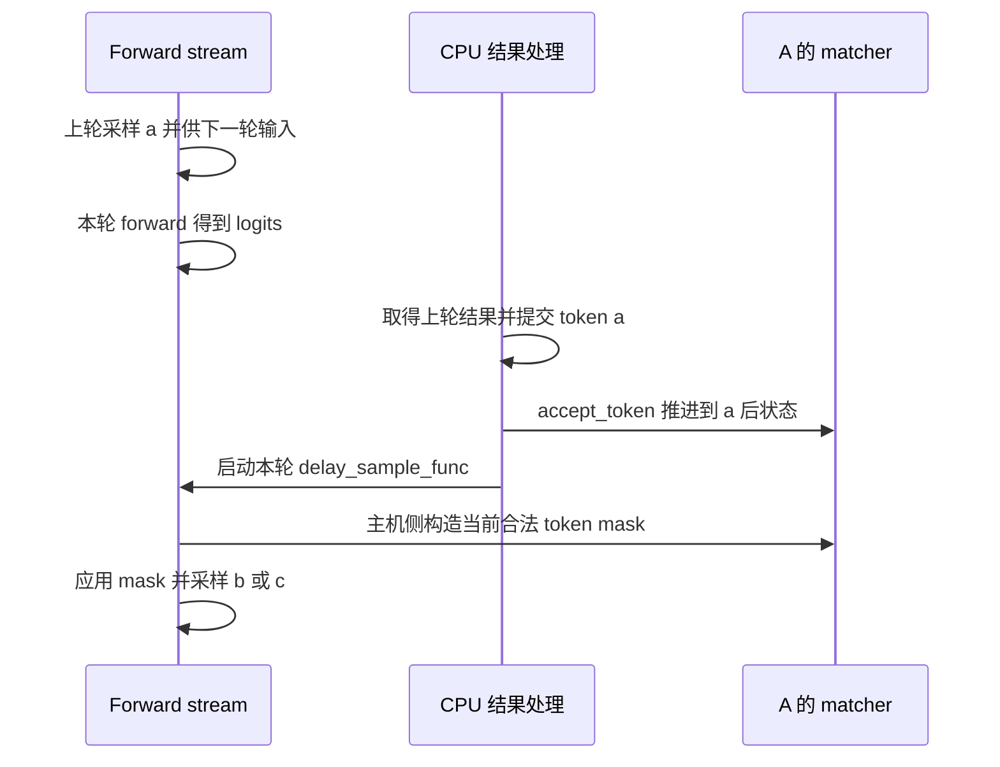

# 模型 forward 已经结束，为什么语法采样还要等上一批结果处理

源码版本：`0f6761b54facebb47f2068f87ecccd8f14da3a0e`。证据等级：静态源码核对。限定 CUDA 普通非推测 overlap、XGrammar、无 reasoning 与 jump-forward 的生成路径；排除 beam、PD 和特殊 sampling-mask 返回功能。时序图为教学依赖关系，未运行 GPU trace、模型或测量性能。未跟踪导读不作为证据。

继续 A 的语言 {ab,ac}。假设上一轮已经在设备采样出 a，下一轮模型也能从设备中继取得 a，但 CPU 尚未处理上一轮输出。如果这时根据旧 matcher 构造 mask，它还认为序列为空，只允许起始 token；attention 和输入依赖都正确，下一枚输出却被过期的语法状态过滤。问题不是 GPU 少算一层，而是设备 token 进度与主机 matcher 进度处在不同时间点。

一种自然办法是每遇到 grammar 就停止整个 overlap，先完整处理上一批再启动下一批。这样容易建立顺序，也缩小了模型计算与 CPU 工作并行的空间。普通路径采用更窄的边界：[worker.forward_batch_generation](https://github.com/sgl-project/sglang/blob/0f6761b54facebb47f2068f87ecccd8f14da3a0e/python/sglang/srt/managers/tp_worker.py#L631) 在启用 overlap、未启用推测且 grammars 不为 None 时，先执行模型 forward，返回的 GenerationBatchResult 保存 delay_sample_func。闭包捕获本轮 logits_output 和 forward_batch，稍后再调用 ModelRunner.sample，返回值不等于当场已有 next_token_ids。

[event_loop_overlap](https://github.com/sgl-project/sglang/blob/0f6761b54facebb47f2068f87ecccd8f14da3a0e/python/sglang/srt/managers/scheduler.py#L1967) 将本轮结果排队后处理上一批结果，然后调用 launch_batch_sample_if_needed。这里延后的是 mask 构造与采样，不要求把本轮 attention 一并推迟到上一批 CPU 提交之后。模型所需 token 依赖仍由之前介绍的设备中继和流顺序满足；matcher 则必须等主机消费确认的 token，两个边界各自建立因果关系。

图为教学依赖示意，不是实际设备时间线。箭头从 forward stream 指向 matcher 表达该执行上下文中的主机准备调用，matcher 本身不是 GPU tensor。图不承诺 CPU 结果处理与模型计算实际重叠了多少；关键是构造本轮 mask 之前，上轮 token 已进入 matcher。

[process_batch_result_decode](https://github.com/sgl-project/sglang/blob/0f6761b54facebb47f2068f87ecccd8f14da3a0e/python/sglang/srt/managers/scheduler_components/batch_result_processor.py#L921) 对普通结果先把每请求 token 追加到 output_ids，更新结束状态，再在 grammar 分支调用 [_accept_grammar_tokens](https://github.com/sgl-project/sglang/blob/0f6761b54facebb47f2068f87ecccd8f14da3a0e/python/sglang/srt/managers/scheduler_components/batch_result_processor.py#L821)。后者依次 accept_token，遇到语法终止即停止；[XGrammar.accept_token](https://github.com/sgl-project/sglang/blob/0f6761b54facebb47f2068f87ecccd8f14da3a0e/python/sglang/srt/constrained/xgrammar_backend.py#L96) 将 token 交给 matcher，接受失败会抛 ValueError，结果层将请求标记为待 abort。它不会偷偷改选另一个 token，因此该异常路径不能被描述成自动修复非法输出。

prefill 的首个输出也要进入同一个状态机。[process_batch_result_prefill](https://github.com/sgl-project/sglang/blob/0f6761b54facebb47f2068f87ecccd8f14da3a0e/python/sglang/srt/managers/scheduler_components/batch_result_processor.py#L257) 对完成 prefill 的请求调用 [_apply_prefill_grammar](https://github.com/sgl-project/sglang/blob/0f6761b54facebb47f2068f87ecccd8f14da3a0e/python/sglang/srt/managers/scheduler_components/batch_result_processor.py#L692)，而未完成的中间 chunk 走另一条计数路径，不把中间结果冒充新生成 token。普通单 token decode 不需要逐轮重编译语法：它推进的是请求自己的 matcher，下一轮根据新状态重新填 mask。

还要区分 grammar.finished 与 matcher.is_terminated。前者由调用方按 req.finished() 同步，后者是匹配器内部终止判断；[Req.update_finish_state](https://github.com/sgl-project/sglang/blob/0f6761b54facebb47f2068f87ecccd8f14da3a0e/python/sglang/srt/managers/schedule_batch.py#L1889) 还检查 EOS、stop 和长度上限。本提交普通 decode 的结束检查在 grammar accept 之前，不能从一条赋值就宣称两种终止状态在同一时刻完全等价。尤其 max_new_tokens 可以使请求在语法尚未完整时结束，结构化约束并不因此承诺所有截断响应都是完整合法文档。

[launch_batch_sample_if_needed](https://github.com/sgl-project/sglang/blob/0f6761b54facebb47f2068f87ecccd8f14da3a0e/python/sglang/srt/managers/scheduler.py#L4723) 在 forward stream 上等待 schedule stream，执行延迟闭包，之后中继本轮采样 token，再让 copy stream 等待并回拷。普通 grammar 依靠延迟采样维持状态依赖；调度器另一处 grammar-specific 禁用 overlap 的条件还要求推测算法，不应概括成“只要有 grammar 就禁 overlap”。推测验证可能一次接受多个 token，有自己的 barrier 与幂等标记，不属于本文单 token 时序的直接推广。

闭包需要让 logits 和执行视图活到采样完成，采样后代码清除 delay_sample_func 与 next_token_logits 引用，避免队列继续持有大对象。这里又接回对象生命周期的课程：结果已计算、语法可采样、主机结果可读、对象可释放是不同事件，不能用一个“forward 完成”覆盖全部含义。

待验证时在 worker 返回、上一批结果处理、accept_token 和 _preprocess_logits 记录 forward_iter、请求身份、output_ids、accepted_tokens 及闭包有无。对 A 应看到本轮模型已返回而 matcher 尚旧，随后先接受上轮 a，再填出 b/c 的 mask；若 mask 提前生成或 a 被重复接受，就能推翻解释。另用很短长度上限检查终止原因，避免把正常截断误报为完整语法产物。代价是采样仍有主机状态依赖与额外生命周期管理；能否改善吞吐和尾延迟必须另测，本文只建立可核对的顺序契约。
