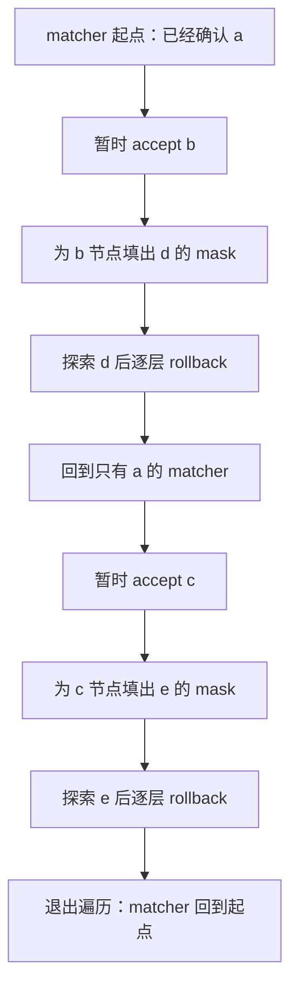

# 推测树的兄弟分支，怎样借用同一个 matcher 又不污染彼此

源码版本：`0f6761b54facebb47f2068f87ecccd8f14da3a0e`。证据等级：静态源码核对。限定单设备 EAGLE V2、XGrammar、普通非 reasoning 请求，排除 jump-forward、推测接受模拟和多层 draft worker。图、树编号和字符 token 是教学简化，真实词表由 tokenizer 决定；未运行模型、编译器或 GPU。工作区另有未跟踪导读，不作为固定提交证据。

昨天一个请求只有一个待采样位置，mask 由当前 matcher 状态决定。现在让 A 的允许语言为 {abd,ace}，a 已经由上一轮确认。draft 给出两个分支：a→b→d 与 a→c→e。target 一次处理这些候选位置，得到多行下一 token 的 logits；其中 b 后只能接 d，c 后只能接 e。若把 a 后的同一个 mask 复制到全部行，分支内部的约束就错了。

为每个树节点复制完整 matcher 看似直接，却需要制造大量短命状态对象。实现用深度优先遍历暂借请求自己的 matcher：进入候选时 accept，生成这个假设历史之后的 mask，离开时 rollback，再访问兄弟。这里的 accept 只是探索假设，不是把候选正式追加到 output_ids；必须与稍后的真实路径提交区分。

[generate_token_bitmask](https://github.com/sgl-project/sglang/blob/0f6761b54facebb47f2068f87ecccd8f14da3a0e/python/sglang/srt/speculative/spec_utils.py#L535) 按请求遍历，为整个 batch 的候选节点分配 mask，行数是 draft_tokens_cpu.numel()，不再是请求数。A 占据其中连续 num_draft_tokens 行；每个节点的行对应 target 在该节点之后预测下一 token 的 logits。[traverse_tree](https://github.com/sgl-project/sglang/blob/0f6761b54facebb47f2068f87ecccd8f14da3a0e/python/sglang/srt/speculative/spec_utils.py#L467) 接收 child、sibling 链接和候选 token，不能把扁平数组次序直接当作一条生成序列。

图为教学状态变化，并非实际运行追踪。每条从根到叶的临时路径独享自己的历史效果，但没有各自永久保存的 matcher。图中的 rollback 必须在访问兄弟之前完成，不能等遍历全部节点后再统一回退，否则 c 会被接在 abd 后面。

根节点 curr=0 有特殊语义：代码把它视为上一轮已经确认的 target token，因此不再 accept，也不在退出时 rollback。a 是否已经进入 matcher，依赖下一篇将继续核对的 grammar barrier；如果把根再次接受，状态从 a 变成 aa，后续 mask 全部偏移。对非根节点，遍历先查父节点 mask 的对应 token 位，只对语法可达候选 accept；非法候选的子树不进入，兄弟仍继续搜索。

因此“数组里有一行 mask”不代表那一行必定已按合法状态填充。XGrammar 的分配初值是全允许，非法或已经终止路径上未访问的行可能保留初值。保证应当来自可达性：一个在父 mask 中被排除的候选，不应再成为后续有效验证路径。不能单看某个不可达节点的行还是全一，就断言该请求失去了约束；也不能把所有行都假设成有效状态，拿去任意重新排序使用。

[XGrammar.accept_token](https://github.com/sgl-project/sglang/blob/0f6761b54facebb47f2068f87ecccd8f14da3a0e/python/sglang/srt/constrained/xgrammar_backend.py#L96) 真正推进 matcher 并记录 accepted_tokens，[rollback](https://github.com/sgl-project/sglang/blob/0f6761b54facebb47f2068f87ecccd8f14da3a0e/python/sglang/srt/constrained/xgrammar_backend.py#L110) 调用 matcher.rollback 并截短记录。这里需要恢复的是匹配进度与接受历史，不是保证包装对象的每个辅助字段都回到旧值；例如 current_token 没有在该 rollback 方法中同步恢复。判断分支隔离应观察下一步合法集合与 matcher 历史，不能只盯最后一次记录的 token 字段。

[EagleVerifyInput](https://github.com/sgl-project/sglang/blob/0f6761b54facebb47f2068f87ecccd8f14da3a0e/python/sglang/srt/speculative/eagle_info.py#L16) 还包含 custom_mask，那是候选间的 attention 可见关系；本文词表 mask 则限制某个 logits 行能选什么 token。前者需要让节点只看自己的祖先历史，后者需要让该历史下的下一 token 符合语法。两者维度和消费者不同，即便都叫 mask，也不能相互替代。本文核对词表遍历，未证明每个 attention backend 的整套树执行正确性。

共享 matcher 减少复制需求，同时引入回退正确性、树遍历主机工作和 rollback 容量约束。源码没有在每次 accept 外包一层 finally 来保证异常中途也恢复；本文结论限定在成功、合法且回退能力足够的遍历，不能把它写成任意异常后的事务保证。

待验证时在 traverse_tree 的进入、填 mask、rollback 与访问 sibling 处记录节点号、父号、accepted_tokens 和合法集合。输入上述两分支，b 行应允许 d，c 行应允许 e，退出后仍处在已确认 a 的状态；再加入父 mask 禁止的 x 节点，检查它的子树不被访问。若 c 行受 b 分支影响、根被重复接受，或成功退出仍留下候选 token，就是反例。这些是待执行检查。下一篇把“语法可达”与“target 同意”分开，追究最终哪条路径有资格成为新输出。
