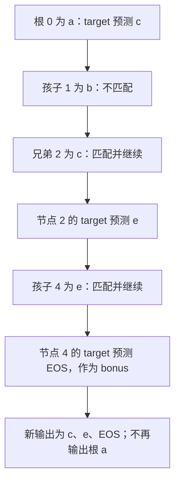

# 两条 draft 分支都合法，target 为什么只能提交其中一条路径

源码版本：`0f6761b54facebb47f2068f87ecccd8f14da3a0e`。证据等级：静态源码核对。限定单设备 CUDA EAGLE V2、greedy target 验证、topk>1 候选树，关闭接受长度模拟，排除概率拒绝采样与自适应配置变化。图、编号和分数选择为教学示意，未执行模型或 GPU。未跟踪导读不作为提交证据。

继续 A：根 a 已确认，候选节点编号为 0:a、1:b、2:c、3:d、4:e，父子关系是 a→b→d 与 a→c→e。语法认为两个分支都可能合法，但这还不能决定输出。即便 draft 更偏爱 b，target 在 a 行的 argmax 可能是 c。把合法候选全部追加会把互斥的历史连在一起；把最高 draft 分数直接当输出，又绕开了 target 的决定。

[run_eagle_verify](https://github.com/sgl-project/sglang/blob/0f6761b54facebb47f2068f87ecccd8f14da3a0e/python/sglang/srt/speculative/eagle_worker_common.py#L462) 对候选树执行 target forward，随后构造 grammar_mask 并交给 [eagle_sample](https://github.com/sgl-project/sglang/blob/0f6761b54facebb47f2068f87ecccd8f14da3a0e/python/sglang/srt/speculative/eagle_utils.py#L731)。采样先按节点行应用约束，再在 greedy 分支取 target argmax，得到每个候选历史下的下一 token 预测。语法 mask 限定支持集合，target logits 在这个集合里决定选择；它们不会因为都存在就把 draft token 变成正式输出。

[verify_tree_greedy_func](https://github.com/sgl-project/sglang/blob/0f6761b54facebb47f2068f87ecccd8f14da3a0e/python/sglang/srt/speculative/eagle_utils.py#L381) 在 CUDA 路径进入本提交的 JIT wrapper，最终调用 [VerifyTreeGreedy](https://github.com/sgl-project/sglang/blob/0f6761b54facebb47f2068f87ecccd8f14da3a0e/python/sglang/kernels/jit/include/sgl_kernel/speculative/eagle.cuh#L215)。kernel 从根对应的 retrieve_index 开始，在当前节点的孩子及其 sibling 链中寻找等于当前 target 预测的候选。匹配到才沿这个孩子向下走，找不到就停止延长 draft 路径。因此接受的是祖先连续的一条路径，不能跳过第一个不匹配位置，再接受后面碰巧相同的 token。

图为教学接受过程，并非实际运行追踪；假设当前 mask 与 target 分数确实选择这些 token，EOS 的合法性取决于实际 grammar 与 stop 配置，不能仅由字符串看起来完整推断。另一分支 b、d 可以有合法 logits，却没有被当前 target 路径选中。

这里最容易错的是 accept_index 的含义。假设 retrieve_index 与本例节点编号一致，kernel 先记录根行，再记录匹配节点行，得到 [0,2,4]。它把 c 写进 predict[0]，e 写进 predict[2]，最后把 bonus 写进 predict[4]。这些索引指向“产生已选下一 token 的预测行”，直接读取 candidates[accept_index] 得到的 a、c、e 不是新增输出。应该按这个索引读取 predict，才是 c、e、EOS。

kernel 中 accept_token_num 统计匹配的 draft 个数，本例为二；eagle_sample 返回时以非原地加一形成 accept_lens，包含最后一个 target bonus，因此为三。根已在历史里，不因 accept_index 第一项是根索引而再生成一次。即便没有任何 draft 匹配，当前 target 预测仍可作为一枚 bonus，不能把“零个正确 draft”误报成没有生成进度。

[EagleVerifyInput.max_tree_depth](https://github.com/sgl-project/sglang/blob/0f6761b54facebb47f2068f87ecccd8f14da3a0e/python/sglang/srt/speculative/eagle_info.py#L46) 约束接受路径宽度，draft_token_num 则是整棵候选树的节点数；本例五个候选节点不等于五枚输出。[run_eagle_verify](https://github.com/sgl-project/sglang/blob/0f6761b54facebb47f2068f87ecccd8f14da3a0e/python/sglang/srt/speculative/eagle_worker_common.py#L462) 用 predict[accept_index] 取得路径，再按 accept_lens 提取 bonus，使用的是 accept_index.shape[1] 这个路径 stride。混用树宽和路径宽，在单链里可能碰巧正确，换成分叉树就会选错每请求最后一项。

topk>1 的正式后续链布局还需要 [_finalize_accept_tree_path](https://github.com/sgl-project/sglang/blob/0f6761b54facebb47f2068f87ecccd8f14da3a0e/python/sglang/srt/speculative/eagle_worker_common.py#L407)：把被选路径对应的 predict、可用 hidden_states 及 KV 位置整理到每请求块的前部。本文只核对这一步的接口与搬运对象，没有把压紧等同于所有拒绝 KV 已经释放，也没有证明全部分页回收边界。路径选择、布局归一化与资源回收需要分别审查。

greedy 规则可以逐节点对照 target argmax，概率验证则有另外的采样与接受机制，不能把本文相等判断推广过去。多候选 target 计算、拓扑构造和整理都要付出成本，正确 draft 多也不自动意味着吞吐提升；本文没有性能数字。

待验证时在 eagle_sample、VerifyTreeGreedy 和路径压紧前后记录 candidates、target_predict、retrieve 链、predict、accept_index、draft-only 计数与 accept_lens。固定上述小树，预期路径索引是 [0,2,4]，取出的新 token 为 c、e、bonus，未选分支不进入输出。再让根预测与所有孩子不匹配，应只返回一枚 bonus；若跨过失配仍接受后代，或把根再输出一次，就是反例。下一篇追问：这份验证结果进入主机前，grammar barrier 如何推进真实状态，又如何避免结果处理再次推进？
