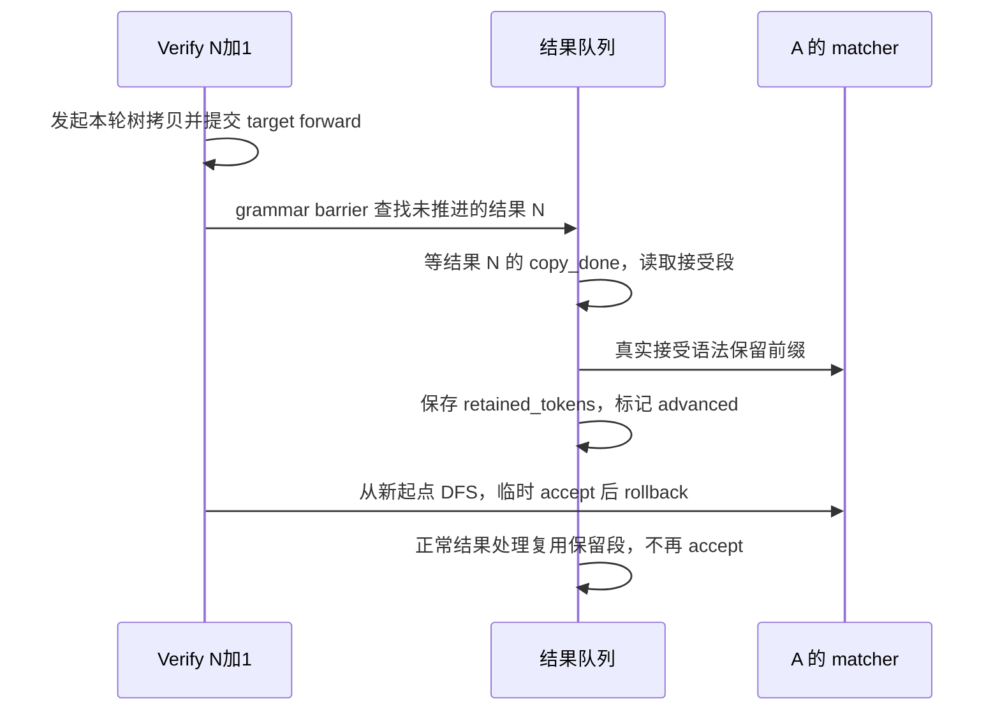

# 语法已经提前推进，结果回流时怎样避免同一批 token 被接受两次

源码版本：`0f6761b54facebb47f2068f87ecccd8f14da3a0e`。证据等级：静态源码核对。限定支持 grammar overlap 的单设备 EAGLE V2 与 XGrammar，普通请求、非 reasoning；排除多层 worker、beam、推测模拟与异常恢复。图为教学依赖关系，未运行 GPU trace 或性能实验。未跟踪导读不作为证据。

上一篇得到一段 target 验证输出，但下一轮可能已经启动。令结果 N 含有 A 的多个新 token，结果处理队列尚未提交它们；verify N+1 又要构造分支 mask。如果继续使用旧 matcher，新树的所有分支都从过期前缀出发。昨天普通 decode 延后采样即可修正，而树验证需要在遍历前拿到完整已确认 token 段，并且稍后正常结果处理不能再接受同一段一次。

[Scheduler.run_batch](https://github.com/sgl-project/sglang/blob/0f6761b54facebb47f2068f87ecccd8f14da3a0e/python/sglang/srt/managers/scheduler.py#L4337) 只给支持 grammar overlap 的推测 worker 传入 grammar_barrier。[run_eagle_verify](https://github.com/sgl-project/sglang/blob/0f6761b54facebb47f2068f87ecccd8f14da3a0e/python/sglang/srt/speculative/eagle_worker_common.py#L462) 在 target forward 前通过 [GrammarTree.from_device](https://github.com/sgl-project/sglang/blob/0f6761b54facebb47f2068f87ecccd8f14da3a0e/python/sglang/srt/speculative/spec_utils.py#L597) 发起树链接与 token 的主机拷贝，在 target forward 提交后调用 [build_grammar_vocab_mask](https://github.com/sgl-project/sglang/blob/0f6761b54facebb47f2068f87ecccd8f14da3a0e/python/sglang/srt/speculative/spec_utils.py#L643)。后者先执行 barrier，再 resolve 树的完成事件，最后开始 grammar 遍历。树数据可读与 matcher 进度正确，是两个独立前提，不能只等其中一个。

图为教学依赖示意，并非实际运行时间线。target 已提交使主机工作有机会与设备计算重叠，但源码安排不能证明实际重叠比例。提前推进的是上一份结果的语法状态，本轮 DFS 仍然是可回退的候选探索，两种 accept 不能混为一次永久提交。

[_advance_pending_grammar](https://github.com/sgl-project/sglang/blob/0f6761b54facebb47f2068f87ecccd8f14da3a0e/python/sglang/srt/managers/scheduler.py#L2079) 遍历队列，把旧批与旧结果交给 [advance_grammar_fsm](https://github.com/sgl-project/sglang/blob/0f6761b54facebb47f2068f87ecccd8f14da3a0e/python/sglang/srt/managers/scheduler_components/batch_result_processor.py#L852)。该函数先检查 result.grammar_advanced 与 batch.has_grammar，再检查执行模式；需要时同步 result.copy_done，按每请求 stride 与 accept_lens 从扁平结果取段。只处理该批的请求，不应把“当前运行集合”当成旧结果的行序。finished、retracted 与无 grammar 的请求都有跳过条件。

[_accept_grammar_tokens](https://github.com/sgl-project/sglang/blob/0f6761b54facebb47f2068f87ecccd8f14da3a0e/python/sglang/srt/managers/scheduler_components/batch_result_processor.py#L821) 逐个接受，若 matcher 终止即停止并返回 retained 列表。假设上一篇的原始结果为 c、e、bonus，而该具体 matcher 在 e 处已终止，则保留段只有 c、e。这里是条件示例，不保证所有语法都在字符 e 结束：某些配置仍需接受 stop token。非法 accept 抛出的 ValueError 被标记为待 abort，不代表能把任意非法段正常修复。

推进完成后，结果对象保存 grammar_retained_tokens 并置 grammar_advanced=True。[_resolve_spec_v2_tokens](https://github.com/sgl-project/sglang/blob/0f6761b54facebb47f2068f87ecccd8f14da3a0e/python/sglang/srt/managers/scheduler_components/batch_result_processor.py#L745) 稍后仍会调用同一函数，但幂等标志让它不再重复 accept，而是复用保存的保留段。这样“为了下一轮 mask 提前做了状态推进”和“为了本轮输出做最终处理”可以共享同一份结果，不要求两边都猜对方是否已经执行。

保留段还决定逻辑提交长度。resolver 对活跃请求用 len(accept_tokens) 增加 req.kv.kv_committed_len，而不是盲信原始 accept_lens；[process_batch_result_decode](https://github.com/sgl-project/sglang/blob/0f6761b54facebb47f2068f87ecccd8f14da3a0e/python/sglang/srt/managers/scheduler_components/batch_result_processor.py#L921) 再将这个段追加到 output_ids，更新停止条件，推测分支不再单独推进 grammar。raw verify 长度、grammar 保留长度、最终向客户端可见的长度不能机械画等号，EOS、stop、长度上限还有各自的处理。

尤其 worker 先计算的 new_seq_lens=batch.seq_lens+accept_lens，是设备推测推进视图；不能因主机后来截短 retained 段，就声称所有设备分配已在同一行代码里同步缩短。本文证明的是语法推进与逻辑提交使用的段，拒绝后缀的物理空间何时归还，需要继续追 KV 释放路径。跨这道边界随意把“已算过”写成“已提交”，会让缓存账目与真实输出脱节。

prefill→decode 的边界也在这个函数覆盖范围内：extend 结果按完成 prefill 的请求接受一枚新 token，跳过 inflight_middle_chunks>0 的中间块，并设置同一个 advanced 标志；后续 _apply_prefill_grammar 接收 already_advanced，避免首 token 被重复接受。这个边界不能因为章节名叫 decode 就被省略。

该协议增加主机结果等待、状态字段与保留段存储，换来可在不同处理时机复用的推进过程。待验证时在 barrier、advance_grammar_fsm、resolver 和输出追加处记录结果身份、advanced 标志、原始段、retained 段、matcher 历史及 kv_committed_len。对同一结果先调用 barrier 再做正常处理，matcher 只能推进一次，逻辑提交增量必须等于保留段长度；再覆盖首 prefill 与中间块。若重复 accept、使用原始长段输出，或未等 copy_done 就读主机数据，就是反例。这些仍是待执行方案，下一步应沿被截短后缀的 KV 归属继续验证物理回收。
