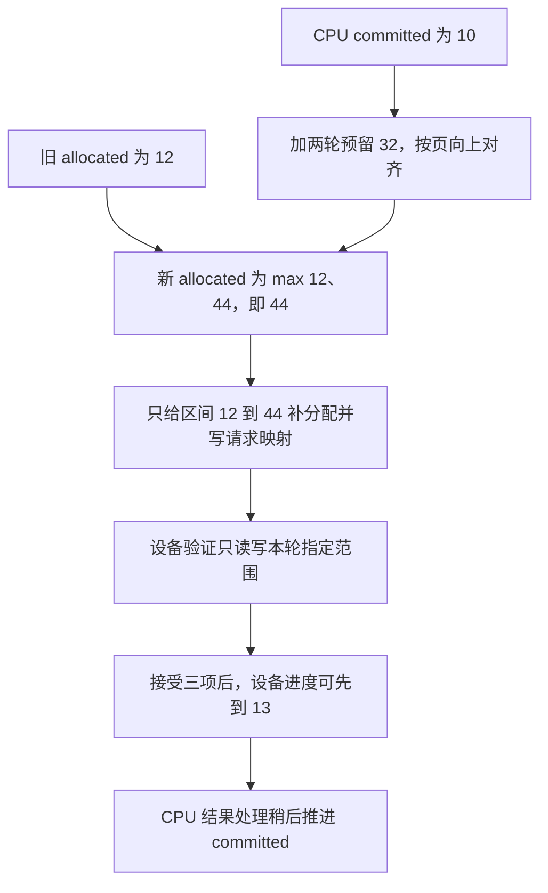

# 推测只接受少量 token，为什么 KV 预留区仍然不立即缩小

源码版本：`0f6761b54facebb47f2068f87ecccd8f14da3a0e`。证据等级：静态源码核对。聚焦单设备 EAGLE V2、静态分页 KV 池与普通文本，排除 SWA、统一池、DCP、Mamba 和自适应配置变化。数字与机制图为教学示意，未运行 GPU 或测量显存、吞吐。工作区另有未跟踪导读，不作为固定提交证据。

昨天追到语法保留段的逻辑提交，今天先看它外围的分配账目。让请求 A 已确认的 KV 长度为十，一轮只接受少量新 token，却已经为多个 draft 分支安排写入位置。如果每轮按接受数马上 free 剩余槽，再为下一轮重新申请，分配器、映射表与尚未读完的旧 forward 都要参与协调；若反过来把全部已分配槽都算作有效上下文，又会读取拒绝分支或未初始化内容。

[ReqKvInfo](https://github.com/sgl-project/sglang/blob/0f6761b54facebb47f2068f87ecccd8f14da3a0e/python/sglang/srt/managers/schedule_batch.py#L922) 分别记录 kv_committed_len 与 kv_allocated_len。前者表达已提交边界，后者表达请求持有的分配边界；请求自己的槽位还需扣除 cache_protected_len 之前的缓存保护前缀。“已经分配”“包含有效 KV”“可被当前 attention 读取”不是同一个判断，不能只用一个长度变量代替。

[eagle_prepare_for_decode](https://github.com/sgl-project/sglang/blob/0f6761b54facebb47f2068f87ecccd8f14da3a0e/python/sglang/srt/speculative/eagle_utils.py#L1050) 根据 [get_alloc_reserve_per_decode](https://github.com/sgl-project/sglang/blob/0f6761b54facebb47f2068f87ecccd8f14da3a0e/python/sglang/srt/mem_cache/allocation_sizing.py#L53) 准备预留，再用 [page_aligned_decode_alloc_lens](https://github.com/sgl-project/sglang/blob/0f6761b54facebb47f2068f87ecccd8f14da3a0e/python/sglang/srt/mem_cache/allocation_sizing.py#L62) 计算下一分配边界。核心关系是 A_next=max(A_old,ceil_page(C+reserve))，其中 C 为主机 committed，A 为 allocated。这是一条只补足缺口的策略：如果原有分配够用，本轮 num_needed_tokens 可以为零；接受少不会触发这个函数把 A 往回缩。

reserve 来自两倍单轮分配上界，并非两倍实际接受数。[get_alloc_len_per_decode](https://github.com/sgl-project/sglang/blob/0f6761b54facebb47f2068f87ecccd8f14da3a0e/python/sglang/srt/mem_cache/allocation_sizing.py#L17) 在 page>1、topk>1 且 draft 使用 KV 的分支中，还为各分支的分页尾部与对齐留余量。教学配置 page=4、topk=2、steps=2、候选节点数为五时，最坏单分支需要 ceil((3+2)/4)=2 页，两分支共十六个槽，大于五个 verify 节点；单轮上界 W 为十六，reserve 为三十二。候选树宽度与 draft 物理布局上界不能混用。

图为教学进度关系，并非实际运行追踪；区间均为左闭右开。例子假定 A_old=12，故只补三十二个槽。设备进度十三不表示 CPU 当场已经更新 C，也不表示 [13,44) 已交还分配器。

两倍预留用于容纳 overlap 下主机提交落后一轮的情况。上一轮已在设备走过最多 W 个位置，而主机 C 尚旧，下一轮仍可能需要最多 W 个位置，因此不能只从旧 C 保证一轮空间。这个有界流水假设很重要：若扩大未处理结果队列深度，不能继续沿用“两倍总是够”的结论，必须重新证明进度差的上界。

[alloc_for_spec_decode](https://github.com/sgl-project/sglang/blob/0f6761b54facebb47f2068f87ecccd8f14da3a0e/python/sglang/srt/mem_cache/allocation.py#L731) 只在 num_needed_tokens>0 时调用 token 或分页分配器，并将新增位置写入 req_to_token；最后更新 allocated，而不在这里增加 committed。主机结果接受段的提交发生在 [_resolve_spec_v2_tokens](https://github.com/sgl-project/sglang/blob/0f6761b54facebb47f2068f87ecccd8f14da3a0e/python/sglang/srt/managers/scheduler_components/batch_result_processor.py#L745)，设备下一轮长度则由 verify 的结果另行发布。三个生产位置分开，正是异步运行时需要显式区分三种进度的原因。

请求映射写入仍是共享 tensor 的写操作，代码特别指出不能与旧 forward 的相关读取冲突。预留够大并不会取消读写依赖，提前复用也不能越过已建立的共享读屏障。另一方面，暂时保留拒绝候选使用过的槽并不让它们重新获得语义有效性：下一次会按新的位置、长度与候选内容覆盖或跳过，不能把残留数据当成缓存命中。

这种策略用更大的请求占用换取少做即时缩减与再分配的机会，可能增加其他请求的容量压力；源码公式不能证明收益大于浪费。接近上下文上限时还要保证 req_to_token 行宽能容纳预留，prepare 函数有相应边界断言，模型最大上下文不自动等于映射表所需最大宽度。

待验证时在两个 prepare/alloc 入口和结果提交处记录 C、A、reserve、num_needed_tokens、设备 seq_lens 与映射表有效范围。固定上述参数，首次应从十二补到四十四，旧预留足够时不再分配；接受数改变 C 的提交增量，却不直接缩小 A。若零缺口仍反复分配、allocated 小于实际记录槽范围，或旧 C 下本轮写越过预留，就是反例。以上仍是待执行方案。下一篇把逻辑接受路径与预留区中的实际 KV 内容对应起来。
