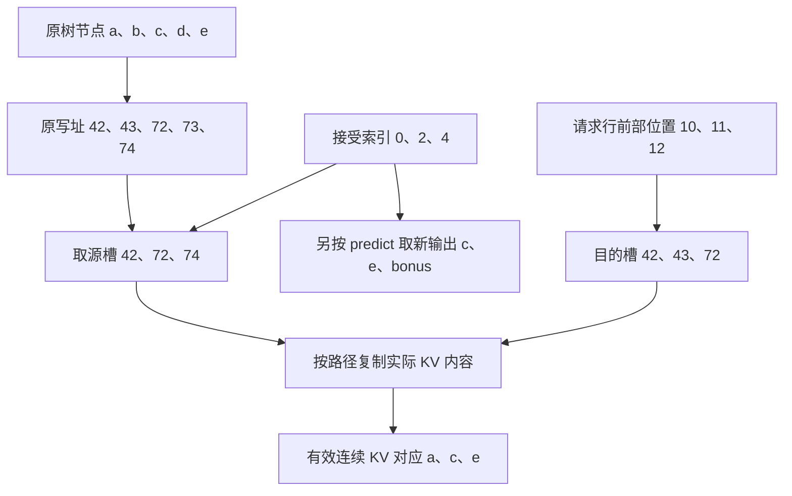

# 新输出是 c、e、bonus，为什么整理后的 KV 却对应 a、c、e

源码版本：`0f6761b54facebb47f2068f87ecccd8f14da3a0e`。证据等级：静态源码核对。限定单设备单层 EAGLE V2、topk>1、普通 MHA 三维 KV 池；讨论 native KV move 配置，排除量化、SWA、DCP、统一池与混合状态。图与槽号为教学示意，未执行搬运或数值对照。未跟踪导读不作为证据。

沿用 A，让本轮开始时设备 KV-ready 前缀长十，根 a 是上一轮已采样的 token，还未计入这个前缀。本轮树为 0:a、1:b、2:c、3:d、4:e，target 选中 a→c→e，新增输出为 c、e、bonus。昨天解释 accept_index=[0,2,4] 如何取预测结果；今天容易产生一个新误解：既然生成了 bonus，是不是 verify 已经算出它的 K/V，可以把三枚新输出对应的缓存直接连起来？

不能这样推断。target 这次实际输入的是树节点 a、b、c、d、e，因此节点二的 hidden state 与 KV 对应“读入 c 后”，它的下一 token 预测才是 e。节点四读入 e 后预测 bonus，而 bonus 本身尚未作为 target 的输入。输入 token、该位置产生的预测 token 相差一步；接受三项输出与新增三项 KV 可以数量相等，内容却有这个一位偏移。

[eagle_prepare_for_verify](https://github.com/sgl-project/sglang/blob/0f6761b54facebb47f2068f87ecccd8f14da3a0e/python/sglang/srt/speculative/eagle_utils.py#L520) 从 req_to_token 已分配的行中，取本轮 batch.seq_lens 开始的连续节点写址，供 target 写入 KV。假设行位置 [10,15) 的槽号为 [42,43,72,73,74]，它们分别放 a、b、c、d、e 的 KV。逻辑相邻不要求物理槽号连续；这里同页内连续、跨页不连续，符合 page=4 的教学布局。

图为教学内容映射，并非实际运行追踪。目的位置是请求行的逻辑连续前部，并非强行把物理槽整理成一块连续显存。新输出与 KV 的相对偏移是因果生成的结果，不是缓存漏掉 bonus；bonus 会作为后续轮次的根或输入继续处理。

[_finalize_accept_tree_path](https://github.com/sgl-project/sglang/blob/0f6761b54facebb47f2068f87ecccd8f14da3a0e/python/sglang/srt/speculative/eagle_worker_common.py#L407) 分别整理 KV、predict 与存在的 hidden_states。[move_accept_tokens_to_target_kvcache](https://github.com/sgl-project/sglang/blob/0f6761b54facebb47f2068f87ecccd8f14da3a0e/python/sglang/srt/speculative/spec_utils.py#L728) 按接受长度从请求行读取目的槽，再从本轮 out_cache_loc[accept_index] 取得源槽，交给池的 move_kv_cache。这里不重新分配接受路径，也不把 req_to_token 前三项直接替换成源槽号，而是让原有目的槽装上正确路径的内容。

[assign_extend_cache_locs](https://github.com/sgl-project/sglang/blob/0f6761b54facebb47f2068f87ecccd8f14da3a0e/python/sglang/kernels/ops/speculative/cache_locs.py#L391) 的职责是 gather 现有行里的位置；名字里有 assign，也不能把这一步当成申请新显存。路径元素数量按 bs*accept_index.shape[1] 决定，不能按整树宽度超读接受索引。有效接受长度之外的填充条目仍需遵守消费者协议，本文只把有效段解释为上下文，不能因 helper 创建固定宽度 tensor 就把全部位置都算作有效 KV。

[move_kv_cache](https://github.com/sgl-project/sglang/blob/0f6761b54facebb47f2068f87ecccd8f14da3a0e/python/sglang/srt/mem_cache/memory_pool.py#L3051) 根据布局与配置选择实现，本文限定的 native 分支进入 [move_kv_cache_native](https://github.com/sgl-project/sglang/blob/0f6761b54facebb47f2068f87ecccd8f14da3a0e/python/sglang/srt/mem_cache/memory_pool.py#L5249)，逐层执行以 src_loc 索引取值、向 tgt_loc 写入的 K/V 操作。上例源槽七十二同时是另一项的目的槽，调试时必须核对搬运前的源内容，而不是用已经写过的槽推断原值。本文没有运行重叠搬运验证，也不把对 native 路径的阅读推广成其他优化 kernel 的并发正确性证明。

predict 和 hidden_states 则由 [_compact_accept_to_front](https://github.com/sgl-project/sglang/blob/0f6761b54facebb47f2068f87ecccd8f14da3a0e/python/sglang/srt/speculative/eagle_worker_common.py#L439) 先 gather 接受索引，再 clone 输出，最后把路径写到每请求块的前部。保留 hidden state 与 KV 的路径对应尤其重要：下一次 draft-extend 会取最后接受位置的状态，若只移动 token ID 而留下兄弟分支的 hidden state，模型下一轮仍可能从错误历史出发。

路径整理没有 free 调用。未选节点和超出有效长度的旧内容仍可能留在预留区，只要没有成为有效上下文，就不能以“还看得到数据”断言资源泄漏；反过来，若按 allocated 长度读取，也会错误消费这些残留。搬运成本随层数、head 维度和接受路径增加，是树验证额外成本的一部分，不能仅凭更多接受 token 推断加速。

待验证时在 finalize 前给各节点 K/V 与 hidden state 做可辨识记录，抓取 accept_index、out_cache_loc、目的槽与有效长度，在移动后核对 [10,13) 对应 a、c、e，而 predict 前三项对应 c、e、bonus。随后检查下一轮根 token 与读取前缀，不能要求本轮 target KV 中已有 bonus。若只移动了预测结果、把兄弟状态留在有效段，或重叠复制破坏七十二的原值，就是反例。这些是待执行检查。下一篇追请求结束后预留尾部如何真正归还，并避开同页重复释放。
