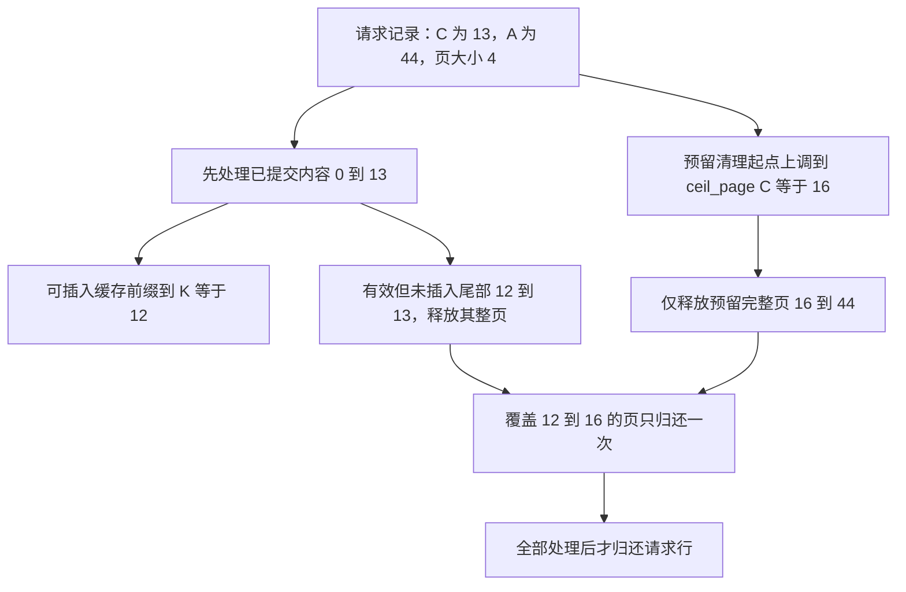

# 请求结束时，有效 KV 尾部与推测预留尾部怎样避免释放同一页两次

源码版本：`0f6761b54facebb47f2068f87ecccd8f14da3a0e`。证据等级：静态源码核对。限定普通 EAGLE 请求、静态分页池、启用 radix 插入的结束路径，排除 streaming session、SWA、DCP、Mamba、offload 与 strip-thinking。区间、页号和图为教学示意，未运行 allocator 压力测试或 GPU。未跟踪导读不作为证据。

沿用 A，设请求最终 owned_kv_len=C=13，allocated=A=44，页大小四。推测阶段保留的尾部现在需要归还，但 C 不在页边界；同时 radix cache 只接纳满足 key 与页对齐条件的前缀。若先 free “有效但不入缓存”的 [12,13)，再直接 free “无效预留”的 [13,44)，两个不同逻辑区间都会碰到同一张覆盖 [12,16) 的物理页。token 区间不重叠，整页释放却仍然重复。

[结束结果处理](https://github.com/sgl-project/sglang/blob/0f6761b54facebb47f2068f87ecccd8f14da3a0e/python/sglang/srt/managers/scheduler_components/batch_result_processor.py#L1257) 在普通分支调用 [release_kv_cache](https://github.com/sgl-project/sglang/blob/0f6761b54facebb47f2068f87ecccd8f14da3a0e/python/sglang/srt/mem_cache/common.py#L272)。后者先从 req.owned_kv_len() 固定本次拥有的内容边界，交给 cache_finished_req，再释放额外预留，最后归还请求行并标记 KV 已释放。先保存边界是为了让两段清理讨论同一个版本的账目；不是把全部 allocated 都塞进前缀树，也不是一结束就把所有缓存页清空。

[RadixCache.cache_finished_req](https://github.com/sgl-project/sglang/blob/0f6761b54facebb47f2068f87ecccd8f14da3a0e/python/sglang/srt/mem_cache/radix_cache.py#L478) 用实际 token 序列和前 C 个映射值构造 key，再根据 bigram 视图与 page_aligned 得到可插入长度 K。EAGLE 的 [RadixKey](https://github.com/sgl-project/sglang/blob/0f6761b54facebb47f2068f87ecccd8f14da3a0e/python/sglang/srt/mem_cache/radix_cache.py#L59) 可以把原始 token 视为相邻二元组，逻辑 key 长度不是原始 token 数；所以不能不经 key 处理就假定 K=ceil_page(C) 或简单把输出条数当成缓存长度。本文教学例子假定对齐后 K=12。

图为教学边界划分，并非实际运行追踪。上图省略已命中重复前缀的归还，假定本请求此前受保护边界 P=8，插入返回的重复前缀长度也为八，则 [8,12) 可成为缓存新拥有的页。保留在树里的页仍占用 KV 空间，直到缓存另行淘汰；请求结束不等于分配器空闲数增加全部 A。

cache_finished_req 对重复且不受本请求原保护的区间，以及 K 之后未插入的尾部调用 free_segments。尾部索引只包含 [12,13) 这一项，但 [PagedTokenToKVPoolAllocator.free_segment](https://github.com/sgl-project/sglang/blob/0f6761b54facebb47f2068f87ecccd8f14da3a0e/python/sglang/srt/mem_cache/allocator/paged.py#L282) 以页为单位释放，从页对齐起点的索引每 page_size 取一项代表页。释放一项就能归还整个 [12,16) 页，不要求把该页四个索引都传进来。

接下来 [_release_overallocated_kv_indices](https://github.com/sgl-project/sglang/blob/0f6761b54facebb47f2068f87ecccd8f14da3a0e/python/sglang/srt/mem_cache/common.py#L317) 把预留起点 C 按 allocator.page_size 向上对齐为十六，只在 start<end 时经 [free_kv_row](https://github.com/sgl-project/sglang/blob/0f6761b54facebb47f2068f87ecccd8f14da3a0e/python/sglang/srt/mem_cache/base_prefix_cache.py#L454) 释放 [16,44)。位置十三、十四、十五没有成为泄漏的洞：它们所属的 [12,16) 页已经由前一段尾部处理。若 C 恰好对齐，起点不变；若没有额外完整页，则这一段不需要再 free。

为什么不能先把预留起点向下取整到十二？因为这会与刚刚处理的有效尾部争抢同一页。为什么不能把未对齐的十三原样传给 free_segment？该接口要求逻辑起点按页对齐，其固定步长抽样依赖这个契约。allocator 的 free_segments 还检查相邻逻辑段是否共页，但两次不同调用看不到彼此，因此上层边界分工本身必须正确，不能把安全寄托在单次去重上。

分配器将页归还空闲集合也可能通过 free_group 延后归并，调用 free 不表示 CPU 返回当刻所有分配统计都已刷新。本文追的是所有权与释放范围，不证明同步时刻或并发设备使用安全；旧 forward 的依赖仍需沿已建立的流屏障检查。特别是推测结果在语法终止时被截短，应以最终逻辑边界进入这条清理路径，不能把更长的设备预测视图当作缓存有效内容。

release_kv_cache 在这些操作完成后释放 req_to_token 行，并调用 ReqKvInfo.mark_kv_released 清除分配与 SWA 游标记录。请求对象上某些历史字段仍可保留，不能把“所有数字都归零”当成唯一完成标准；应检查行是否仍被持有、页归属是否转移、是否还有越界或重复 free。缓存插入与尾部回收各有成本，也共同决定结束瞬间实际可回收多少容量。

待验证时在 release_kv_cache、cache_finished_req、预留释放 helper 和 allocator.free_page_ids 记录 C、A、K、P、每次逻辑区间与最终物理页 ID。用上述示例，应看到尾页 [12,16) 只出现一次，随后释放七个完整预留页 [16,44)，[8,12) 仍由缓存持有。再覆盖 C=12、C=A 和缓存已有重复前缀的情况。若把同一页归还两次、把缓存新页当尾部释放，或声称十三到十五需要额外逐槽归还，就是反例。以上均为待执行检查；统计空闲量还需在 free_group 结束后核对。
