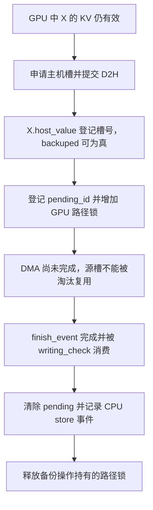

# 节点已经有 host_value，为什么还不能认定主机备份完成

源码版本：`0f6761b54facebb47f2068f87ecccd8f14da3a0e`。证据等级：静态源码核对。限定单设备、普通文本、静态 MHA KV 池的 HiRadixCache，采用 write_through，关闭外部存储、推测、SWA、DCP 与混合状态。图与 token 数为教学示意，未运行 DMA、模型或测量性能。工作区另有未跟踪导读，不作为固定提交证据。

版本边界：本提交的[默认缓存工厂](https://github.com/sgl-project/sglang/blob/0f6761b54facebb47f2068f87ecccd8f14da3a0e/python/sglang/srt/mem_cache/registry.py#L80)通常进入 UnifiedRadixCache；本文分析的是仍保留的 HiRadixCache 节点协议，不能据此声称默认服务正在运行该类。下文请求例子是这个类的教学推演；若做运行验证，需要隔离构造对应缓存与依赖，先确认实际实例类型。

昨天请求结束后，部分有效 KV 的所有权转交给前缀树。现在让 A 留下一段四十八 token 的前缀，前十六项属于父节点 P，后面三十二项属于节点 X。GPU 内存有限，希望把 X 备份到主机，以后仍能复用。朴素方案是分配主机槽位后立刻宣布“已备份”，甚至允许释放 GPU 源槽；但异步传输此刻可能刚排队，目标地址存在不代表内容已经到达。

[TreeNode](https://github.com/sgl-project/sglang/blob/0f6761b54facebb47f2068f87ecccd8f14da3a0e/python/sglang/srt/mem_cache/radix_cache.py#L256) 的 backuped 属性只检查 host_value 是否非 None，evicted 则只检查 value 是否为 None。两个名字表达索引是否存在，并没有在属性访问时查询设备事件。因此需要把“主机槽位已登记”和“DMA 已完成”分开看，不能把一个布尔属性当成数据可读性的全部证明。

[write_backup](https://github.com/sgl-project/sglang/blob/0f6761b54facebb47f2068f87ecccd8f14da3a0e/python/sglang/srt/mem_cache/hiradix_cache.py#L857) 在 write-through 模式先要求非根父节点已有 host 记录，以维持从根连续的备份前缀，再让 controller.write 为 X 申请主机位置。主机空间不够时会尝试 evict_host 后重试，仍失败则返回零；不能因为策略叫 write_through，就推导所有新节点必定成功备份。本文例子假设父节点条件成立且分配成功。

图为教学状态关系，并非实际运行追踪。登记 host_value 与增加锁之间是调度线程中的控制步骤；它没有说可以在中间插入一次不受约束的淘汰。X 可能还被别的请求引用，所以最后释放这次操作的锁，不一定让总 lock_ref 归零。

[HiCacheController.write](https://github.com/sgl-project/sglang/blob/0f6761b54facebb47f2068f87ecccd8f14da3a0e/python/sglang/srt/managers/cache_controller.py#L793) 先申请 host_indices、构造 CacheOperation，再调用 start_writing；[start_writing](https://github.com/sgl-project/sglang/blob/0f6761b54facebb47f2068f87ecccd8f14da3a0e/python/sglang/srt/managers/cache_controller.py#L811) 将传输提交给 L2 engine，并把开始事件、结束事件、node_ids 记入 ack_write_queue。[submit_device_to_host](https://github.com/sgl-project/sglang/blob/0f6761b54facebb47f2068f87ecccd8f14da3a0e/python/sglang/srt/mem_cache/l2_transfer.py#L57) 让传输流等待提交起点，再安排所有层的备份，最后记录完成事件。返回一组事件描述一次尚需确认的操作，返回主机索引也只是给上层建立对应关系。

HiRadixCache 得到主机槽后设置 host_value，登记 ongoing_write_through 与 write_through_pending_id，并通过 inc_lock_ref 保护源节点及祖先。这个锁的用途是阻止源 KV 在备份读取结束前被淘汰重用；它不是把 CPU 阻塞在整次拷贝上。若只保住 Python 的 node 对象而释放物理槽，DMA 仍可能把其他请求的新数据复制到旧前缀名下。

[writing_check](https://github.com/sgl-project/sglang/blob/0f6761b54facebb47f2068f87ecccd8f14da3a0e/python/sglang/srt/mem_cache/hiradix_cache.py#L1045) 在普通路径按队列前部已完成事件计数消费 ack，并在处理时同步对应事件，然后调用 [_finish_write_through_ack](https://github.com/sgl-project/sglang/blob/0f6761b54facebb47f2068f87ecccd8f14da3a0e/python/sglang/srt/mem_cache/hiradix_cache.py#L921)。后者清除 pending 标记、记录 CPU 层 store 事件，并释放这次备份持有的路径锁。完成计数遇到尚未结束的前部项会停止，不能看到后面某项好像完成就任意跨过队列协议确认。

这里还有异步操作身份与树拓扑的差别。备份排队后，另一请求可能只命中 X 的前半段，导致节点分裂。[_split_node](https://github.com/sgl-project/sglang/blob/0f6761b54facebb47f2068f87ecccd8f14da3a0e/python/sglang/srt/mem_cache/hiradix_cache.py#L1896) 拆分 value、host_value 和 key，同时经 [_replace_pending_write_through_node](https://github.com/sgl-project/sglang/blob/0f6761b54facebb47f2068f87ecccd8f14da3a0e/python/sglang/srt/mem_cache/hiradix_cache.py#L893) 让新片段继承原 pending ID，更新该 ack 需要发布的节点集合。等旧 ack 回来时，确认的是原传输覆盖的现有片段，不能只按“现在节点长什么样”猜拷贝范围。

这些层次各有成本：主机容量、传输流、事件、路径引用和分裂后的操作追踪都需要维护。write_through 尝试提前准备备份，不代表请求响应前同步完成全部拷贝，更不能由源码存在事件就认定开销已被计算完全隐藏。本文没有显存收益或带宽测量。

待验证时在 controller.write 返回、write_backup 登记、writing_check 与 ack 完成处记录 host_value、pending_id、lock_ref、node_ids 和 finish_event 状态。故意延长传输，应能观察到 backuped 已真而事件未完成，此时源槽仍受保护；再在等待期间构造部分前缀命中，检查分裂片段沿同一个 ack 完成。若 host 地址一出现就允许源槽复用、旧 ack 找不到拆分后的片段，或未等完成就对外发布 CPU store，就是反例。下一篇沿完成后的 X，研究显存压力下怎样降级而不丢掉这份主机前缀。
