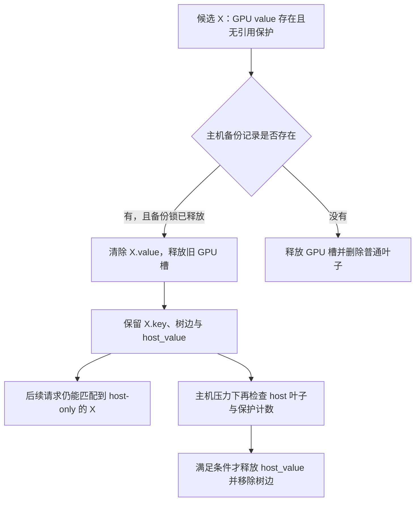

# GPU 淘汰了前缀节点，为什么 radix 树还必须保留它

源码版本：`0f6761b54facebb47f2068f87ecccd8f14da3a0e`。证据等级：静态源码核对。沿用单设备 HiRadixCache、write_through 与普通静态 KV 池，关闭外部存储、推测、SWA 和分布式；末尾仅对照 write_back 的不同释放边界。图为教学所有权变化，未运行内存压力实验。未跟踪导读不作为提交证据。

版本边界：本提交的[默认缓存工厂](https://github.com/sgl-project/sglang/blob/0f6761b54facebb47f2068f87ecccd8f14da3a0e/python/sglang/srt/mem_cache/registry.py#L80)通常进入 UnifiedRadixCache；本文分析的是仍保留的 HiRadixCache 节点协议，不能据此声称默认服务正在运行该类。下文请求例子是这个类的教学推演；若做运行验证，需要隔离构造对应缓存与依赖，先确认实际实例类型。

现在 A 的节点 X 已完成主机备份，X 长三十二，父前缀 P 长十六，GPU 与主机各有一份。另一个长请求造成显存压力。如果沿用普通 radix 的删除方式，把 X 的树边和 key 一起移除，确实能释放 GPU 槽，却也丢掉了“这份主机 KV 属于哪个前缀”的检索关系。保留一块无法按前缀找到的主机内存，不能算有效缓存。

设计把数据驻留位置与逻辑前缀关系拆开。[evict](https://github.com/sgl-project/sglang/blob/0f6761b54facebb47f2068f87ecccd8f14da3a0e/python/sglang/srt/mem_cache/hiradix_cache.py#L1206) 按写策略选择淘汰路径；[_evict_write_through](https://github.com/sgl-project/sglang/blob/0f6761b54facebb47f2068f87ecccd8f14da3a0e/python/sglang/srt/mem_cache/hiradix_cache.py#L1230) 从设备可淘汰叶子中按策略优先级选取，跳过 lock_ref>0 的节点。继承的 [设备叶子维护](https://github.com/sgl-project/sglang/blob/0f6761b54facebb47f2068f87ecccd8f14da3a0e/python/sglang/srt/mem_cache/radix_cache.py#L871) 要求节点仍驻留设备、无锁，且没有设备驻留的孩子。这是设备层的叶子定义，不要求整个逻辑树真的没有孩子。

图为教学状态转移，并非实际运行追踪。图中的主机记录与上一章 pending 锁契约必须一起解释：不能只检查 backuped 就忽略未完成 DMA 的保护。没有主机记录的节点会走删除分支，因此分层缓存不保证每个被 GPU 淘汰的前缀都能在主机找回。

[_evict_backuped](https://github.com/sgl-project/sglang/blob/0f6761b54facebb47f2068f87ecccd8f14da3a0e/python/sglang/srt/mem_cache/hiradix_cache.py#L1295) 先保存 device_indices，经 [_detach_backuped](https://github.com/sgl-project/sglang/blob/0f6761b54facebb47f2068f87ecccd8f14da3a0e/python/sglang/srt/mem_cache/hiradix_cache.py#L1282) 将 node.value 置 None、调整设备 evictable_size 并更新两层叶子集合，再让 controller.evict_device 归还原 GPU 槽。key、父子关系与 host_value 留在节点上。这里“detach”是移除设备驻留，不是把节点从整棵 radix 树断开；否则后续 host hit 没有可达路径。

没有备份时，[_evict_regular](https://github.com/sgl-project/sglang/blob/0f6761b54facebb47f2068f87ecccd8f14da3a0e/python/sglang/srt/mem_cache/hiradix_cache.py#L1301) 要求真实无孩子的叶子，释放 device value 并删除节点。两个分支都可能给分配器增加 GPU 空闲，但逻辑结果不同。若只监控空闲 token 数，无法知道下一请求将是主机回装还是完全重算；若只看树中节点数，又无法得知它还有没有设备数据。

当 X 被降级后，父 P 可能成为新的设备叶子，即使 P 仍有 host-only 孩子。[_promote_parent](https://github.com/sgl-project/sglang/blob/0f6761b54facebb47f2068f87ecccd8f14da3a0e/python/sglang/srt/mem_cache/hiradix_cache.py#L1224) 在所有孩子都 evicted 时把父节点推进候选堆，使淘汰可沿设备驻留边界向上移动。此前引入的祖先引用保护仍然约束这个过程：某个运行请求正在消费 P，就不能因 X 已离开显存而一并释放 P。

主机空间也有限。[evict_host](https://github.com/sgl-project/sglang/blob/0f6761b54facebb47f2068f87ecccd8f14da3a0e/python/sglang/srt/mem_cache/hiradix_cache.py#L1356) 只考虑设备已经 evicted 的节点，并跳过 host_ref_counter>0 的项；[_update_host_leaf_status](https://github.com/sgl-project/sglang/blob/0f6761b54facebb47f2068f87ecccd8f14da3a0e/python/sglang/srt/mem_cache/hiradix_cache.py#L1191) 还根据 lock_ref 和孩子是否仍有 host 记录维护候选集合。因而 GPU 叶子、主机叶子和逻辑叶子是三个不同概念。主机淘汰真正释放 host_value 后才移除树边，必要时再把 host-only 父节点加入候选。

device 的 lock_ref 与 host_ref_counter 各有用途，不能用一个“引用数”笼统代替。前者在传输或请求消费期间保护设备路径，也参与候选维护；后者用于主机侧操作的保护。本文范围中没有外部存储，因此主机副本最终被删后不会自动落到某个持久层，下一次相同前缀可能需要重新计算。

对照 [_evict_write_back](https://github.com/sgl-project/sglang/blob/0f6761b54facebb47f2068f87ecccd8f14da3a0e/python/sglang/srt/mem_cache/hiradix_cache.py#L1248)，未备份节点会在淘汰时尝试写主机，并暂存旧设备索引；flush_staged 先等待 write-back 完成，再释放这些槽。node.value 提前为 None 与物理源槽已经 free 也不总是同一时刻。本文不展开该策略，只说明不能把 write-through 的即时降级释放顺序机械套到尚在复制的 write-back 节点。

分层保留扩大了可复用前缀的范围，同时消耗主机容量、树元数据和未来回装带宽。是否值得取决于再次命中的概率与重算成本，本文不从更大的缓存容量直接推断 TTFT 改善。待验证时对完成备份的 X 施加 GPU 压力，记录 value、host_value、树边、lock_ref、host_ref_counter 与实际 freed 页。预期只有 value 消失，X 仍可按前缀找到；随后在无保护时施加主机压力，才看到主机记录和树边消失。若设备降级把 key 一起删掉、正在备份的源槽被归还，或同一 host 页被重复 free，就是反例。下一篇让 B 命中 host-only 的 X，核对它如何重新成为可供 attention 读取的数据。
