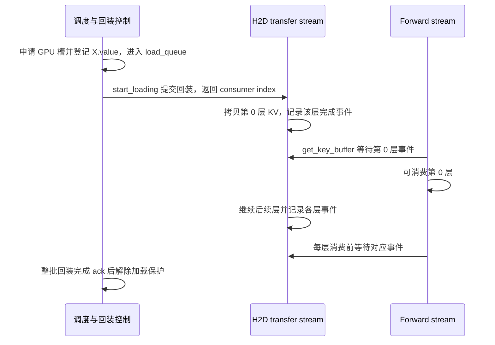

# 主机前缀命中后，为什么拿到 GPU 槽号还不能直接读取 KV

源码版本：`0f6761b54facebb47f2068f87ecccd8f14da3a0e`。证据等级：静态源码核对。限定单设备普通 eager prefill、HiRadixCache、静态 MHA 池，关闭外部存储、SWA、推测、DCP 与混合模型。图与层间交错为教学示意，未运行设备 trace、正确性对照或测量 TTFT。未跟踪导读不作为证据。

版本边界：本提交的[默认缓存工厂](https://github.com/sgl-project/sglang/blob/0f6761b54facebb47f2068f87ecccd8f14da3a0e/python/sglang/srt/mem_cache/registry.py#L80)通常进入 UnifiedRadixCache；本文分析的是仍保留的 HiRadixCache 节点协议，不能据此声称默认服务正在运行该类。下文请求例子是这个类的教学推演；若做运行验证，需要隔离构造对应缓存与依赖，先确认实际实例类型。

让新请求 B 复用 A 的四十八 token 前缀，此时 P 的十六项仍在 GPU，X 的三十二项只在主机。B 不是完全未命中，也不是已经拥有四十八项设备可读 KV。若把 host_indices 直接塞进请求的设备映射，attention 会在错误的地址空间读数据；若申请 GPU 槽后就当作回装完成，又可能读取尚未写入的旧内容。

[match_prefix](https://github.com/sgl-project/sglang/blob/0f6761b54facebb47f2068f87ecccd8f14da3a0e/python/sglang/srt/mem_cache/hiradix_cache.py#L1741) 分别返回 device_indices、last_device_node、last_host_node 和 host_hit_length。本例设备直接可用前缀是 P，主机命中还包含 X。[init_load_back](https://github.com/sgl-project/sglang/blob/0f6761b54facebb47f2068f87ecccd8f14da3a0e/python/sglang/srt/mem_cache/hiradix_cache.py#L1464) 尝试从最佳主机节点回装，失败时退回仍驻留设备的祖先。[load_back](https://github.com/sgl-project/sglang/blob/0f6761b54facebb47f2068f87ecccd8f14da3a0e/python/sglang/srt/mem_cache/hiradix_cache.py#L1391) 先沿 evicted 链收集待加载节点，按祖先到后代拼接 host_indices，而不是只搬最终叶子的一段并留下前缀空洞。

分配前它保护设备祖先，并检查回装长度阈值及可选内存配额；申请失败会尝试淘汰 GPU 缓存后重试，仍失败则返回 None 并释放临时主机保护。[准入入口](https://github.com/sgl-project/sglang/blob/0f6761b54facebb47f2068f87ecccd8f14da3a0e/python/sglang/srt/managers/schedule_policy.py#L1232) 会根据实际 host_loaded_length 更新 prefix_indices；若承诺的主机命中没有回装成功，需要重新评估重算预算。host hit 是准备复用的机会，不是忽略设备容量的强制准入承诺。

图为教学依赖关系，并非实际时间线。代码允许逐层等到可读后继续，不保证硬件上每层都形成了有效重叠，也不表示 event 记录调用返回时设备数据已经到达。

[HiCacheController.load](https://github.com/sgl-project/sglang/blob/0f6761b54facebb47f2068f87ecccd8f14da3a0e/python/sglang/srt/managers/cache_controller.py#L841) 此时只分配 device_indices 并加入 load_queue，尚未调用 H2D engine。HiRadixCache 会先将新索引切片登记到 node.value，记录 ongoing_load_back，并增加加载路径锁。因此 value 非 None 表达已有目的存储与待传输关系，不能单凭 evicted=False 证明全部层已完成复制。

[ready_to_load_host_cache](https://github.com/sgl-project/sglang/blob/0f6761b54facebb47f2068f87ecccd8f14da3a0e/python/sglang/srt/mem_cache/hiradix_cache.py#L1538) 将批次积累的 load_queue 交给 [start_loading](https://github.com/sgl-project/sglang/blob/0f6761b54facebb47f2068f87ecccd8f14da3a0e/python/sglang/srt/managers/cache_controller.py#L941)，后者分配轮换的 producer 事件槽、合并操作并提交传输，返回 consumer index。共享调度接口把这个 index 放入批次，[worker.set_hicache_consumer](https://github.com/sgl-project/sglang/blob/0f6761b54facebb47f2068f87ecccd8f14da3a0e/python/sglang/srt/managers/tp_worker.py#L572) 将其绑定到对应 forward 的层传输计数器；没有回装时使用负值，使常规读取不等待不存在的操作。这里复用了控制器、调度与池接口的源码说明消费契约，不能把接口对接等同于默认工厂实例化了 HiRadixCache。隔离验证必须将同一 layer_done_counter 注册到 worker 与 KV 池，再观察 getter 等待；仅实例化节点树不足以验证整条链。

[L2TransferEngine.submit_host_to_device](https://github.com/sgl-project/sglang/blob/0f6761b54facebb47f2068f87ecccd8f14da3a0e/python/sglang/srt/mem_cache/l2_transfer.py#L74) 逐层安排 load_to_device_per_layer，并调用 on_layer_done 记录当前层完成事件。[LayerLoadingEvent](https://github.com/sgl-project/sglang/blob/0f6761b54facebb47f2068f87ecccd8f14da3a0e/python/sglang/srt/managers/cache_controller.py#L53) 的 wait 给当前消费流安排 wait_event，[LayerDoneCounter](https://github.com/sgl-project/sglang/blob/0f6761b54facebb47f2068f87ecccd8f14da3a0e/python/sglang/srt/managers/cache_controller.py#L71) 根据 consumer_index 找到这一批的事件。轮换事件槽在复用前还检查末层完成，不能把新批次绑定到某个旧批已完成的事件，当作新数据已经可读的证明。

[KV 池 get_key_buffer](https://github.com/sgl-project/sglang/blob/0f6761b54facebb47f2068f87ecccd8f14da3a0e/python/sglang/srt/mem_cache/memory_pool.py#L2532) 和 [get_value_buffer](https://github.com/sgl-project/sglang/blob/0f6761b54facebb47f2068f87ecccd8f14da3a0e/python/sglang/srt/mem_cache/memory_pool.py#L2556) 在交出本层 buffer 前调用 wait_until。这是实际消费者边界：地址早已登记，读取仍被对应层的设备事件约束。直接访问内部原始 buffer 或绑定错误 consumer index 会绕开这道契约；调试接口也不能为方便读数据而随意替代受保护的 getter。

回装写入还有另一方向的依赖：start_loading 在存在 load_fence_stream 时，让传输流等待它，避免向旧 forward 仍可能写入的回收页过早覆盖。等 H2D 完成的读屏障不能自动代替这个防写冲突的等待。[loading_check](https://github.com/sgl-project/sglang/blob/0f6761b54facebb47f2068f87ecccd8f14da3a0e/python/sglang/srt/mem_cache/hiradix_cache.py#L1099) 则消费整次完成 ack 并释放 ongoing_load_back 持有的节点锁，它服务全批生命周期，逐层事件服务模型消费，两者不能混为一个边界。

该机制用主机传输、事件槽和层级接口维护成本换取跳过部分 prefill 重算的机会。短前缀、带宽瓶颈或 GPU 容量不足都可能使回装不划算，本文没有收益测量。待验证时在 match、load、start_loading、受保护 getter 和 loading_check 记录命中长度、槽空间、队列状态、consumer index 与事件位置。应能看到槽号先存在而 DMA 尚未开始，模型消费某层前仍正确等待该层；对照不复用前缀的计算结果检查有效输出。若把主机槽当设备槽、用旧事件放行新读取，或回装未结束便释放加载锁，就是反例。下一步可继续追取消或节点分裂发生在传输中的状态恢复，而不能从正常路径推断所有异常都已覆盖。
