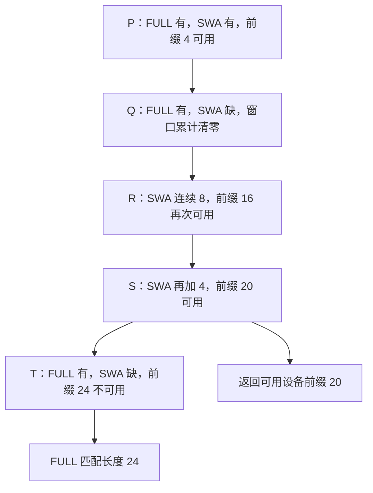

# FULL KV 命中了二十四项，为什么请求只能复用前二十项

源码版本：`0f6761b54facebb47f2068f87ecccd8f14da3a0e`。证据等级：静态源码核对。限定 Python UnifiedTreeCore、FULL+SWA、普通 token key、页大小四和内容稳定的 SWA 槽，关闭 HiCache、Mamba、推测、分布式和会话功能，不讨论每请求 ring。数字和图为教学示意，未运行模型或测量命中收益。工作区未跟踪导读不作为提交证据。

昨天说明旧 HiRadixCache 中地址与数据就绪的区别，但也发现当前版本的默认缓存选择已改变。[默认工厂](https://github.com/sgl-project/sglang/blob/0f6761b54facebb47f2068f87ecccd8f14da3a0e/python/sglang/srt/mem_cache/registry.py#L80) 的常规分支进入 UnifiedRadixCache；[构造函数](https://github.com/sgl-project/sglang/blob/0f6761b54facebb47f2068f87ecccd8f14da3a0e/python/sglang/srt/mem_cache/unified_radix_cache.py#L163) 根据组件集合建立驱动，再通过注册表建立 TreeCore。[Python 工厂](https://github.com/sgl-project/sglang/blob/0f6761b54facebb47f2068f87ecccd8f14da3a0e/python/sglang/srt/mem_cache/unified_cache/tree_core_registry.py#L48) 返回本文分析的 UnifiedTreeCore。FULL+SWA 是混合 full attention 与 sliding-window attention 的缓存组合，不意味着所有模型都有两种组件，也不意味着所有配置都走这个后端。

让 A 留下一条前缀链，依次为 P=[0,4)、Q=[4,8)、R=[8,16)、S=[16,20)、T=[20,24)，区间左闭右开。FULL 五段都在设备，SWA 只有 P、R、S 有数据，Q、T 的 SWA 已被回收；窗口 W=8。新请求 B 的前二十四项与它相同。如果只看 FULL，似乎可以跳过全部二十四项 prefill；但从 T 之后续算时，SWA 需要的末尾窗口缺了一段，其他层拥有旧 KV 并不能替它补齐。

[UnifiedTreeNode](https://github.com/sgl-project/sglang/blob/0f6761b54facebb47f2068f87ecccd8f14da3a0e/python/sglang/srt/mem_cache/unified_cache/unified_tree_core.py#L110) 为各组件保存独立 ComponentData；树级 evicted 属性只由 FULL 的 value 决定。因而“这个节点没有 evicted”并不保证 SWA 也在。把多份状态压成一个通用 present 布尔值，会把一个组件的存活误当作整个模型的恢复条件。

图为教学匹配过程，并非运行追踪。它刻意展示有效边界不是“一遇到缺口永远停止”：SWA 的旧缺口可以退出后续边界的窗口。到 R 的末尾，最后八项全部由 R 提供，Q 的缺失不再影响从十六开始续算；到 T 的末尾，缺失重新落进当前窗口，所以二十四又不能复用。

[_match_prefix_helper](https://github.com/sgl-project/sglang/blob/0f6761b54facebb47f2068f87ecccd8f14da3a0e/python/sglang/srt/mem_cache/unified_cache/unified_tree_core.py#L830) 为每个组件创建 validator，并在每个节点上调用所有 validator；只有共同认可时才更新 best_match_device_node。这里不是把若干独立命中长度取最小值。[FULL validator](https://github.com/sgl-project/sglang/blob/0f6761b54facebb47f2068f87ecccd8f14da3a0e/python/sglang/srt/mem_cache/unified_cache/components/full.py#L105) 检查本节点设备 value；[SWA validator](https://github.com/sgl-project/sglang/blob/0f6761b54facebb47f2068f87ecccd8f14da3a0e/python/sglang/srt/mem_cache/unified_cache/components/swa.py#L319) 持有本次遍历的连续长度，遇到缺失清零，有数据则加 len(node.key)，达到窗口才认可。它初始为无穷，表示根起始、尚未遇到淘汰缺口时，短于完整窗口的已有前缀也可以匹配。每次匹配新建状态，不能把上一请求的累计长度带给下一请求。

遍历仍会收集 P 到 T 的 FULL 索引并累计 full_kv_hit_length=24，却在 S 保存最近的共同有效边界。best_match_device_value_len 记录的是索引块列表长度，而不是 token 数。[_match_post_processor](https://github.com/sgl-project/sglang/blob/0f6761b54facebb47f2068f87ecccd8f14da3a0e/python/sglang/srt/mem_cache/unified_cache/unified_tree_core.py#L946) 只拼接该边界以前的块，因此返回 device_indices 长二十、last_device_node 为 S；无 HiCache 时不额外宣称主机命中。这区分了“沿 key 找到的 FULL 内容”与“所有组件支持直接恢复的设备前缀”。

[SWA 结果补全](https://github.com/sgl-project/sglang/blob/0f6761b54facebb47f2068f87ecccd8f14da3a0e/python/sglang/srt/mem_cache/unified_cache/components/swa.py#L344) 还比较共同边界与页对齐的 FULL 命中，给出 swa_branching_seqlen=24。它是后续考虑补建分支状态的位置提示，不是准许本次读取缺失的 T。FULL 仍在意味着有进一步利用的机会，但具体续算与插入还需走后续协议，不能把这个提示直接加进 prefix_indices。

这个设计允许组件各自回收，代价是每次匹配要维护额外状态，而且一个廉价组件缺失就可能缩短整个模型的直接复用边界。是否因此更快取决于容量、重算与命中分布，本文没有性能证据。待验证时在 helper 的 validator 调用前后和 post processor 记录各段 value、连续长度、full_kv_hit_length、best_match_device_node 与最终索引长度。用上述树应得到 FULL 二十四、直接复用二十；把 T 的 SWA 补齐应推进到二十四，删掉 R 则不应仍认可 S。若返回二十四却允许读取缺失 SWA，或遇到 Q 后永远无法在足够连续窗口处恢复，都会推翻本文解释。下一篇让另一个请求在 R 中间分叉，研究一次匹配为何会改变树。
