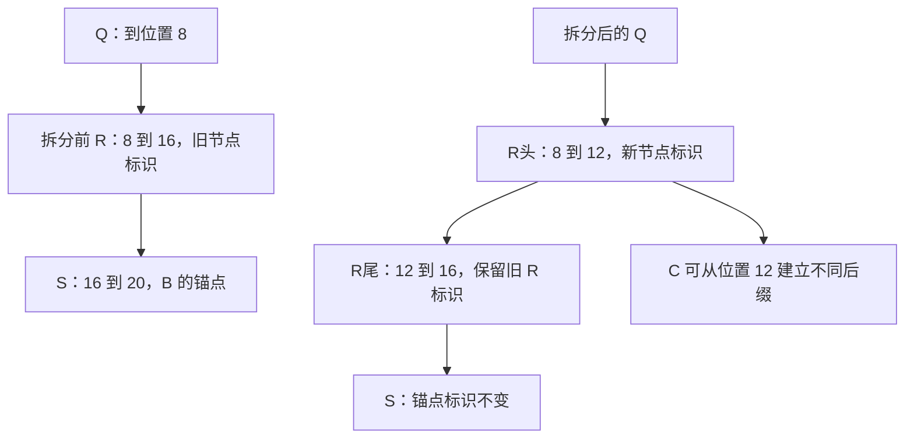

# 一次前缀查询，为什么会拆开其他请求正在引用的节点

源码版本：`0f6761b54facebb47f2068f87ecccd8f14da3a0e`。证据等级：静态源码核对。沿用 Python UnifiedTreeCore、FULL+SWA、page=4、W=8、内容稳定槽和设备缓存，关闭 HiCache、推测、Mamba、会话与分布式。图与索引关系为教学示意，未运行并发请求或 GPU。未跟踪导读不作为提交证据。

上一篇 B 在 S 的末尾取得二十项可用前缀。假设调度已在 S 取得引用保护，另一个请求 C 只共享前十二项，随后 token 不同。旧 R 对应 [8,16)，C 只命中它的前四项。最自然的“查询”实现似乎应该直接返回 R 和一个偏移，不修改缓存；但后续插入、加锁与分支恢复希望操作真实节点边界。如果每个调用都另外解释半节点，组件、引用与淘汰接口都会背负一套偏移协议。

[_match_prefix_helper](https://github.com/sgl-project/sglang/blob/0f6761b54facebb47f2068f87ecccd8f14da3a0e/python/sglang/srt/mem_cache/unified_cache/unified_tree_core.py#L830) 在 prefix_len 小于 child.key 长度时直接调用 [_split_node](https://github.com/sgl-project/sglang/blob/0f6761b54facebb47f2068f87ecccd8f14da3a0e/python/sglang/srt/mem_cache/unified_cache/unified_tree_core.py#L1377)，把公共部分提升为新父节点。R 因此变成 R头=[8,12) 与 R尾=[12,16)，S 仍在 R尾下面。C 随后取得的不是一个“半 R”句柄，而是按新边界计算的匹配结果。正常匹配入口也更新访问时间和 LRU 相关状态，所以它不是对树的纯只读函数，不能任意假设多线程调用无需协调。

图为教学拓扑变换，并非实际运行追踪；C 的新后缀尚未在这次 match 中插入。原 R 对象与标识留给 R尾，新增对象代表 R头，原 S 没有被重新编号。树核之外的匹配结果暴露 NodeId，由 [node_by_id](https://github.com/sgl-project/sglang/blob/0f6761b54facebb47f2068f87ecccd8f14da3a0e/python/sglang/srt/mem_cache/unified_cache/unified_tree_core.py#L547) 在 arena 中解析；保持后缀标识，有助于旧锚点沿更新后的父链继续找到同一段历史，但 NodeId 本身并不取代引用保护。

结构变化必须与组件同步。[FullComponent.redistribute_on_node_split](https://github.com/sgl-project/sglang/blob/0f6761b54facebb47f2068f87ecccd8f14da3a0e/python/sglang/srt/mem_cache/unified_cache/components/full.py#L142) 把原 FULL 索引按 split_len 分成两半，分别 clone，并继承 lock_ref。这里 clone 的对象是槽位索引 tensor，不是把模型每层的整份 K/V 内容重新复制一遍。前后两片索引拼起来仍指向原来八项物理缓存，不应因此增加一组 KV 页分配，也不该释放原槽。

[SWA 的拆分钩子](https://github.com/sgl-project/sglang/blob/0f6761b54facebb47f2068f87ecccd8f14da3a0e/python/sglang/srt/mem_cache/unified_cache/components/swa.py#L586) 同样拆分设备索引；若原组件没有 value，新父节点也保持缺失，而不是拿 FULL 仍在当作 SWA 可以重新出现的理由。钩子还复制引用计数等组件状态，并把代表窗口旧边界的 uuid 从旧 R 移到 R头，R尾删除这个标记。两种状态可以共享 token 拓扑，却不能只靠统一切 key 完成更新：槽位、计数和边界元数据都属于组件自己的契约。

为什么复制 lock_ref 不等于多锁了一份数据？假设 B 原来让八项 R 的引用数为一，拆开后是四项加四项各为一，受保护数据仍是八项。若只给 R尾保留锁，R头可被提前淘汰；若在复制后又把八项全部加进 protected_size，就会重复记账。树核随后更新两片节点的可淘汰叶子与重复副本状态，并把新片放到相应 LRU 关系中，使结构、账目与候选集合一起保持一致。

C 的查询也不能因为 FULL 已切出了十二项就返回十二项直接复用。沿 P、Q、R头遍历，Q 清零后的 SWA 连续段只有四，小于 W=8；共同有效边界仍是 P 的四项。这说明“建立公共节点”与“当前请求具有完整恢复状态”是两个步骤。拆分让结构表达准确，不会制造原本缺少的窗口数据。

[UnifiedRadixCache.match_prefix](https://github.com/sgl-project/sglang/blob/0f6761b54facebb47f2068f87ecccd8f14da3a0e/python/sglang/srt/mem_cache/unified_radix_cache.py#L558) 是树核与缓存协调层的边界：它先取得树核结果，消费返回的 cache_actions，再运行组件的 cache 级补全。本文关闭 HiCache，普通设备拆分没有传输发布动作；在启用相关功能的其他配置中，树核可用动作通知协调层修正待完成操作。这个顺序说明组件化不仅是若干子类共用目录，还包括树内结构变化与外部资源操作之间的接口约束，不能脱离配置把所有分支都画进同一次执行。

拆分会增加节点、索引副本与维护开销，但让后续组件接口面对明确边界。待验证时在 helper、split 和两个组件钩子观察 R 的旧标识、新父标识、key、索引切片、lock_ref、uuid 与分配器空闲页。C 的 match 后两片长度应为四与四，旧标识留在尾片，原八个物理槽保持不变，B 的 S 仍能沿父链到达两片。若查询导致重新分配整份 KV、缺失 SWA 被凭空恢复，或切片后有物理槽丢失或重复释放，就是反例。下一篇解释 B 结束时为何还需要最初加锁留下的凭据。
