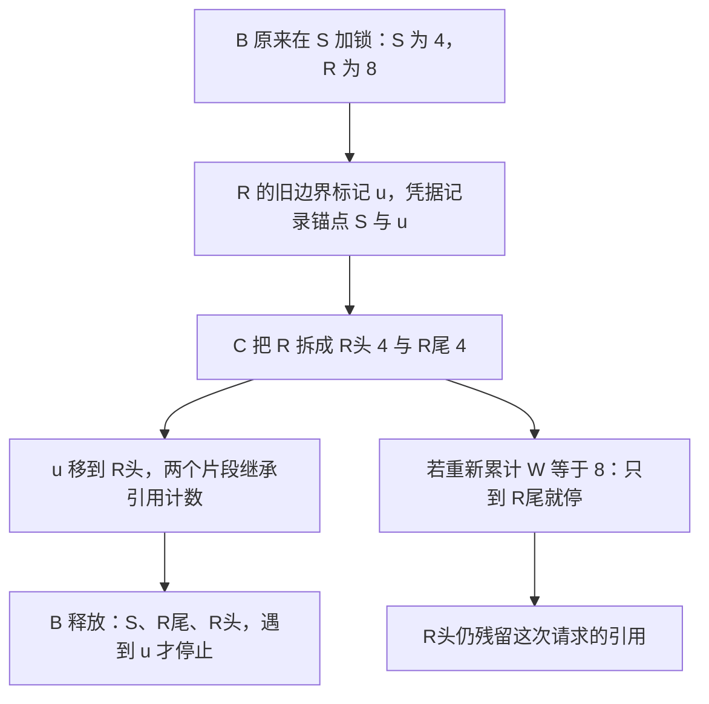

# 节点拆分后，为什么解锁必须重放旧凭据而不能重新数一个窗口

源码版本：`0f6761b54facebb47f2068f87ecccd8f14da3a0e`。证据等级：静态源码核对。沿用 Python UnifiedTreeCore、FULL+SWA、W=8、page=4、设备侧引用与内容稳定槽；关闭 HiCache、Mamba、会话、推测及分布式。数字和图为教学示意，未执行锁压力测试或内存测量。未跟踪导读不作为提交证据。

现在让 B 的引用保护跨过上一篇 C 拆分 R 的时刻。B 的锚点是 S=[16,20)，旧 R=[8,16)。从 S 往根数八项，S 自己只有四，再包含整个 R 就到十二项。实现按节点保护，所以这次 SWA 锁实际覆盖 [8,20)，不是精确八项。若释放时再按“当前树上数满 W 就停”执行，C 已把 R 切成两个四项节点，S 加 R尾恰好八项，释放会提前停下，漏掉当初确实锁过的 R头。

一个抽象的 lock_ref 无法同时描述 FULL 与 SWA 的范围。[FullComponent.acquire_component_lock](https://github.com/sgl-project/sglang/blob/0f6761b54facebb47f2068f87ecccd8f14da3a0e/python/sglang/srt/mem_cache/unified_cache/components/full.py#L263) 沿设备路径保护到根；[SWAComponent.acquire_component_lock](https://github.com/sgl-project/sglang/blob/0f6761b54facebb47f2068f87ecccd8f14da3a0e/python/sglang/srt/mem_cache/unified_cache/components/swa.py#L774) 则沿连续节点向上走到窗口覆盖边界。前者防止完整前缀被回收，后者只需维护末尾窗口所在的节点段。让两者都锁到根虽然简单，却把旧 SWA 保留得过久；只锁当前叶子又会漏掉窗口的祖先段。

图为教学锁范围，并非实际运行追踪。u 是源码中单调生成的组件边界标识的示意。它标记节点的旧侧边缘；上一篇把该标记移到新父节点，正是为了让原来的释放范围在拓扑变动后仍能被找到。

[IncLockRefResult](https://github.com/sgl-project/sglang/blob/0f6761b54facebb47f2068f87ecccd8f14da3a0e/python/sglang/srt/mem_cache/base_prefix_cache.py#L161) 不仅返回容量变化，还携带 node_id、swa_uuid_for_lock、主机侧标记与 skipped_lock_components。to_dec_params 将这些字段传给解锁参数。[TreeCore.inc_lock_ref](https://github.com/sgl-project/sglang/blob/0f6761b54facebb47f2068f87ecccd8f14da3a0e/python/sglang/srt/mem_cache/unified_cache/unified_tree_core.py#L673) 先记录锚点与跳过的组件，再调用各组件取得锁。这里的凭据是一次 acquire 的结果，不是随时从请求当前位置重新构造的“当前应该释放什么”。

SWA acquire 用 len(cur.key) 累计逻辑覆盖，包含 tombstone 节点；计数变化与容量账目分开，有实际数据且引用从零变一时，才把相应数量从 evictable 转到 protected。达到 W 时，在边界节点设置或复用 uuid，将它写进凭据。如果一直走到根还不足窗口，标记为 None，含义是本次段直到根。对缺数据节点也记录范围，使后续在锁内补建数据、或结构再次拆分时，release 仍能镜像原 acquire，而不是凭 value 当前是否存在跳过一段。

[SWAComponent.release_component_lock](https://github.com/sgl-project/sglang/blob/0f6761b54facebb47f2068f87ecccd8f14da3a0e/python/sglang/srt/mem_cache/unified_cache/components/swa.py#L832) 从原锚点向上逐项减少引用，到凭据中的 uuid 才停止；遇到零引用会断言失败。它不重新用 W 计算边界，所以 B 会依次释放 S、R尾、R头，共十二项。最后一个持有者离开有数据节点时才把账目移回 evictable，并刷新候选集合；另一个请求仍持有引用时，不能把整片当成空闲。这里 protected 是容量分类，不是又分配了十二项显存。

[TreeCore.dec_lock_ref](https://github.com/sgl-project/sglang/blob/0f6761b54facebb47f2068f87ecccd8f14da3a0e/python/sglang/srt/mem_cache/unified_cache/unified_tree_core.py#L726) 还通过 [_assert_receipt_anchor](https://github.com/sgl-project/sglang/blob/0f6761b54facebb47f2068f87ecccd8f14da3a0e/python/sglang/srt/mem_cache/unified_cache/unified_tree_core.py#L689) 检查凭据是否对应传入节点，并按凭据跳过当初没有取得的组件。否则 rematch 改写 req.last_node 后，用旧凭据释放新锚点，就可能偷减其他请求的引用。缓存协调层的 [_dec_req_lock](https://github.com/sgl-project/sglang/blob/0f6761b54facebb47f2068f87ecccd8f14da3a0e/python/sglang/srt/mem_cache/unified_radix_cache.py#L934) 使用请求保存的 lock_receipt；[cache_unfinished_req](https://github.com/sgl-project/sglang/blob/0f6761b54facebb47f2068f87ecccd8f14da3a0e/python/sglang/srt/mem_cache/unified_radix_cache.py#L1115) 在更新前缀保护时释放旧锁、取得新锁，再保存新锚点和新凭据，不能只更新一个节点字段。

窗口前进还可能提前释放 SWA，但不是本文假定自动发生的行为。[批次侧入口](https://github.com/sgl-project/sglang/blob/0f6761b54facebb47f2068f87ecccd8f14da3a0e/python/sglang/srt/managers/schedule_batch.py#L3811) 受 SGLANG_OPT_SWA_RELEASE_LEAF_LOCK_AFTER_WINDOW 开关控制，并检查 decode 进度、凭据和是否已经释放。[dec_swa_lock_only](https://github.com/sgl-project/sglang/blob/0f6761b54facebb47f2068f87ecccd8f14da3a0e/python/sglang/srt/mem_cache/unified_cache/unified_tree_core.py#L757) 与 [release_window_lock](https://github.com/sgl-project/sglang/blob/0f6761b54facebb47f2068f87ecccd8f14da3a0e/python/sglang/srt/mem_cache/unified_cache/components/swa.py#L880) 保留 FULL 的前缀保护，只处理本次窗口锁及适用的更低优先级组件。后续完整释放必须带 skip_swa，避免同一份锁释放两遍；调用方用 swa_prefix_lock_released 记录这段生命周期。这条路径要求每个锚点和窗口凭据至多提前释放一次，并不是可无限重试的幂等 decrement。

凭据与标记增加了状态，但避免将“现在需要保护哪些数据”误当成“过去这次操作确实保护了哪些数据”。待验证时在 acquire、R 拆分、release 和请求重匹配处记录 node_id、uuid、各组件 lock_ref、protected_size 与 receipt。先加 B 的锁，再让 C 拆 R，最后用原凭据释放，应无残留且不触碰 Q 的 SWA 引用；把 release 改成重新数八项的教学对照应留下 R头。另检查错误锚点、重复提前释放与两请求共享窗口。若正确配对后仍漏锁、引用为负，或另一请求仍在用的数据被划为可淘汰，就是反例。本文只给验证方案，没有将这条教学轨迹当作已运行结果。
