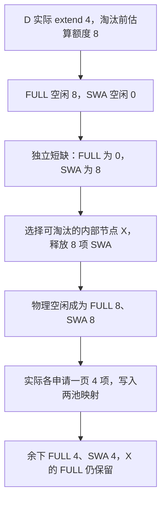

# FULL 还空着八个槽，为什么新 prefill 仍要先淘汰 SWA

源码版本：`0f6761b54facebb47f2068f87ecccd8f14da3a0e`。证据等级：静态源码核对。限定 Python UnifiedTreeCore、FULL+SWA、独立静态分页池、page=4 和内容稳定的 SWA 槽；关闭 HiCache、Mamba、推测、分布式、会话与每请求 ring，不讨论共享字节池。数字与图为教学示意，未运行模型、分配器或性能实验。工作区未跟踪导读不作为提交证据。

昨天把引用保护的范围讲清楚了，但请求释放引用，只会让缓存变为可淘汰，并不会自动把所有 KV 都还给分配器。现在新请求 D 要做四项 extend，假定批次只有它一个，请求原前缀恰好页对齐。FULL 池还有八个空闲槽，SWA 池却已经没有空闲。若只检查 FULL，就可能在请求已经进入执行准备之后，才发现对应滑窗层没有写入位置。

[SWATokenToKVPoolAllocator.available_size](https://github.com/sgl-project/sglang/blob/0f6761b54facebb47f2068f87ecccd8f14da3a0e/python/sglang/srt/mem_cache/allocator/swa.py#L152) 在本文布局中返回两个子分配器空闲量的最小值；[new_pages_available](https://github.com/sgl-project/sglang/blob/0f6761b54facebb47f2068f87ecccd8f14da3a0e/python/sglang/srt/mem_cache/allocator/swa.py#L277) 则分别检查 FULL 与 SWA 所需页数。这里不是一个大池随便换标签使用：FULL 的八个槽不能直接充当 SWA 的八个槽。共享物理字节池与每请求 ring 有不同实现，不能把本文的双池约束推广过去。

上层申请额度还不等于实际新增 token 数。[alloc_paged_token_slots_extend](https://github.com/sgl-project/sglang/blob/0f6761b54facebb47f2068f87ecccd8f14da3a0e/python/sglang/srt/mem_cache/allocation.py#L174) 为淘汰估算使用 extend_num_tokens 加每请求一页的保守余量；本例单设备、单请求得到 4+4=8。真正 [alloc_extend](https://github.com/sgl-project/sglang/blob/0f6761b54facebb47f2068f87ecccd8f14da3a0e/python/sglang/srt/mem_cache/allocator/swa.py#L289) 随后依据前后长度计算新增页，本例只需要一张 FULL 页和一张 SWA 页。多留的估算余量并不是给 D 强制写八项 KV，也不表示模型上下文增加了八项。

图为教学容量账目，并非实际运行追踪；假定 X 的八项 SWA 都有有效配对页、没有引用保护，释放不处于尚未结束的 free_group 中，也没有其他分配穿插。X 还拥有设备驻留的孩子，因此本例可以走内部组件淘汰，下一篇再解释这个条件为何重要。

[evict_to_free_tokens](https://github.com/sgl-project/sglang/blob/0f6761b54facebb47f2068f87ecccd8f14da3a0e/python/sglang/srt/mem_cache/allocator/swa.py#L199) 分别计算 max(0,额度减当前空闲)，然后调用缓存的 [evict_for_alloc](https://github.com/sgl-project/sglang/blob/0f6761b54facebb47f2068f87ecccd8f14da3a0e/python/sglang/srt/mem_cache/unified_radix_cache.py#L610)。所以传入的是 FULL 短缺零、SWA 短缺八，而不是要求两类缓存各无条件删八项。后者将短缺转换为目标空闲量：SWA 当前零加短缺八，目标为八；没有短缺的 FULL 不建立额外目标。把调用参数误认成绝对容量或总 token 数，会多删缓存或过早停止。

[_component_available_size](https://github.com/sgl-project/sglang/blob/0f6761b54facebb47f2068f87ecccd8f14da3a0e/python/sglang/srt/mem_cache/unified_radix_cache.py#L689) 从对应分配器读取可用于下一次申请的容量。[_evict_components](https://github.com/sgl-project/sglang/blob/0f6761b54facebb47f2068f87ecccd8f14da3a0e/python/sglang/srt/mem_cache/unified_radix_cache.py#L807) 既维护各组件的淘汰累计量，也在每步释放后检查目标容量是否已达到。先前组件的整节点淘汰可能连带释放其他组件，所以随后检查不能完全忽略已经发生的连带回收。在本文独立池、完整配对页的例子中数量比较直观，源码接口还为其他布局保留了重新读容量的边界；本文不把共享池中的字节换算规则带进来。

“树上减少八项”与“现在能申请八项”之间还有一道接口。[缓存侧淘汰步](https://github.com/sgl-project/sglang/blob/0f6761b54facebb47f2068f87ecccd8f14da3a0e/python/sglang/srt/mem_cache/unified_radix_cache.py#L759) 取得树核返回的 device_frees，调用 _free_values 执行实际回收，再累计 tracker；它不会只更新节点的 value=None 就宣布容量已经兑现。若候选都受保护、已不存在或不足，遍历结束可以仍达不到目标；调用返回不是无限容量的承诺，最终分配仍需要处理失败。

[alloc_extend](https://github.com/sgl-project/sglang/blob/0f6761b54facebb47f2068f87ecccd8f14da3a0e/python/sglang/srt/mem_cache/allocator/swa.py#L289) 在两池页数足够时分别分配，建立 FULL 到 SWA 的映射，向上返回 FULL 槽号。请求映射使用一套索引，不代表只有一份资源账目。相反，映射把这两类物理资源的关系连接起来，也为之后独立回收 SWA 留下依据。保守淘汰可能降低本轮失败风险，却也可能比实际新增页更早损失缓存命中；本文不据此推断吞吐收益。

待验证时在上层额度计算、evict_to_free_tokens、evict_for_alloc 与 alloc_extend 记录实际 extend、估算额度、两池空闲量、目标和新增页。按例子应先看到 SWA 目标八，再各分配四；若把估算八当成实际写入长度、FULL 空闲充足就放过 SWA 检查，或树已变 tombstone 但物理容量未到账却报告满足，都是反例。以上为待执行方案。下一篇进入 X 的淘汰过程，核对它为什么可以只丢 SWA 而保留 FULL。
