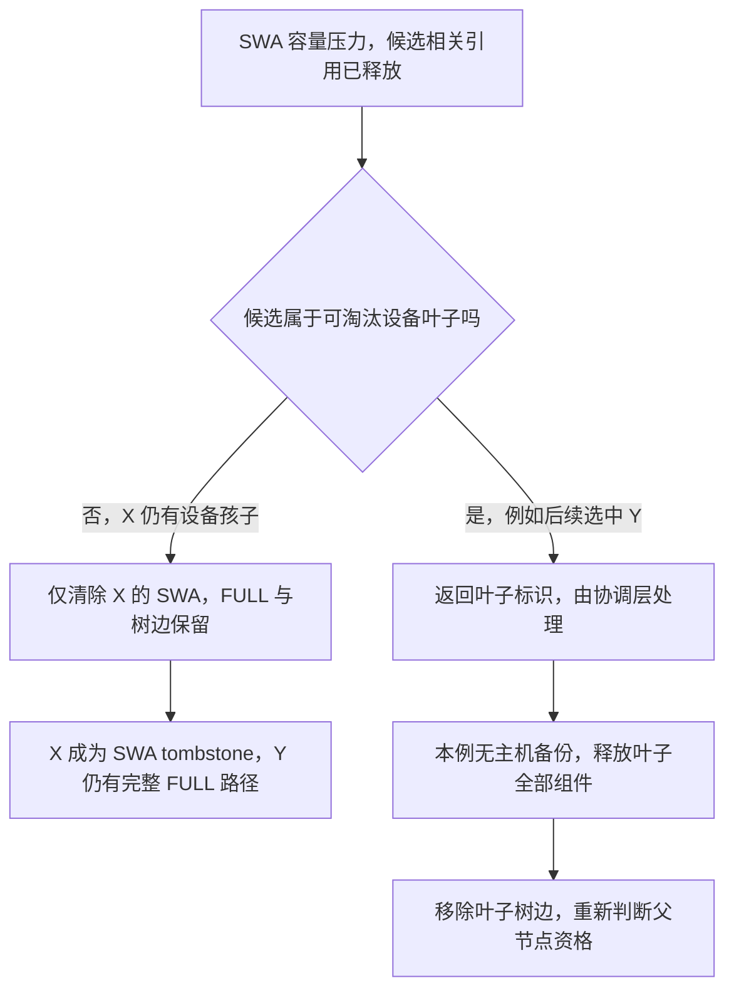

# 同样为 SWA 腾空间，为什么有时保留 FULL，有时整片前缀一起删除

源码版本：`0f6761b54facebb47f2068f87ecccd8f14da3a0e`。证据等级：静态源码核对。沿用 Python UnifiedTreeCore、FULL+SWA、独立静态分页池和普通 token key，关闭 HiCache、外部存储、Mamba、会话、推测及分布式。图为教学状态转移，未运行淘汰压力测试。未跟踪导读不作为提交证据。

沿用 D 的容量请求，选中缓存内部节点 X，key 长八，下面还有设备驻留的孩子 Y，长四。两种组件的数据都在，相关引用计数为零。D 只缺 SWA，如果每次都整片删除 X，既浪费仍可复用的 FULL，还会破坏 Y 依赖的 FULL 前缀连续性；如果永远只删 SWA，已经没有后代价值的叶子又会继续保留一份 FULL 与树元数据。淘汰需要区别组件内部退化与整节点收缩。

[SWAComponent._evict_device_next_node](https://github.com/sgl-project/sglang/blob/0f6761b54facebb47f2068f87ecccd8f14da3a0e/python/sglang/srt/mem_cache/unified_cache/components/swa.py#L713) 从 SWA 的可淘汰 LRU 位置推进。若选中项是可整节点淘汰的设备叶子，它返回 node_id，让缓存协调层处理完整叶子；否则本步直接淘汰该节点的 SWA，再执行组件连带判断。因此同一个 SWA 容量请求既可能只产生组件释放，也可能带回一个需要整节点处理的候选，不能把函数返回 None 一概解释成“没有发生任何回收”。

图为教学分支，并非实际运行追踪。Y 的整节点删除发生在后续一次选择中，不是说选择 X 会自动把孩子 Y 也递归删除。本文没有主机副本，因此叶子删除之后也不存在自动降级到主机的保证。

[_is_device_leaf](https://github.com/sgl-project/sglang/blob/0f6761b54facebb47f2068f87ecccd8f14da3a0e/python/sglang/srt/mem_cache/unified_cache/unified_tree_core.py#L2099) 规定节点非根、FULL 在设备、没有 FULL 仍在设备的孩子，并且所有组件都没有设备锁。它关注的是设备驻留边界，不要求每个辅助组件都有数据。反过来，一个结构上没有孩子的节点，如果仍有组件被保护，也不属于这个集合。昨天的锁凭据最终是否释放完整，直接影响今天有哪些候选能进入整节点路径。

X 是内部节点，因此先进入 [SWAComponent.evict_component](https://github.com/sgl-project/sglang/blob/0f6761b54facebb47f2068f87ecccd8f14da3a0e/python/sglang/srt/mem_cache/unified_cache/components/swa.py#L654)，把 SWA 的 value 变成 None，并生成待释放记录。[_cascade_evict](https://github.com/sgl-project/sglang/blob/0f6761b54facebb47f2068f87ecccd8f14da3a0e/python/sglang/srt/mem_cache/unified_cache/unified_tree_core.py#L1891) 再根据优先级判断是否连带其他组件。[FULL 优先级](https://github.com/sgl-project/sglang/blob/0f6761b54facebb47f2068f87ecccd8f14da3a0e/python/sglang/srt/mem_cache/unified_cache/components/full.py#L187) 在内部节点为二，[SWA 优先级](https://github.com/sgl-project/sglang/blob/0f6761b54facebb47f2068f87ecccd8f14da3a0e/python/sglang/srt/mem_cache/unified_cache/components/swa.py#L698) 为一；只向较低或相等优先级传播，内部 SWA 的一不会淘汰 FULL 的二。所以 X 的 FULL、key 和父子关系继续存在，之后请求仍可以遍历到 Y。

这里的优先级表达组件保留与结构依赖的取舍，不是 token 热度、LRU 年龄或操作系统线程优先级。LRU 决定先考察哪个 SWA 候选，组件优先级决定一个候选上的回收影响哪些同伴，两者不是同一个维度。[_should_cascade_evict_component](https://github.com/sgl-project/sglang/blob/0f6761b54facebb47f2068f87ecccd8f14da3a0e/python/sglang/srt/mem_cache/unified_cache/unified_tree_core.py#L1942) 还检查组件数据、锁与适用的引用约束；不能把“数值较低”读成越过引用保护随时删除的许可。

当候选确实属于可淘汰设备叶子时，FULL 与 SWA 的叶子优先级都归零，体现整片收缩的策略；但本文无 HiCache 的实际叶子路线不是把内部 tombstone 操作重复一遍。[TreeCore.evict_device_leaf](https://github.com/sgl-project/sglang/blob/0f6761b54facebb47f2068f87ecccd8f14da3a0e/python/sglang/srt/mem_cache/unified_cache/unified_tree_core.py#L1597) 对无主机备份节点调用 [_delete_unbacked_device_leaf](https://github.com/sgl-project/sglang/blob/0f6761b54facebb47f2068f87ecccd8f14da3a0e/python/sglang/srt/mem_cache/unified_cache/unified_tree_core.py#L1700)，后者通过 [_release_all_component_layers](https://github.com/sgl-project/sglang/blob/0f6761b54facebb47f2068f87ecccd8f14da3a0e/python/sglang/srt/mem_cache/unified_cache/unified_tree_core.py#L1677) 收集全部组件释放，再移除节点并刷新父节点。于是后续淘汰 Y 可以同时释放 FULL 与 SWA，X 也可能因此成为新的设备叶子。

树核把一步的资源清单和计数变化返回给协调层。[TreeCore.evict_device_next_node](https://github.com/sgl-project/sglang/blob/0f6761b54facebb47f2068f87ecccd8f14da3a0e/python/sglang/srt/mem_cache/unified_cache/unified_tree_core.py#L1569) 用 node_id 或 tracker 增量计算 made_progress，所以内部 SWA 释放即使没有带回叶子标识，也会被视为实际进展。协调层先兑现本步释放、检查容量，再决定是否继续。否则“遇到内部节点返回 None”就停，会把已经腾出的容量漏算；反过来，不兑现物理释放就继续按树计数准入，也会造成账目与分配器脱节。

保留 FULL tombstone 路径减少了立即丢弃所有组件的损失，却可能让下一请求只命中 FULL、仍需补算 SWA；整叶删除节省两池资源，却牺牲更多潜在复用。源码没有证明其中一种总是更快。待验证时分别安排无锁内部 X 与无锁叶子 Y，记录叶子集合、两组件 value、lock_ref、返回 node_id、made_progress 和各类 tracker。X 应只少八项 SWA，Y 的无备份叶子路径则释放两类数据并移除树边。若 X 的内部 SWA 淘汰连带删除仍驻留的 FULL 祖先链，或一份未释放的锁仍被忽略，就是反例。下一篇把返回清单继续追到两池映射与真正的物理页。
