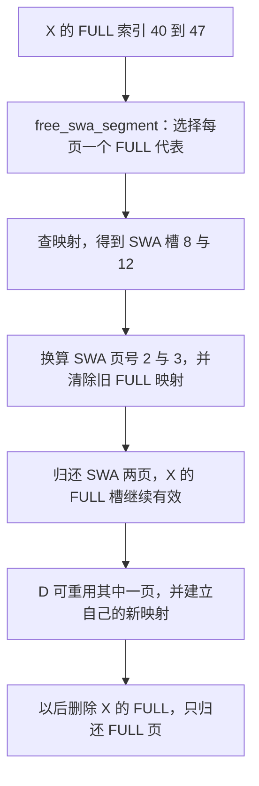

# 释放 SWA，为什么传给分配器的却是 FULL 槽号

源码版本：`0f6761b54facebb47f2068f87ecccd8f14da3a0e`。证据等级：静态源码核对。限定 FULL+SWA 独立静态分页分配器、page=4、完整配对页、普通内容稳定 KV；关闭共享字节池、ring、HiCache、推测、会话与分布式。图和地址均为教学示意，未执行 CUDA kernel、内存复用或数值对照。未跟踪导读不作为提交证据。

X 的八项 SWA 已从树中逻辑淘汰，现在必须真正把两张页还给 SWA 池。假定它的 FULL 槽号为 [40,48)，对应 SWA 槽号为 [8,16)，区间左闭右开。最直观的做法是拿 X.component_data[SWA].value 去 free。问题是缓存还维护着 FULL 到 SWA 的配对映射：只归还 SWA 槽、不撤销原映射，下一次用旧 FULL 查表就会把已重用的数据认成 X 的伙伴。

[SWAComponent.evict_component](https://github.com/sgl-project/sglang/blob/0f6761b54facebb47f2068f87ecccd8f14da3a0e/python/sglang/srt/mem_cache/unified_cache/components/swa.py#L654) 放进 device_frees[SWA] 的实际上是 X 的 FULL 索引，并把 SWA value 清空。这不是写错了组件标签。标签选择应该执行哪种资源操作，清单中的索引则是这个操作所需的输入地址空间。[缓存侧 _drain_device_frees](https://github.com/sgl-project/sglang/blob/0f6761b54facebb47f2068f87ecccd8f14da3a0e/python/sglang/srt/mem_cache/unified_radix_cache.py#L1306) 将清单转换为组件动作，[SWA 的动作执行器](https://github.com/sgl-project/sglang/blob/0f6761b54facebb47f2068f87ecccd8f14da3a0e/python/sglang/srt/mem_cache/unified_cache/components/swa.py#L1453) 调用 free_swa_segment，约定输入就是 FULL 行片段。不能看到字典键为 SWA，就把 payload 自动解释成 SWA 的物理槽号。

图为教学地址和所有权关系，并非运行追踪；“到”包含该段最后一项，正文区间仍用左闭右开。D 何时拿到哪张空闲页由分配器状态决定，图仅假设它后来复用了 SWA 页二，不把教学地址当作真实分配日志。

[free_swa_segment](https://github.com/sgl-project/sglang/blob/0f6761b54facebb47f2068f87ecccd8f14da3a0e/python/sglang/srt/mem_cache/allocator/swa.py#L513) 进入 [_free_swa_pages](https://github.com/sgl-project/sglang/blob/0f6761b54facebb47f2068f87ecccd8f14da3a0e/python/sglang/srt/mem_cache/allocator/swa.py#L521)，要求逻辑 start_pos 页对齐，再按 page_size 的步长选 FULL 页代表。本例八项得到代表四十、四十四，映射查得 SWA 槽八、十二，除以四得到 SWA 页二、三。索引序列是页对齐的请求行片段，而非任意集合；输入必须代表不同 FULL 页，不能因为一般 free 接口会去重，就随意在这里重复传同一张页。

CPU/非 CUDA 分支在 [_free_swa_pages_none_cuda](https://github.com/sgl-project/sglang/blob/0f6761b54facebb47f2068f87ecccd8f14da3a0e/python/sglang/srt/mem_cache/allocator/swa.py#L544) 中查表并清除整张 FULL 页的映射。CUDA 分支经 [_free_swa_pages_cuda](https://github.com/sgl-project/sglang/blob/0f6761b54facebb47f2068f87ecccd8f14da3a0e/python/sglang/srt/mem_cache/allocator/swa.py#L569) 调用 [get_and_clear_swa_pages](https://github.com/sgl-project/sglang/blob/0f6761b54facebb47f2068f87ecccd8f14da3a0e/python/sglang/kernels/ops/memory/allocator.py#L66)，由 [kernel](https://github.com/sgl-project/sglang/blob/0f6761b54facebb47f2068f87ecccd8f14da3a0e/python/sglang/kernels/ops/memory/allocator.py#L7) 读取代表、输出 SWA 页并清零映射；kernel 还在清零前安排块内屏障，防止同一块中的读映射尚未结束就被其他 warp 清掉。这里描述的是源码中的依赖，未证明实际带宽或开销。

页代表的伙伴映射应为正值，代码通过 swa.peer_mapped 不变量声明检查；零表示没有配对，不能当作可以归还的普通 SWA 页零。尤其不能把“以前释放过了”解释成这一接口可无条件重试。X 的组件已经为 None 时，组件淘汰不会再次生成这份 SWA 释放；若绕过上层重复调用底层 free_swa_segment，就是破坏调用契约，而不是安全的幂等清理。

映射撤销必须属于这次释放的时刻。[free_group_end](https://github.com/sgl-project/sglang/blob/0f6761b54facebb47f2068f87ecccd8f14da3a0e/python/sglang/srt/mem_cache/allocator/swa.py#L639) 可以批量归还页，但 _free_swa_pages 会在入组时就解析并保存 swa_pages、清除旧映射，而不是只保存 FULL 索引等组末再查。如果期间其他缓存动作重新配对同一个 FULL 索引，推迟查表会释放新伙伴而漏掉旧伙伴。批处理可以延后物理空闲集合的更新，不能顺便延后决定“这次到底释放谁”。

再看以后 X 的 FULL 也不需要时。[FullComponent.apply_component_action](https://github.com/sgl-project/sglang/blob/0f6761b54facebb47f2068f87ecccd8f14da3a0e/python/sglang/srt/mem_cache/unified_cache/components/full.py#L504) 在 SWA 模式直接调用 full_attn_allocator.free_segment，只归还 FULL 子池。它没有再次调用会同时释放两边的组合 free；已经归还并可能被 D 重用的 SWA 页因此不受影响。完整叶子同时释放两种组件时，两个动作也各管一边。[FULL 生成释放清单](https://github.com/sgl-project/sglang/blob/0f6761b54facebb47f2068f87ecccd8f14da3a0e/python/sglang/srt/mem_cache/unified_cache/components/full.py#L160) 时暂不清空 value，让同一步后续的 SWA 钩子有机会取到索引，再由协调层消费两种资源清单。

这套协议把树状态、索引映射、物理页和批处理账目分开维护，代价是接口必须区分组合释放与单组件释放。待验证时在组件生成清单、两个动作执行器和分配器回收处记录 FULL 索引、旧映射、SWA 页号与 free_group 队列。按例子应只归还页二、三，X 的 FULL 仍在；D 重用页二后，再删除 X 不应把 D 的页还回去。重复释放、映射仍指向已归还页、或组末误释放重新配对的伙伴，都是反例。以上均为待执行方案，本文没有把静态地址推演当作运行正确性证据。
