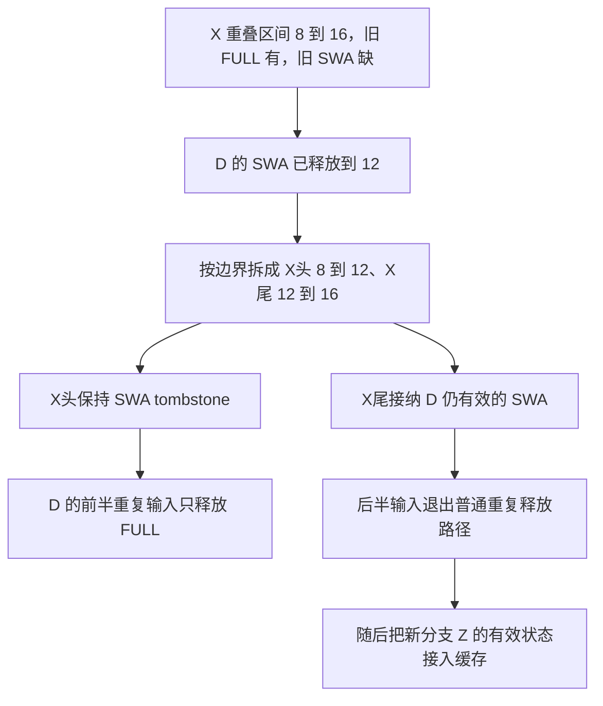

# 补算出一段重叠前缀后，为什么缓存只接纳它的后半段 SWA

源码版本：`0f6761b54facebb47f2068f87ecccd8f14da3a0e`。证据等级：静态源码核对。限定 Python UnifiedTreeCore、FULL+SWA、独立静态分页池、page=4、W=8、内容稳定槽与普通 token key，关闭 HiCache、Mamba、推测、会话、分布式及每请求 ring。数字与图为教学输入，不是运行日志。未运行模型或测量恢复收益；工作区未跟踪导读不作为提交证据。

昨天把内部节点的 SWA 淘汰到 None，同时保留 FULL。今天反过来：新请求 D 补算后再次插入同一段 key，怎样让已有前缀重新拥有滑窗状态？不能把“FULL 已存在”直接解释成全部重复并释放 D 的输入，也不能把 D 整段 SWA 都当成仍然有效，因为请求自己也可能已回收窗口之外的数据。

令树中 X 覆盖逻辑 [8,16)，FULL 在设备而 SWA 缺失；D 原来受保护的前缀到八，本次待插入 key 到二十，新分支 Z 覆盖 [16,20)。假定插入时 D 的 swa_evicted_seqlen=12：它新计算的 FULL 仍覆盖 X，但 X 前半 [8,12) 的请求侧 SWA 已释放，后半 [12,16) 仍有效。这是对一次插入参数的教学设定，不声称任意长度二十的 forward 都必然产生边界十二。

[InsertParams](https://github.com/sgl-project/sglang/blob/0f6761b54facebb47f2068f87ecccd8f14da3a0e/python/sglang/srt/mem_cache/base_prefix_cache.py#L76) 分开传递 prev_prefix_len 和 swa_evicted_seqlen。前者说明此前已经保护的前缀，后者说明请求侧 SWA 的回收进度；两者不能用同一个 prefix_len 代替。[SWA.prepare_for_caching_req](https://github.com/sgl-project/sglang/blob/0f6761b54facebb47f2068f87ecccd8f14da3a0e/python/sglang/srt/mem_cache/unified_cache/components/swa.py#L925) 将请求记录的回收边界放进插入参数，[cache_unfinished_req](https://github.com/sgl-project/sglang/blob/0f6761b54facebb47f2068f87ecccd8f14da3a0e/python/sglang/srt/mem_cache/unified_radix_cache.py#L1115) 准备 key 与新 FULL 索引，再调用插入。本文直接从这些输入分析，不展开调度如何选择缓存时机。

图为教学范围与所有权变化，所有区间左闭右开，并非实际运行追踪。它没有表示前半 SWA 永远无法恢复，而是这次插入已没有那部分有效输入。恢复要尊重此刻仍由 D 持有的资源，不能从旧 FULL 的存在凭空重建被释放的滑窗页。

[update_component_on_insert_overlap](https://github.com/sgl-project/sglang/blob/0f6761b54facebb47f2068f87ecccd8f14da3a0e/python/sglang/srt/mem_cache/unified_cache/components/swa.py#L388) 先跳过原受保护范围以及 SWA 已有数据的节点。对 tombstone，它比较 swa_evicted_seqlen 与当前段起止：边界在段前面时整段恢复，落在段内部时部分恢复，已经越过段尾时本段不接纳 SWA。本例 total_prefix_len=8、prefix_len=8，start_idx=12-8=4，于是调用树核 split 将 X 切成两片，恢复动作只拿 value_slice[4:]。

关键返回值不是“新命中的总长度”，而是这段重叠输入从哪里开始被组件消费。本例返回四，整段恢复返回零，不需要恢复则返回八。[TreeCore._insert_walk_step](https://github.com/sgl-project/sglang/blob/0f6761b54facebb47f2068f87ecccd8f14da3a0e/python/sglang/srt/mem_cache/unified_cache/unified_tree_core.py#L1217) 对组件结果取最小 consumed_from，让拥有接纳需求的组件阻止那部分输入被当成普通重复数据释放。最终 InsertResult.prefix_len 仍描述 key 重叠范围，不能拿它推断 D 的全部重叠物理槽都已经归还。

本例 duplicate slice 只覆盖 D 的前四项，即逻辑 [8,12)。这些 SWA 已低于请求的回收边界，walk 因此生成 FreeDeviceKVFullOnly；若错误地用同时释放两池的 FreeDeviceKV，会再次触碰已经回收的 SWA 伙伴。后四项的 SWA 将被缓存接纳，输入 FULL 是否保留则取决于旧 FULL 的引用保护，下一篇追这条分支。

[InsertResult.record_adopted_range](https://github.com/sgl-project/sglang/blob/0f6761b54facebb47f2068f87ecccd8f14da3a0e/python/sglang/srt/mem_cache/base_prefix_cache.py#L129) 还支持按组件记录接纳区间，但只有显式启用 track_adopted_ranges 时才实际保存。不能在普通配置下假定一定能从结果对象读到完整轨迹。调试时可开启这份辅助记录；真正控制本步重复释放的仍是组件返回的 consumed_from 和执行的资源动作。

部分恢复会增加切分节点和动作维护开销，同时保留只有 FULL 的旧段。接入 Z 的有效 SWA 后，是否能形成可复用窗口还要经过已有的组件匹配协议；插入 X尾 并不独自保证任意边界都可直接复用。待验证时在 overlap hook、split 与 walk 的重复释放分支记录两种边界、start_idx、consumed_from、动作载荷及组件 value。上述输入应切出两个四项片段，只恢复 X尾，前半只释放 D 的 FULL。再分别设置边界八和十六，应进入整段恢复与本段不接纳分支。若已回收的前半 SWA 被重新发布、被接纳的后半又走普通重复释放，或把 key 重叠长度当物理回收数量，就是反例。以上均为待执行检查。
