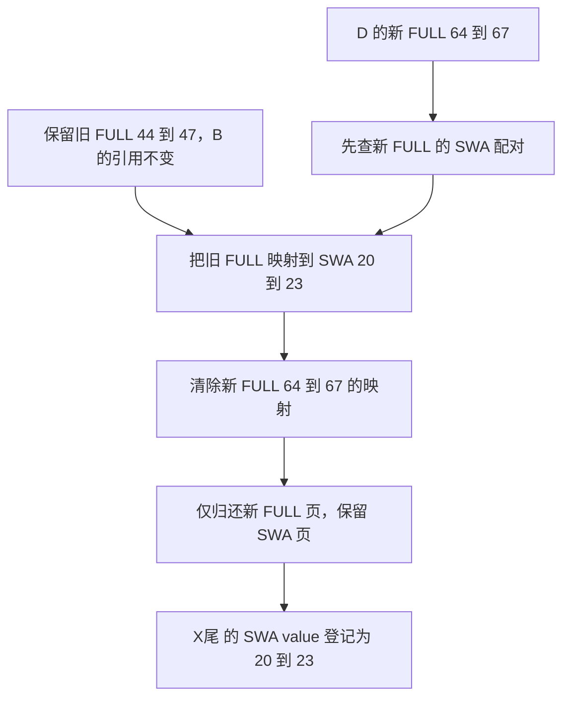

# 旧 FULL 还被其他请求引用，怎样接纳新 SWA 而不搬动它的槽号

源码版本：`0f6761b54facebb47f2068f87ecccd8f14da3a0e`。证据等级：静态源码核对。沿用 Python UnifiedTreeCore、FULL+SWA、独立静态分页池、page=4 与内容稳定槽，关闭共享字节池、ring、HiCache、Mamba、会话、推测和分布式。图与槽号为教学示意，未执行映射重绑、GPU 复制或数值对照；未跟踪导读不作为证据。

沿用 X 的部分恢复。设旧 X 的 FULL 槽为 [40,48)，D 新算出的对应 FULL 槽为 [60,68)。X尾 的旧 FULL 是 [44,48)，D 的新 FULL 是 [64,68)，后者配对的有效 SWA 槽为 [20,24)。旧 X 的 SWA 已淘汰，因此旧 FULL 到 SWA 的映射为空。另一个请求 B 仍引用旧 FULL 前缀，但它所需的 SWA 窗口在更后面，不覆盖 X，故 X 的 FULL 有保护而 SWA 可以缺失。

如果直接把 X尾 的 FULL 指向 D 的 [64,68)，再释放旧 [44,48)，B 的请求映射并不会自动跟着树节点变化。它仍可能读旧 FULL 槽，而这些槽已被其他请求重用。反过来，如果把 D 的新配对整组释放，虽保住 B 的 FULL，却把刚刚补算、准备接纳的 SWA 也扔掉。两个组件在同一逻辑前缀上，物理所有权却不能作为一个整体随意替换。

[overlap hook](https://github.com/sgl-project/sglang/blob/0f6761b54facebb47f2068f87ecccd8f14da3a0e/python/sglang/srt/mem_cache/unified_cache/components/swa.py#L388) 检查的是 full_cd.lock_ref。本例大于零，于是产生 [RecoverSWAWithLockedFull](https://github.com/sgl-project/sglang/blob/0f6761b54facebb47f2068f87ecccd8f14da3a0e/python/sglang/srt/mem_cache/unified_cache/cache_action.py#L91)，携带 node_id、kept_full 和 incoming_full；它不会先改掉树中受保护的 FULL。该动作描述的是“保留哪份 FULL、接纳哪份 SWA”，不是要求按 key 再分配一组存储，也不是发起模型计算。

图为教学所有权转移，并非实际运行追踪；图中“到”包括末项。动作开始前，SWA 页二十到二十三已经由 D 的计算准备好。转移的是缓存归属与配对索引，没有在这条独立池分支中重新复制整层 K/V 内容；这不等于模型执行前的流依赖可以省略。

[SWA.apply_component_action](https://github.com/sgl-project/sglang/blob/0f6761b54facebb47f2068f87ecccd8f14da3a0e/python/sglang/srt/mem_cache/unified_cache/components/swa.py#L1453) 在独立池分支先翻译 incoming_full，保存其 swa_value，然后调用 [set_full_to_swa_mapping](https://github.com/sgl-project/sglang/blob/0f6761b54facebb47f2068f87ecccd8f14da3a0e/python/sglang/srt/mem_cache/allocator/swa.py#L466) 建立 kept_full 的新配对。接着清掉 incoming_full 的配对，再用 [free_full_segment](https://github.com/sgl-project/sglang/blob/0f6761b54facebb47f2068f87ecccd8f14da3a0e/python/sglang/srt/mem_cache/allocator/swa.py#L622) 只归还新 FULL，最后把 swa_value 存回节点。必须先取到要接纳的 SWA，再撤销原映射；否则清零后再查表会丢失这份所有权证据。

为什么不调用组合 free_segment？它会同时释放新 FULL 所配对的 SWA，恰好破坏本次接纳。free_full_segment 的契约要求该 FULL 已没有活配对，所以前面的清映射既防止旧地址继续冒领 SWA，也满足单侧释放条件。D 的前半重复 FULL 则由上一篇的另一动作清理，两部分不能因来自同一个请求就合并成一次无差别释放。

[set_component_device_value](https://github.com/sgl-project/sglang/blob/0f6761b54facebb47f2068f87ecccd8f14da3a0e/python/sglang/srt/mem_cache/unified_cache/unified_tree_core.py#L2663) 发布恢复后的辅助组件索引，更新 LRU，并依据 SWA 自己的 lock_ref 把容量计入 protected 或 evictable。FULL 被 B 保护，不代表新接纳的 SWA 必须自动继承同一个保护范围。D 后续重新匹配并取得相应窗口锁时，才把自己真正需要的组件范围纳入引用协议；不能用 FULL 的引用数代替 SWA 的引用数。

若旧 FULL 没有任何引用，hook 可以采用另一条路线：将节点 FULL 换成 D 的新索引，生成 FreeDeviceKVFullOnly 归还旧 FULL，再用 [SWARebuild](https://github.com/sgl-project/sglang/blob/0f6761b54facebb47f2068f87ecccd8f14da3a0e/python/sglang/srt/mem_cache/unified_cache/cache_action.py#L101) 从新 FULL 配对中登记 SWA。这时没有必要维持旧物理地址，但接纳范围、重复输入清理与页归属仍必须相互一致。该分支以旧 FULL 无引用为前提，不能为了少一次映射维护而无条件选择它。

这是一种利用已有数据和索引关系恢复缓存的方式，收益取决于新状态已准备好以及映射维护成本；本文没有搬运量或延迟测量。待验证时在 hook、动作执行器和组件发布处记录旧 FULL、新 FULL、两份映射、SWA 槽及两类 lock_ref。锁定分支应保持 [44,48) 不变，把它配到 [20,24)，清空并归还 [64,68)，而 SWA 页仍由缓存持有。另做无锁对照，应看到树改用新 FULL、旧 FULL 被释放。若 B 的旧槽被归还、接纳的 SWA 又进入空闲集合，或两个 FULL 地址长期同时声称拥有同一份配对，就是反例。以上为待执行验证，下一篇追这些动作必须何时被执行。
