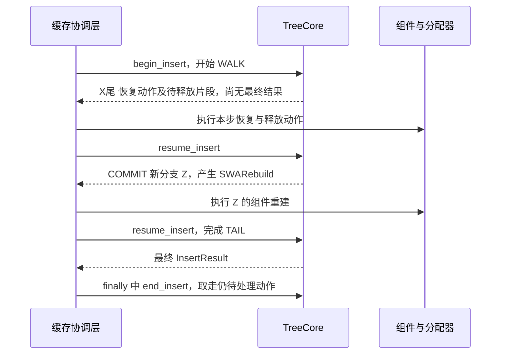

# 插入前缀为什么要暂停并执行动作，不能只返回一张统一清理清单

源码版本：`0f6761b54facebb47f2068f87ecccd8f14da3a0e`。证据等级：静态源码核对。限定 Python UnifiedTreeCore 与 UnifiedRadixCache 协调层，用 FULL+SWA 独立池的恢复作为例子，关闭 HiCache、Mamba、会话、推测及分布式。图为单次插入的教学调用关系，不是 GPU 并行时间线。未运行故障注入；工作区未跟踪导读不作为提交证据。

前两篇已经让 X尾 产生一个 RecoverSWAWithLockedFull 动作，并让 D 的旧窗口外重复段产生 FULL-only 释放。树的 key 与父子关系可以先调整，真正的映射重绑、页回收和组件发布却在协调层执行。如果把“已经生成动作”直接当成“恢复已经完成”，插入返回后马上重新匹配时，就可能仍看到 SWA tombstone，或者在资源账目尚未兑现时继续使用已改写的逻辑状态。

把所有资源操作都塞进树核，可以减少这类接口边界，却也会把分配器、外部传输与组件协调绑在树的遍历实现里。这个提交采用另一种组织方式：[UnifiedRadixCache.insert](https://github.com/sgl-project/sglang/blob/0f6761b54facebb47f2068f87ecccd8f14da3a0e/python/sglang/srt/mem_cache/unified_radix_cache.py#L586) 驱动 TreeCore 的可恢复插入，每到需要执行动作的边界先消费清单，再继续下一步。它既不把树核当纯函数，也不把全部外部操作无条件拖到调用结束以后。

图为教学调用顺序，并非实际运行追踪。它没有表示一次暂停就切换到另一个请求；这条可恢复协议由协调层在当前插入中同步驱动。普通节点可能不产生动作，具体要暂停几次由实际分支决定，不是每个节点固定一次。

[_InsertWalkState](https://github.com/sgl-project/sglang/blob/0f6761b54facebb47f2068f87ecccd8f14da3a0e/python/sglang/srt/mem_cache/unified_cache/unified_tree_core.py#L412) 保存 phase、当前 node、剩余 key/value、累计前缀与 pending_actions。[begin_insert](https://github.com/sgl-project/sglang/blob/0f6761b54facebb47f2068f87ecccd8f14da3a0e/python/sglang/srt/mem_cache/unified_cache/unified_tree_core.py#L1066) 拒绝已有未结束的插入，建立 WALK 状态；[_advance_insert](https://github.com/sgl-project/sglang/blob/0f6761b54facebb47f2068f87ecccd8f14da3a0e/python/sglang/srt/mem_cache/unified_cache/unified_tree_core.py#L1185) 推进 WALK、COMMIT、TAIL。WALK 处理已有节点的重叠与恢复，COMMIT 创建剩余新分支并执行组件提交钩子，TAIL 完成 LRU 等收尾。这些阶段表达插入协议进度，不是事务持久化日志。

[_is_deferrable_action](https://github.com/sgl-project/sglang/blob/0f6761b54facebb47f2068f87ecccd8f14da3a0e/python/sglang/srt/mem_cache/unified_cache/unified_tree_core.py#L1210) 只把 FreeDeviceKV、FreeDeviceKVFullOnly 与 ReplaceWriteThroughOnNodeSplit 列为可延后动作。本文关闭 HiCache，第三种不出现在本例。RecoverSWAWithLockedFull 与 SWARebuild 不在此集合，所以 X 的恢复与 Z 的重建分别触发动作边界。此前积攒的释放也随该批一起输出，TreeCore 清空自己的 pending 列表后等待 resume。可以批量处理某类释放，不代表其他动作也自动具有延后安全性。

协调层先执行 step.actions，再检查 step.result 是否已最终完成，或者调用 [resume_insert](https://github.com/sgl-project/sglang/blob/0f6761b54facebb47f2068f87ecccd8f14da3a0e/python/sglang/srt/mem_cache/unified_cache/unified_tree_core.py#L1169)。因此即使最后一步已经带回结果，它也不会先把结果交给上层再慢慢执行清单。对本例可直接验证的契约是：resume 前该步恢复动作已经由协调层调用，insert 返回前终结动作也已处理；这不声称 CPU 调用返回就让所有 GPU 工作同步结束，设备依赖仍属于各接口自己的要求。

[_apply_cache_actions](https://github.com/sgl-project/sglang/blob/0f6761b54facebb47f2068f87ecccd8f14da3a0e/python/sglang/srt/mem_cache/unified_radix_cache.py#L1263) 按原顺序逐个 pop 并分派动作，已经消费的清单不能被当作原始清单再次重放。资源释放不是普遍幂等操作，保存同一列表准备失败后全量重试可能造成重复回收。另一方面，pop 表示动作已被取出，不证明动作内部已经原子成功；不能把这个列表机制误读成失败自动回滚或严格的事务 exactly-once。

[finally 调用的 end_insert](https://github.com/sgl-project/sglang/blob/0f6761b54facebb47f2068f87ecccd8f14da3a0e/python/sglang/srt/mem_cache/unified_cache/unified_tree_core.py#L1179) 清除 ongoing 状态，返回树核中仍待处理的动作；正常完成后再次调用得到空列表。它有助于把树步异常时尚挂在 state 里的释放交给协调层，也确保下一次不会误接上旧 walk。但它不会撤销已经换过的映射、找回已归还的页，或自动补齐某个已取出但执行到一半的动作。[_insert_commit_step](https://github.com/sgl-project/sglang/blob/0f6761b54facebb47f2068f87ecccd8f14da3a0e/python/sglang/srt/mem_cache/unified_cache/unified_tree_core.py#L1296) 的源码注释明确以动作失败后停止进程为设计前提；不能据 finally 就承诺捕获任意异常后仍可安全继续服务。

相比一次大遍历，阶段状态与动作分类增加了协调开销，却把树结构与外部资源操作之间的顺序约束写成可检查接口。本文没有证明性能更好，也不把该协议称为支持并发重入。待验证时在 begin、advance、动作分派、resume 和 end 记录 phase、pending 长度、X尾/Z 的组件状态与实际分配记录。应看到恢复先于对应 resume，最终动作先于结果交还；再次提交同一已消费列表不应再有条目。若在恢复尚未分派时就把最终结果返回，或把动作失败后的残留状态当成可自动回滚，便违背这条协议。故障注入应在隔离进程验证其停止与资源记录，本文没有执行该实验。
