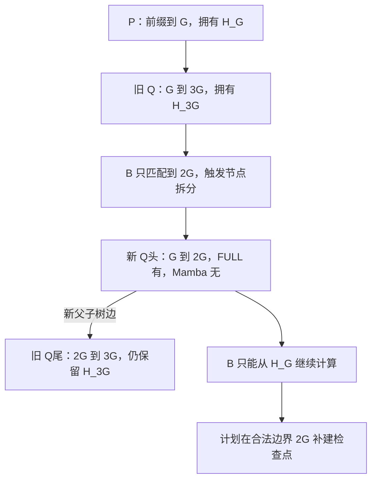

# FULL 前缀已经命中，为什么 Mamba 状态不能跟着节点一起切开

源码版本：`0f6761b54facebb47f2068f87ecccd8f14da3a0e`。证据等级：静态源码核对。限定 Python UnifiedTreeCore、FULL+MAMBA、page=1、普通非量化状态池，启用 extra buffer，关闭 SWA、HiCache、ReplaySSM、推测、会话、分布式与路径检查点上限。符号、图与槽号为教学示意，未运行模型或测量命中收益。工作区未跟踪导读不作为提交证据。

昨天的 SWA 恢复可以沿 token 区间拆索引、重新配对。Mamba 改变了这个假设：缓存保存的是某个准确前缀结束后的递归状态，不是该段每个 token 各有一个可独立取出的历史快照。FULL KV 能分出一段索引，并不意味着旁边的递归状态也能按同样长度切片。[缓存工厂](https://github.com/sgl-project/sglang/blob/0f6761b54facebb47f2068f87ecccd8f14da3a0e/python/sglang/srt/mem_cache/registry.py#L149) 为混合状态模型加入 MAMBA 组件，这份组件与 FULL 共用树的 key，却有不同的边界语义。

用 G 表示当前合法检查点网格，而非某个固定默认值。树中 P 覆盖 [0,G)，保存 H_G；孩子 Q 覆盖 [G,3G)，只保存 H_3G。新请求 B 与旧前缀相同到 2G，随后分叉。FULL 有前 2G 的 KV，直觉上似乎只要把 Q 从中间拆开，就能从 2G 继续。但 H_3G 表示已经读过后面 G 项的状态，把张量 clone 一份再改名 H_2G，不会替实现计算出这个缺失的检查点。

图为教学拆分变换，并非实际运行追踪；区间左闭右开。拆分后 Q头 是 Q尾 的新父节点。H_3G 留在尾片，不是说它只概括尾片 [2G,3G)，而是它仍对应从根到该节点末尾的整个前缀。这是“节点的局部 key 长度”与“递归状态的累计语义”之间最重要的区别。

[TreeCore._match_prefix_helper](https://github.com/sgl-project/sglang/blob/0f6761b54facebb47f2068f87ecccd8f14da3a0e/python/sglang/srt/mem_cache/unified_cache/unified_tree_core.py#L830) 在部分命中时调用 split，并根据所有组件的 validator 选择可直接恢复的边界。[Mamba.redistribute_on_node_split](https://github.com/sgl-project/sglang/blob/0f6761b54facebb47f2068f87ecccd8f14da3a0e/python/sglang/srt/mem_cache/unified_cache/components/mamba.py#L304) 明确让新父节点的 Mamba value 为 None，状态与对应引用留在原孩子；FULL 则按自己的钩子分割索引。新父节点没有凭空继承一个语义错误的中间状态，因此 B 的共同有效边界仍是 P，device_indices 长 G，而 full_kv_hit_length 可以达到 2G。

[Mamba.create_match_validator](https://github.com/sgl-project/sglang/blob/0f6761b54facebb47f2068f87ecccd8f14da3a0e/python/sglang/srt/mem_cache/unified_cache/components/mamba.py#L142) 在设备路径检查节点是否确有 value。它没有像 SWA 一样累计最后若干节点的连续长度，也没有要求祖先每一段都有 Mamba 状态；只要 FULL 路径满足前缀契约，并且目标边界有对应检查点，就可以从该边界恢复。检查点之间的缺口代表没有保存那些时刻，而不是目标状态一定无效。

[finalize_match_result_in_tree_core](https://github.com/sgl-project/sglang/blob/0f6761b54facebb47f2068f87ecccd8f14da3a0e/python/sglang/srt/mem_cache/unified_cache/components/mamba.py#L155) 另外将 FULL 命中按 mamba_checkpoint_grid 向下对齐，若该位置超过当前状态边界，就返回 mamba_branching_seqlen。本例是 2G，提示后续执行考虑捕获这个缺失检查点；它不会把 B 的 prefix_indices 直接扩成 2G。[mamba_checkpoint_grid](https://github.com/sgl-project/sglang/blob/0f6761b54facebb47f2068f87ecccd8f14da3a0e/python/sglang/srt/runtime_context.py#L2227) 取缓存 chunk 粒度与实际树页的最小公倍数，所以合法网格由配置和布局共同决定，不能把模型 chunk 大小、树页和任意分叉位置混为一谈。

[批次的跟踪准备](https://github.com/sgl-project/sglang/blob/0f6761b54facebb47f2068f87ecccd8f14da3a0e/python/sglang/srt/managers/schedule_batch.py#L2969) 将这类分叉提示与本轮 extend 范围、可捕获的状态位置共同检查。即使某个位置按树网格对齐，也还要满足相对于本轮输入起点的 chunk 条件。计划捕获、已经保存快照、快照数值正确是三种证据，本文只核对计划与缓存接口，未运行后端验证它们的数值结果。

这种布局用少量终点检查点换取跳过长段递归计算的机会，代价是匹配可能回退到更早位置，并为新分叉补算与保存状态。它不是 FULL 命中多少就一定省去多少计算。待验证时在 split、validator、结果补全与跟踪准备处记录 G、两个片段的 Mamba value、full_kv_hit_length、device_indices 长度和分叉提示。上述树应得到 FULL 命中 2G、直接恢复 G，新父没有 H_2G，旧孩子仍持有 H_3G。若拆分把 H_3G 当成新父的状态，或有提示就直接跳过缺失检查点之前的计算，都是反例。下一篇从真正存在的 H_G 出发，追 B 如何获得可以独立更新的请求状态。
