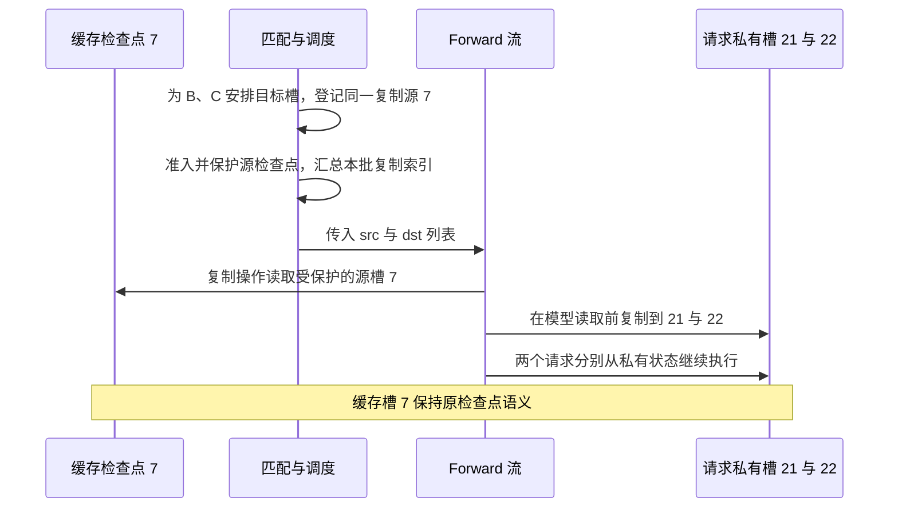

# 两个请求命中同一个 Mamba 检查点，为什么匹配结束时还没有真正复制状态

源码版本：`0f6761b54facebb47f2068f87ecccd8f14da3a0e`。证据等级：静态源码核对。沿用 FULL+MAMBA、Python 树核、普通非量化独立状态池和 extra buffer；限定 target worker 的普通 eager extend，关闭 ReplaySSM、SWA、HiCache、共享字节池、推测、会话及分布式。图与状态槽号为教学示意，未执行 GPU 复制或分支正确性实验；未跟踪导读不作为证据。

现在 B 与 C 都命中 P 的检查点 H_G，假定缓存槽号为七；它们随后读入不同后缀。若把两个请求的活动状态都指向槽七，B 推进一步就会改变 C 的起点，也污染缓存提供给第三个请求的 H_G。共享前缀的状态可以作为读取源，却不能同时充当所有分支持续写入的工作区。请求要拥有自己的可变状态槽，缓存的终点快照则保持可复用。

[Mamba.finalize_match_result_in_cache](https://github.com/sgl-project/sglang/blob/0f6761b54facebb47f2068f87ecccd8f14da3a0e/python/sglang/srt/mem_cache/unified_cache/components/mamba.py#L187) 在 cow_mamba 开启时取得缓存源槽，并确保请求有目标槽。本例令 B 的目标为二十一、C 的目标为二十二。若第一次 alloc(1) 失败，它临时保护命中的节点，调用 evict_for_alloc 请求一个 Mamba 槽，再尝试分配并按原凭据解除临时锁。FULL 还有空闲 token 槽并不能代替这一个递归状态槽，两个分配单位不同。

图为教学依赖关系，并非运行追踪。箭头没有表示 B 与 C 的算子必定硬件并行，也没有说登记复制意图时目标槽已经装好 H_G。具体算子如何更新私有状态，超出本文缓存与执行准备的接口范围。

匹配补全函数实际上只写入 req.kv.mamba_cow_src_index，并将 mamba_needs_clear 设为 False；它没有在此处调用 copy_from。[_collect_deferred_mamba_cow_and_clear](https://github.com/sgl-project/sglang/blob/0f6761b54facebb47f2068f87ecccd8f14da3a0e/python/sglang/srt/managers/schedule_batch.py#L3069) 才把多个请求的源、目标汇总成 batch tensor，并清掉请求上的暂存标记。已有检查点的目标需要复制源内容，首次使用且没有检查点的槽则走 clear 元数据，不能因为目的槽“刚分配”就默认里面已经全零或拥有正确历史。

真正的执行边界在 [ModelRunner._maybe_execute_deferred_mamba_cow_and_clear](https://github.com/sgl-project/sglang/blob/0f6761b54facebb47f2068f87ecccd8f14da3a0e/python/sglang/srt/model_executor/model_runner.py#L1801)。普通 extend 路径在模型读取状态前调用它，在 forward 流上清理或复制，并清空 forward batch 的相关标记。独立非量化池经索引翻译调用 [HybridReqToTokenPool.copy_mamba_state](https://github.com/sgl-project/sglang/blob/0f6761b54facebb47f2068f87ecccd8f14da3a0e/python/sglang/srt/mem_cache/memory_pool.py#L1557)，再进入 [MambaPool.copy_from](https://github.com/sgl-project/sglang/blob/0f6761b54facebb47f2068f87ecccd8f14da3a0e/python/sglang/srt/mem_cache/memory_pool.py#L1030)，复制卷积与 temporal 状态。本文布局的索引翻译为恒等，但接口仍保留翻译边界，不能把虚拟槽号在所有布局中都当作物理地址。

这段延迟安排有明确顺序理由：源码注释要求复制在 forward 流、Mamba 层读取之前执行，避免在调度侧复制流上提前操作而与消费发生竞争。本文没有设备 trace，不能由函数位置就宣布所有 overlap 情形都已测过；能确认的是复制意图与实际复制被分开，执行路径显式承担消费前的准备责任。

源检查点在这段间隔中仍需有效。[准入时的保护入口](https://github.com/sgl-project/sglang/blob/0f6761b54facebb47f2068f87ecccd8f14da3a0e/python/sglang/srt/managers/schedule_policy.py#L979) 为 req.last_node 保存锁凭据，[Mamba.acquire_component_lock](https://github.com/sgl-project/sglang/blob/0f6761b54facebb47f2068f87ecccd8f14da3a0e/python/sglang/srt/mem_cache/unified_cache/components/mamba.py#L427) 保护锚点状态；源 tensor 或一个槽号的 Python 引用本身并不能阻止分配器回收物理内容。若请求匹配后没有被准入，[调度入口](https://github.com/sgl-project/sglang/blob/0f6761b54facebb47f2068f87ecccd8f14da3a0e/python/sglang/srt/managers/scheduler.py#L3843) 会清掉暂存复制元数据并归还未进入执行的请求状态槽，不能把一次匹配直接算作已经启动的分支。

私有副本消除了后缀更新对共享快照的污染，却消耗状态容量与复制带宽；按批汇总也增加了跨层元数据的生命周期，源码不能证明它总比立即复制更快。待验证时在匹配补全、汇总函数和 runner 执行前后记录源七、目标二十一/二十二、复制标记与源锁。应看到登记先于复制、复制先于模型读取；给 B、C 不同后缀，并与各自从头计算的结果对照，同时检查槽七未被改写。若登记后就当目标可读、源锁提前消失，或两个请求共用同一可写目标，都是反例。以上均为待执行方案。下一篇让 B 产生一个新的合法检查点，再看它如何交给缓存而继续前进。
