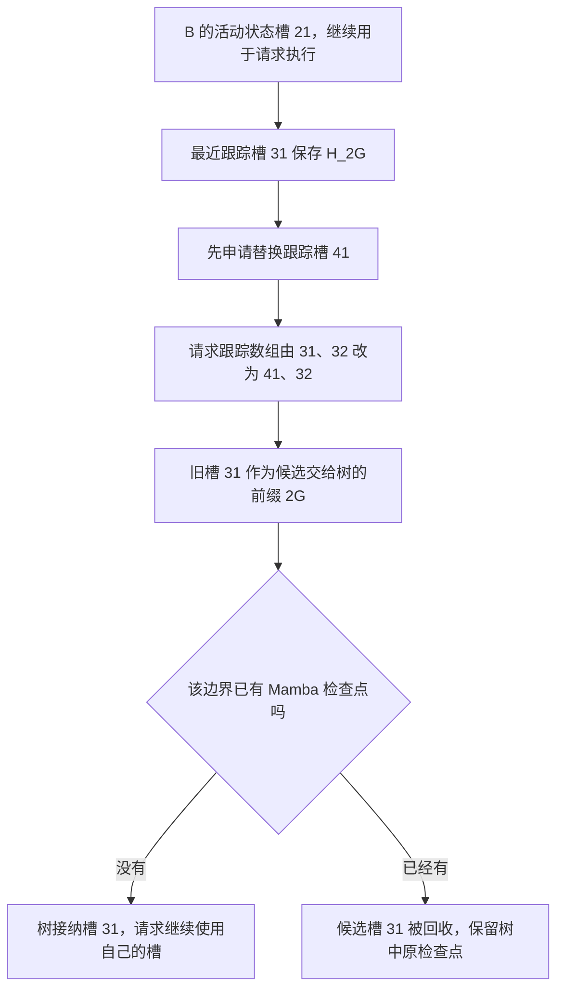

# 请求还要继续更新，为什么能把 Mamba 跟踪槽直接交给缓存

源码版本：`0f6761b54facebb47f2068f87ecccd8f14da3a0e`。证据等级：静态源码核对。限定 FULL+MAMBA、Python 树核、普通非量化独立状态池、extra buffer 的双槽非 lazy 路径，关闭 ReplaySSM、SWA、HiCache、推测、会话、分布式和每路径状态上限。图为教学所有权变化，未运行跟踪 kernel、故障注入或性能测量；未跟踪导读不作为提交证据。

B 已经在请求私有槽二十一上继续计算。假定执行按计划把前缀 2G 的检查点 H_2G 写到跟踪槽三十一，另一跟踪槽为三十二；请求稍后还要继续。若把活动槽二十一直接挂进树，下一轮更新会修改缓存快照。若把整个跟踪数组交给缓存，请求下一次轮换也可能覆盖它。缓存需要稳定的快照所有权，请求仍需要可继续写入的缓冲位置。

extra buffer 把活动状态与按边界捕获的检查点分开。[跟踪准备](https://github.com/sgl-project/sglang/blob/0f6761b54facebb47f2068f87ecccd8f14da3a0e/python/sglang/srt/managers/schedule_batch.py#L2969) 记录 mamba_last_track_seqlen 和对应跟踪槽位置；[get_mamba_ping_pong_keep_idx](https://github.com/sgl-project/sglang/blob/0f6761b54facebb47f2068f87ecccd8f14da3a0e/python/sglang/srt/mem_cache/memory_pool.py#L1591) 返回 mamba_last_track_idx，选择最近被跟踪的那一槽，而不是简单假定 next_track_idx 就是最新完成的快照。字段会在执行准备期间被设置，所以本文以“上一 forward 已正确产生 H_2G”为前提，不把字段存在当作 GPU 写入已经完成或数值正确的证明。

图为教学槽位关系，并非运行追踪。图中的三十一、四十一是状态槽 ID，不是 token 位置；2G 才是检查点所对应的前缀长度。一个槽里容纳该模型所需的一组状态，不能把“接纳一个状态槽”换算成“接纳一个 token 的 KV”。

[Mamba.prepare_for_caching_req](https://github.com/sgl-project/sglang/blob/0f6761b54facebb47f2068f87ecccd8f14da3a0e/python/sglang/srt/mem_cache/unified_cache/components/mamba.py#L525) 在 extra buffer 路径选择 cache_len=mamba_last_track_seqlen。若没有合法跟踪位置，未结束请求返回零，不能强行按全部 token_ids_len 发布一个新状态。若 B 当前已经读到 2G+r，跟踪槽只保存 H_2G，则缓存 key 也必须截到 2G；把更长 key 配上更早的状态，会让下一请求跳过尚未反映在快照里的更新。[cache_unfinished_req](https://github.com/sgl-project/sglang/blob/0f6761b54facebb47f2068f87ecccd8f14da3a0e/python/sglang/srt/mem_cache/unified_radix_cache.py#L1115) 根据组件给出的有效长度形成插入 key。

未结束请求先经 [_alloc_mamba_slot](https://github.com/sgl-project/sglang/blob/0f6761b54facebb47f2068f87ecccd8f14da3a0e/python/sglang/srt/mem_cache/unified_cache/components/mamba.py#L489) 申请替换槽，再调用 [donate_mamba_ping_pong_slot](https://github.com/sgl-project/sglang/blob/0f6761b54facebb47f2068f87ecccd8f14da3a0e/python/sglang/srt/mem_cache/memory_pool.py#L1638)。后者取出旧跟踪槽的索引，更新请求的对应位置为新槽，并同步设备侧请求映射，返回旧槽给插入。这里 clone 的是索引 tensor，不是复制整份递归状态；已捕获的数据留在原位置，变更的是谁将继续持有它。申请替换槽先于交出旧槽，也避免请求没有可继续跟踪的位置。

[commit_insert_component_data](https://github.com/sgl-project/sglang/blob/0f6761b54facebb47f2068f87ecccd8f14da3a0e/python/sglang/srt/mem_cache/unified_cache/components/mamba.py#L218) 对新节点直接接纳候选；对已有节点但 Mamba 为 None 的情况发布候选，正好可以补上第一篇拆分后缺失的 H_2G。如果目标边界已经有状态，则保留原检查点并把 result.mamba_exist 设为 True。FULL key 重叠、Mamba 候选是否被接纳，是两份不同的判断，不能只用 InsertResult.prefix_len 决定状态槽归谁。

[cleanup_after_caching_req](https://github.com/sgl-project/sglang/blob/0f6761b54facebb47f2068f87ecccd8f14da3a0e/python/sglang/srt/mem_cache/unified_cache/components/mamba.py#L603) 在未结束请求路径回收没有被接纳的候选，并清空 mamba_last_track_seqlen，防止没有新捕获时又把同一记录当成新快照捐出。成功接纳后，旧槽三十一已不在请求跟踪数组里；下一次捕获可以写入请求自己的替换槽。反之，重复边界的候选三十一虽被回收，替换槽四十一仍归请求，不能为了“插入没新增”而把它也一并释放。

结束请求的清理另有一个边界：若缓存确实接纳了某个跟踪槽，[free_mamba_cache](https://github.com/sgl-project/sglang/blob/0f6761b54facebb47f2068f87ecccd8f14da3a0e/python/sglang/srt/mem_cache/memory_pool.py#L1661) 可以在归还活动状态与其他跟踪槽时保留它；若没有接纳，则不留下这份缓存所有权。本文没有经过结束路径的运行验证，只对照接口说明“结束”也不能无差别释放所有请求曾持有的槽。

直接捐出快照减少了一次状态内容复制的需求，但要额外保有跟踪槽、申请替换容量，并处理重复检查点的候选清理。源码不能证明这些成本一定值得。待验证时在准备、donate、commit 与 cleanup 记录跟踪长度、keep_idx、请求数组、设备映射、候选槽和 mamba_exist。成功分支应由树持有三十一、请求持有四十一/三十二，后续写请求状态不改变 H_2G；重复分支应只回收候选三十一。若 key 长于快照位置、请求数组仍引用已捐出的槽，或成功接纳后清理又释放树的槽，都是反例。以上为待执行检查。
