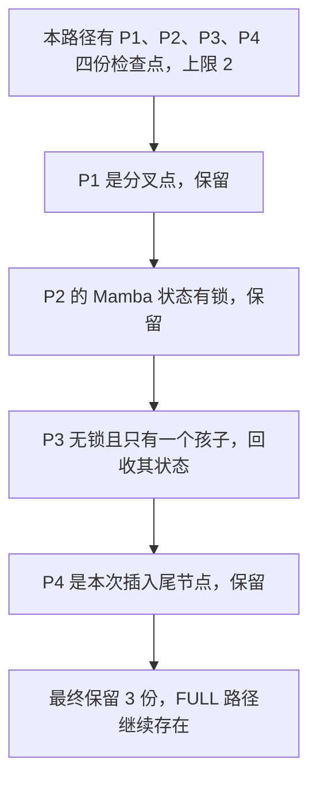

# 每条路径最多保留两个检查点，为什么树中仍可能留下三个

源码版本：`0f6761b54facebb47f2068f87ecccd8f14da3a0e`。证据等级：静态源码核对。限定 Python UnifiedTreeCore、FULL+MAMBA、普通非量化状态；本组显式采用共享字节池与 lazy compaction，关闭 SWA、HiCache、ReplaySSM、推测、会话和分布式。今天启用每路径状态上限，其他状态语义沿用前文。图与数量为教学示意，未运行压力测试；未跟踪导读不作为提交证据。

昨天的检查点捐出让请求继续前进，也让缓存不断积累 H_G、H_2G 等状态。一个长请求若在每个合法位置都留下快照，即使每份状态大小固定，总占用仍会增加。自然方案是给每条根到叶路径设上限，超过就删最早的检查点。但最早的节点可能是多个分支的共同起点，也可能正被新请求当作延迟复制源，单按数量删除会损坏正在使用的恢复入口。

考虑路径 P1→P2→P3→P4，四个节点各有一个 Mamba 检查点，P4 是这次插入的尾节点。P1 另有一条孩子分支，P2 的状态被请求 C 保护，P3 没有锁且只有 P4 一个孩子。把 mamba_max_states_per_path 设为二，并不意味着代码必须无条件把四变二。这里能够被安全删掉的是 P3，最后仍会保留三个状态。

图为教学筛选顺序，并非实际运行追踪。它只列出本路径，P1 的另一分支没有画成一条串行路径。剩余三个不是自动证明泄漏，而是需要对照被跳过节点的角色和引用，判断为什么没有更多合法候选。

[Mamba._emit_excess_path_states_eviction](https://github.com/sgl-project/sglang/blob/0f6761b54facebb47f2068f87ecccd8f14da3a0e/python/sglang/srt/mem_cache/unified_cache/components/mamba.py#L246) 在上限非负时生成组件动作，交给插入协调过程执行。[动作执行器](https://github.com/sgl-project/sglang/blob/0f6761b54facebb47f2068f87ecccd8f14da3a0e/python/sglang/srt/mem_cache/unified_cache/components/mamba.py#L915) 经 [TreeCore.evict_excess_path_states](https://github.com/sgl-project/sglang/blob/0f6761b54facebb47f2068f87ecccd8f14da3a0e/python/sglang/srt/mem_cache/unified_cache/unified_tree_core.py#L1746) 进入 Python 组件的 [_evict_excess_path_states](https://github.com/sgl-project/sglang/blob/0f6761b54facebb47f2068f87ecccd8f14da3a0e/python/sglang/srt/mem_cache/unified_cache/components/mamba.py#L256)，收集尾节点到根之间 value 非 None 的持有者。统计的是设备检查点数量，不是 FULL token 数，也不包括请求自己的活动状态和跟踪槽；因此每路径上限本来就不是整个状态池的总容量预算。

遍历反转持有者列表，优先检查更浅的节点。它跳过 Mamba lock_ref>0 的项、孩子数不等于一的项，以及可整节点淘汰的设备叶子；到本次 tail 时停止。例子中 P1 因分叉跳过，P2 因引用跳过，P3 被回收，P4 因 tail 保留。excess 只在真正回收后减少，不能为满足配置数字而把跳过项也算作已经删除。

被选中的 P3 走组件回收，移除的是 Mamba value 与相应 LRU 关系，FULL 前缀仍可存在。更深的 H_4G 本身就对应完整前缀终点，并不要求沿途每个历史检查点都保留；下一请求若只能命中 P3 的终点，可能需要退回更早检查点补算，若直接命中 P4，则仍可从 P4 的状态恢复。这里牺牲的是一部分中间恢复机会，不是把一个递归状态切掉一段再继续用。

引用的用途也因此更具体。[Mamba.acquire_component_lock](https://github.com/sgl-project/sglang/blob/0f6761b54facebb47f2068f87ecccd8f14da3a0e/python/sglang/srt/mem_cache/unified_cache/components/mamba.py#L427) 保护命中锚点上的状态；当 C 已安排延迟复制但尚未消费源时，这份锁让 P2 不会因路径超额被删除。不能为了观察到“恰好两个”就手工减掉引用，也不能用 FULL 还有数据作为 Mamba 源仍可读的证据。分叉点保留则是一项缓存复用策略，使一份公共恢复起点继续服务多个后缀，不等价于它永远不能在全局容量压力下淘汰。

被收集的释放清单仍需交给缓存的 _free_values 兑现。共享池可能把逻辑释放变成待整理的物理孔洞，状态数量减少不表示同一瞬间所有其他组件都能扩张。本篇只核对选谁与保留谁，后两篇继续追容量视图和实际申请。源码也没有证明上限二在某种负载下最优；较少检查点可能省容量，却增加再次命中中间位置时的重算。

待验证时在动作生成、持有者收集和组件释放处记录 cap、tail、节点孩子数、Mamba value、lock_ref 与释放清单。上述树应只回收 P3，结果为三；解除 P2 引用后重新检查，才可能继续压缩到二。另验证 cap<0 不生成这项动作、只有 tail 时不会为追零上限而删除 tail。若带锁状态被回收、分叉判断忽略了另一孩子，或只改计数没有兑现释放，就是反例。以上均为待执行方案；观察到超过配置值时，应先解释保留条件，再判断是否异常。
