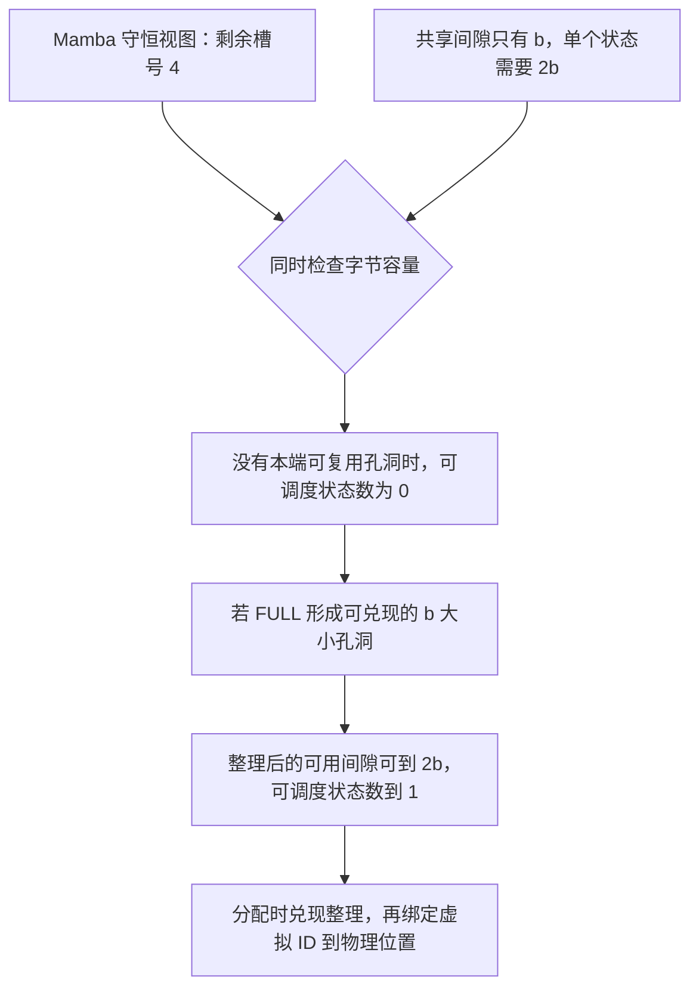

# Mamba 还有四个空闲槽号，为什么仍可能申请不到一个状态

源码版本：`0f6761b54facebb47f2068f87ecccd8f14da3a0e`。证据等级：静态源码核对。限定 FULL+MAMBA 双端共享字节池、page=1、lazy compaction、普通非量化状态，关闭 SWA、HiCache、PD、ReplaySSM、推测、会话与分布式。字节比例和图为归一化教学示意，不是任何模型的内存测量。未运行分配或整理实验；未跟踪导读不作为提交证据。

每路径回收只能减少符合条件的历史状态，池中还有活动请求、跟踪槽和其他分支。即使一份回收容量已经被其他请求用掉，接下来仍可能需要为新的复制目标或跟踪替换槽分配一个状态。昨天分析的是独立状态池，今天改为共享布局：FULL 与 Mamba 可以竞争同一片物理字节空间，但各自仍有自己的虚拟 ID 空间。

[UnifiedMambaTokenToKVPoolAllocator 的构造](https://github.com/sgl-project/sglang/blob/0f6761b54facebb47f2068f87ecccd8f14da3a0e/python/sglang/srt/mem_cache/allocator/unified_mamba.py#L50) 创建两个 MultiEndedAllocator 并互相绑定。Mamba 仍以一个请求状态为单位，FULL 仍以 token 页为单位，共享的是支撑它们的字节预算。[UnifiedMambaSlotAllocator.available_size](https://github.com/sgl-project/sglang/blob/0f6761b54facebb47f2068f87ecccd8f14da3a0e/python/sglang/srt/mem_cache/unified_memory_pool.py#L964) 返回 max_size 减 live allocated_count，是状态槽的守恒视图；它不承诺同样数量的状态都能立即得到物理支撑。

令状态槽还有四个未占用 ID，没有 Mamba 自己可直接复用的物理孔洞，也没有待完成事件。本例把一个 FULL 槽的成本记为 b，一个 Mamba 状态槽的成本记为 2b，当前共享间隙只有 b。于是 ID 账目仍显示四，但间隙装不下一个完整状态，调度可申请容量为零。这是用于解释取整和资源约束的假定比例，不是当前模型的规格。

图为教学容量关系，并非实际运行追踪。FULL 的孔洞不会把一个 FULL ID 变成 Mamba ID；它只可能释放字节，而 Mamba 仍要从自己的空间取 ID。后一阶段还必须满足整理协议，不能只在纸面上相加就访问新物理位置。

底层 [MultiEndedAllocator._available_tokens](https://github.com/sgl-project/sglang/blob/0f6761b54facebb47f2068f87ecccd8f14da3a0e/python/sglang/srt/mem_cache/allocator/unified_sub_pool.py#L693) 将间隙字节按本端 entry_bytes_per_page 向下取整，并受本端页索引空间限制；lazy 模式还计入本端已经可复用的孔洞。[底层 available_size](https://github.com/sgl-project/sglang/blob/0f6761b54facebb47f2068f87ecccd8f14da3a0e/python/sglang/srt/mem_cache/allocator/unified_sub_pool.py#L708) 描述当前可兑现容量，[schedulable_available_size](https://github.com/sgl-project/sglang/blob/0f6761b54facebb47f2068f87ecccd8f14da3a0e/python/sglang/srt/mem_cache/allocator/unified_sub_pool.py#L734) 则允许加入增长方向邻居能够紧急整理释放的孔洞字节。两个方法与包装层同名计数属于不同抽象层，调试时必须连同对象类型记录，不能只截一行 available=4 作判断。

[_peer_drainable_hole_bytes](https://github.com/sgl-project/sglang/blob/0f6761b54facebb47f2068f87ecccd8f14da3a0e/python/sglang/srt/mem_cache/allocator/unified_sub_pool.py#L720) 只给邻居已可整理的 _free_phys_pages 记账，不把仍等待事件的 _pending_reuse 算进去；涉及 PD 迁移门禁时还会排除当时不能整理的邻居。本例关闭 PD，但这条过滤说明调度信用不是对任意“未来也许空闲”字节的乐观估计。若从仍被旧执行使用的页提前借容量，下一次绑定就可能覆盖尚在读取的数据。

包装层的 [schedulable_available_size](https://github.com/sgl-project/sglang/blob/0f6761b54facebb47f2068f87ecccd8f14da3a0e/python/sglang/srt/mem_cache/unified_memory_pool.py#L969) 委托底层字节视图，供 [缓存的容量查询](https://github.com/sgl-project/sglang/blob/0f6761b54facebb47f2068f87ecccd8f14da3a0e/python/sglang/srt/mem_cache/unified_radix_cache.py#L689) 使用。[MultiEndedAllocator.alloc](https://github.com/sgl-project/sglang/blob/0f6761b54facebb47f2068f87ecccd8f14da3a0e/python/sglang/srt/mem_cache/allocator/unified_sub_pool.py#L1122) 在即时空间不足时经 [_relieve_for_alloc](https://github.com/sgl-project/sglang/blob/0f6761b54facebb47f2068f87ecccd8f14da3a0e/python/sglang/srt/mem_cache/allocator/unified_sub_pool.py#L195) 请求邻居 urgent flush，重新核对即时容量，再领取虚拟 ID 并绑定物理页。虚拟 ID 可保持请求身份，[translate](https://github.com/sgl-project/sglang/blob/0f6761b54facebb47f2068f87ecccd8f14da3a0e/python/sglang/srt/mem_cache/unified_memory_pool.py#L950) 通过 v2p 表取得当前位置；虚拟地址稳定不等于整理时物理内容永远不移动。

因此至少应分开观察守恒计数、即时容量和整理后可兑现容量。前者帮助核对状态槽归属，后两者影响能否继续分配；其中任意一个数字都不能独自解释全部失败。本文也没有测量整理耗时：可调度容量到一，表达协议下能够兑现空间，不表达一次 alloc 必然廉价或没有流依赖。

待验证时分别记录包装层 available_size、底层 available_size、schedulable_available_size、当前 gap、每槽字节、本端孔洞、邻居可整理孔洞与 pending 条目。上述初始条件应得到四、零、零；产生足够且可整理的 FULL 孔洞后，可调度视图可以先到一，而即时视图要到整理兑现后才到一。若把 pending 字节提前记入、忽略本端 ID 约束，或把 FULL 与 Mamba 的相同数值 ID 当作同一资源，就是反例。以上为待执行检查；下一篇追缓存怎样选择从哪一边补足这一份空间。
